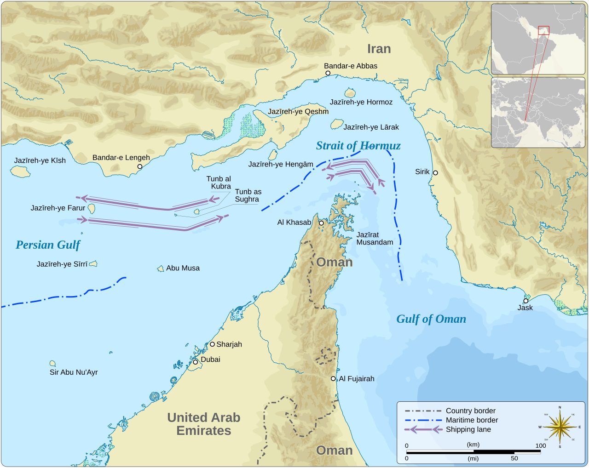
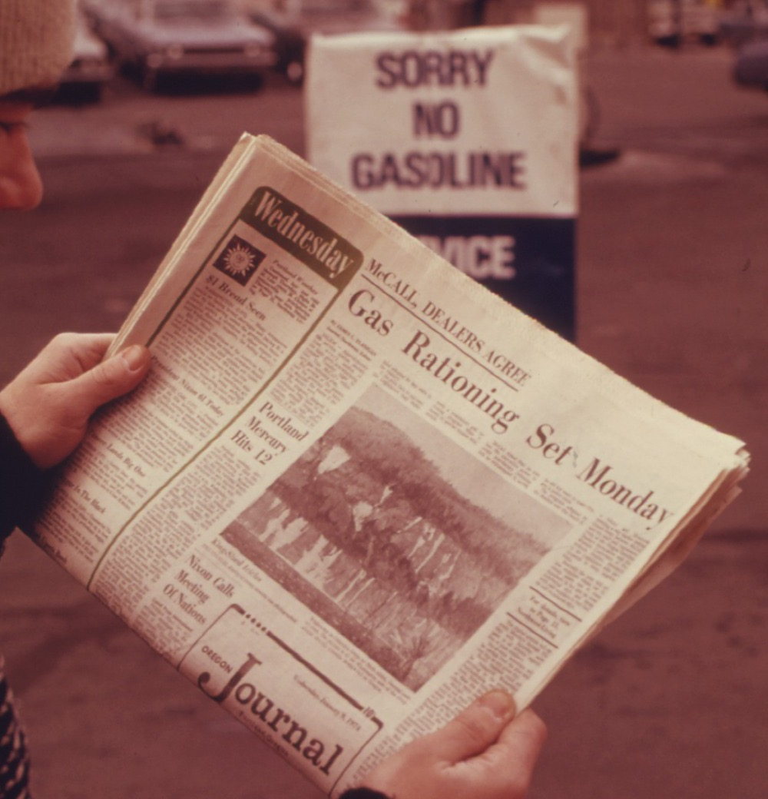
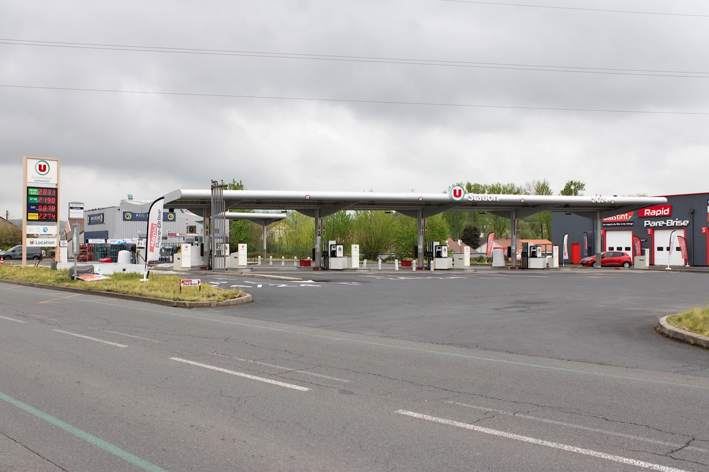

```{r}
#| include: false
source(here::here("R/theme_cours.R"))
source(here::here("R/cm1.R"))   # même fichier que la page de cours
```

## Le fait de départ : la fermeture du détroit d'Ormuz (28/02/2026)

- La guerre entre les États-Unis et Israël d'un côté, l'Iran de l'autre, ferme de fait le détroit, par lequel transite environ un cinquième du pétrole et du gaz liquéfié mondiaux (Insee, *Note de conjoncture*, 24/03/2026).

. . .

- Conséquence à la pompe : Euro-super 95 de 1,71 € à 2,21 € le litre entre le 23/02 et le 12/10/2026 (+29,3 %), gazole de 1,65 € à 2,33 € (+41,1 %).

. . .

**Question de la séance** : comment la fermeture d'un détroit lointain se répercute-t-elle si vite sur les prix en France ?

[Sources : Insee, 24/03/2026 ; Commission européenne, *Weekly Oil Bulletin*, prix TTC, consulté le 21/10/2026.]{.wp-source}

::: {.notes}
0 h 00 – 0 h 04. Demander à l'amphi : qui a fait le plein cette semaine ? Transition : la carte montre pourquoi ce passage se bloque si facilement.
:::

## Le détroit d'Ormuz : un passage étroit entre l'Iran et Oman

:::: {.columns}
::: {.column width="60%"}
{fig-alt="Carte du détroit d'Ormuz. Le golfe Persique, à gauche, communique avec le golfe d'Oman, à droite, par un passage étroit entre la côte iranienne au nord et la péninsule omanaise de Musandam au sud. Deux couloirs de navigation en flèches violettes longent ce passage."}
:::

::: {.column width="40%"}
::: {.incremental}
- Le golfe Persique ne communique avec le golfe d'Oman que par ce passage, entre l'Iran au nord et la péninsule omanaise de Musandam au sud.
- Tous les navires qui quittent le Golfe doivent le franchir : d'où la facilité de le bloquer.
:::
:::
::::

[Carte en anglais : Goran tek-en, CC BY-SA 4.0, Wikimedia Commons.]{.wp-source}

::: {.notes}
0 h 04 – 0 h 07. Les flèches violettes sont les couloirs de navigation, un dans chaque sens. Question : que se passe-t-il pour l'offre mondiale si ce passage ferme ? Transition : comment la presse a raconté la flambée.
:::

## Les unes de presse : un coût qui monte, des automobilistes contraints

:::: {.columns}
::: {.column width="66%"}
::: {.incremental}
- *Le Figaro*, 09/03/2026 : « La hausse des coûts d'approvisionnement en pétrole fait flamber les prix des carburants ».
- *Sud Ouest*, 30/03/2026 : « Si cela continue, je n'aurai plus les moyens d'aller travailler ».
- Les deux moitiés du raisonnement : l'offre recule (choc d'offre) ; la demande est peu élastique à court terme.
:::
:::

::: {.column width="34%"}
{height="320px" fig-alt="Photographie aux couleurs passées : un homme tient un journal dont la une titre « Gas Rationing Set Monday ». Au fond, un panneau de station-service indique « Sorry no gasoline »."}

[Portland, janvier 1974 · David Falconer, DOCUMERICA (EPA), domaine public, Wikimedia Commons]{.wp-credit}
:::
::::

::: {.notes}
0 h 07 – 0 h 10. Demander : lequel des deux titres parle de l'offre, lequel de la demande ? Le premier : le coût d'approvisionnement monte, l'offre recule. Le second : on ne renonce pas à aller travailler du jour au lendemain. Photo : en 1974, *The Oregon Journal* annonce « Gas Rationing Set Monday » (le rationnement de l'essence commence lundi), le panneau dit « Sorry no gasoline » : la pénurie s'affichait à la pompe. Autres titres dans la page de cours (*Le Figaro*, 08/03/2022 ; *Le Parisien*, 21/09/2026). Transition : 2026 et 2022 sur vingt ans de prix.
:::

## Gazole depuis 2005 : le record de 2026 dépasse celui de 2022

:::: {.columns}
::: {.column width="60%"}
```{r}
#| fig-width: 8
#| fig-height: 5.4
#| fig-alt: "Prix hebdomadaires TTC de l'Euro-super 95 et du gazole en France de 2005 à 2026, en euros courants ; deux points marquent les records du gazole, 2,14 euros en mars 2022 et 2,38 euros en septembre 2026"
graphe_prix_pompe_long(base_size = 24)
```
:::

::: {.column width="40%"}
- Record hebdomadaire du gazole en 2022 : 2,14 € (semaine du 14/03).
- En 2026 : 2,38 € (semaine du 21/09), soit 24 centimes de plus.

::: {.fragment}

- Euros courants. Le gazole, d'habitude moins cher, passe au-dessus de l'essence pendant la majeure partie de 2022 et de 2026.
:::
:::
::::

[Source : Commission européenne, *Weekly Oil Bulletin*, prix TTC, moyennes hebdomadaires, consulté le 22/10/2026.]{.wp-source}

::: {.notes}
0 h 10 – 0 h 13. Euros courants, non corrigés de la hausse générale des prix ; le record journalier de 2,41 € du 20 septembre vient d'une autre série (*The Conversation*). Question : en 2022, le gazole coûtait-il déjà plus cher que l'essence ? (Oui, 33 semaines sur 51 à partir du 14 mars.) Transition : trois faits à expliquer.
:::

## Trois faits à expliquer et la question de la séance

::: {.incremental}
1. Un détroit lointain fait bondir un prix payé chaque semaine par des millions de ménages.
2. Les Français paient beaucoup plus cher, mais roulent à peine moins.
3. Le gazole, moins cher que l'essence avant la guerre, devient plus cher qu'elle.
:::

. . .

**La question se précise** : pourquoi les carburants ont-ils flambé, et pourquoi si fort ? Deux outils s'ajoutent à l'offre et à la demande : le *déplacement* d'une courbe et l'*élasticité*.

::: {.notes}
0 h 13 – 0 h 16. Demander lequel des trois faits les surprend le plus ; on y revient à la fin. Les chiffres sont arrêtés au 14 octobre 2026 (pétrole) et au 12 octobre 2026 (pompe) : la situation a pu évoluer, le raisonnement reste valable. Transition : on rappelle d'abord trois outils déjà connus.
:::

## Rappel : équilibre, toutes choses égales par ailleurs, raisonnement à la marge

::: {.rappel}
- **Équilibre** : au prix P\*, la quantité offerte égale la quantité demandée, Q\*. Au-dessous de P\* : **pénurie** ; au-dessus : **surproduction**.
- **Toutes choses égales par ailleurs** : on fait varier une seule cause à la fois. Comparer l'équilibre avant et après, c'est la **statique comparative**.
- **Raisonnement à la marge** : on produit une unité de plus tant qu'elle rapporte plus qu'elle ne coûte.
:::

::: {.notes}
0 h 16 – 0 h 21. Rappel rapide, sans redéfinir. Question : « Que se passe-t-il au-dessous de P\* ? » Transition : Marshall a fait de ces trois idées une méthode.
:::

## Marshall (1890) : le prix, rencontre de l'offre et de la demande

::: {.auteur}
::: {.wp-portrait}
{fig-alt="Portrait photographique d'Alfred Marshall vers 1891, debout, accoudé à une cheminée, moustache blanche."}
[Vers 1891 · Elliott and Fry, domaine public, Wikimedia Commons]{.wp-credit}
:::

**Alfred Marshall** (1890), *Principles of Economics* · école néoclassique. Le prix se fixe là où la quantité offerte égale la quantité demandée. Marshall isole un seul marché et fait varier une seule cause à la fois.
:::

. . .

Offre et demande sont les deux lames d'une paire de ciseaux : pour expliquer une hausse de prix, il faut dire **quelle courbe a bougé, et pourquoi**.

::: {.notes}
0 h 21 – 0 h 26. Le prix monte si l'offre recule *ou* si la demande augmente. Question : dans le cas d'Ormuz, quelle courbe a bougé ? Transition : pour le savoir, il faut comprendre d'où vient la courbe d'offre.
:::

## Coût marginal : l'offre reflète le coût du dernier baril produit

::: {#def-cout-marginal}
## Coût marginal du producteur

Le **coût marginal** (Cm) est le coût de production d'une unité supplémentaire. Au prix P, on produit toutes les unités dont le Cm est inférieur ou égal à P.
:::

. . .

- Les producteurs, rangés du moins cher au plus cher, donnent une offre croissante.
- Tant que les capacités suffisent, le prix d'équilibre est le Cm du **dernier producteur nécessaire**.

::: {.notes}
0 h 26 – 0 h 31. Raisonnement à la marge, côté producteur. Les exportateurs à bas coût sont surtout dans l'OPEP, qui compte plusieurs pays du Golfe. Question : qui fixe le prix, le producteur le moins cher ou le plus cher ? Transition : que se passe-t-il quand un producteur disparaît ?
:::

## Choc d'offre et déplacement d'une courbe : définitions

::: {.incremental}
- **Choc d'offre** : événement qui modifie la quantité offerte *à chaque prix* ; O devient O′. Négatif (guerre, panne, embargo) : vers la gauche, ou vers le haut.
- **Le prix du bien change** : on glisse *le long* de la courbe ; la courbe ne bouge pas.
- **Une autre cause change** (coûts, guerre ; revenus, goûts, anticipations) : la courbe *entière* se déplace.
:::

::: {.notes}
0 h 31 – 0 h 38. Gauche ou haut : même chose, le montrer au tableau. Vers la gauche, moins de barils à chaque prix ; vers le haut, le dernier baril coûte plus cher. Question : une hausse des revenus fait-elle glisser ou déplacer ? (Elle déplace la demande.) Transition : on construit le graphique pas à pas.
:::

## Choc d'offre (1/3) : l'équilibre initial E

:::: {.columns}
::: {.column width="60%"}
```{r}
#| fig-width: 6.4
#| fig-height: 4.6
#| fig-alt: "Offre et demande : la demande D décroissante et l'offre O croissante se coupent en E, au prix P étoile et à la quantité Q étoile"
graphe_choc_offre(base_size = 24, etape = 1)
```
:::

::: {.column width="40%"}
- Avant le 28 février, le marché des carburants est à l'équilibre E.
- Au prix P\*, les vendeurs offrent Q\* et les acheteurs demandent Q\*.
- Ni pénurie, ni surproduction : rien ne pousse le prix à bouger.
:::
::::

::: {.notes}
0 h 38 – 0 h 40. Tracer D puis O, nommer E. Graphique théorique, sans chiffres. Transition : le détroit ferme.
:::

## Choc d'offre (2/3) : l'offre se déplace de O vers O′

:::: {.columns}
::: {.column width="60%"}
```{r}
#| fig-width: 6.4
#| fig-height: 4.6
#| fig-alt: "Même graphique : l'offre se déplace vers la gauche de O à O prime, en tirets ; au prix P étoile, un trait rouge marque la pénurie entre O prime et D"
graphe_choc_offre(base_size = 24, etape = 2)
```
:::

::: {.column width="40%"}
::: {.incremental}
1. **Le choc** : le blocage d'Ormuz retire des barils ; à chaque prix, la quantité offerte diminue.
2. **Le déséquilibre** : au prix P\*, les acheteurs veulent toujours Q\*, les vendeurs offrent beaucoup moins : **pénurie**.
:::
:::
::::

::: {.notes}
0 h 40 – 0 h 44. Insister : la courbe entière se déplace, on ne glisse pas le long de O. Question : au prix P\*, qui veut acheter sans trouver de vendeur ? Transition : que fait le prix ?
:::

## Choc d'offre (3/3) : nouvel équilibre E′, prix plus haut, quantité plus faible

:::: {.columns}
::: {.column width="60%"}
```{r}
#| fig-width: 6.4
#| fig-height: 4.6
#| fig-alt: "Figure complète : nouvel équilibre E prime au prix P étoile prime, plus élevé, et à la quantité Q étoile prime, plus faible"
graphe_choc_offre(base_size = 24, etape = 3)
```
:::

::: {.column width="40%"}
::: {.incremental}
3. **L'ajustement** : les acheteurs enchérissent, le prix monte.
    - Il décourage des achats : on glisse **le long** de D, de E vers E′.
    - Il rend rentables des barils plus coûteux : on glisse le long de O′.
:::
:::
::::

::: {.notes}
0 h 44 – 0 h 48. Lecture finale : en E′, P\*′ > P\* et Q\*′ < Q\*. Transition : une erreur fréquente se glisse ici.
:::

## Point d'attention : la quantité demandée baisse, la demande ne bouge pas

::: {.piege}
« Le prix a monté, donc la demande a baissé, donc le prix va redescendre. » Ce raisonnement est faux.
:::

. . .

- La hausse du prix fait baisser la **quantité demandée** : mouvement le long de D.
- La **demande**, la courbe D, n'a pas bougé : seule l'offre s'est déplacée.
- Le prix ne redescend que si l'offre revient (réouverture du détroit) ou si la demande se déplace vers la gauche.

::: {.notes}
0 h 48 – 0 h 53. Sondage à main levée avant le clic : « le prix va-t-il redescendre tout seul ? » Transition : chiffrer le choc avec quatre producteurs fictifs.
:::

## Offre en escalier (1/2) : avant le choc, le prix vaut 60 $

:::: {.columns}
::: {.column width="60%"}
```{r}
#| fig-width: 6.4
#| fig-height: 4.6
#| fig-alt: "Escalier des coûts marginaux de quatre producteurs fictifs, Golfe, X, Y et Z ; la demande fixe à 25 millions de barils par jour coupe l'offre à 60 dollars"
graphe_cout_marginal(base_size = 24, etape = 1)
```
:::

::: {.column width="40%"}
- Quatre producteurs fictifs, 10 Mb/j chacun ; Cm : Golfe 20 $, X 40 $, Y 60 $, Z 80 $ le baril.
- Demande fixe : 25 Mb/j.
- Golfe, X et Y suffisent : prix = Cm de Y = **60 $**. Z ne produit pas.
:::
::::

::: {.notes}
0 h 53 – 0 h 57. Chiffres fictifs. Y ne produit que 5 Mb/j. Question : pourquoi Z ne produit-il pas ? (60 $ ne couvre pas son coût de 80 $.) Transition : le Golfe ne peut plus exporter.
:::

## Offre en escalier (2/2) : sans le Golfe, le prix passe à 80 $

:::: {.columns}
::: {.column width="60%"}
```{r}
#| fig-width: 6.4
#| fig-height: 4.6
#| fig-alt: "Même escalier sans la marche du Golfe, en tirets, décalé vers la gauche ; la demande fixe à 25 coupe maintenant l'offre à 80 dollars"
graphe_cout_marginal(base_size = 24, etape = 2)
```
:::

::: {.column width="40%"}
::: {.incremental}
- L'escalier se décale de 10 Mb/j vers la gauche : O′.
- Il faut X, Y **et Z** : prix = **80 $**, soit (80 − 60) ÷ 60 = **+33 %**.
- Aucun coût n'a augmenté ; X gagne 40 $ par baril au lieu de 20 $.
:::
:::
::::

::: {.notes}
0 h 57 – 1 h 03. Faire calculer à la main. Question : et si la demande montait à 35 Mb/j ? Transition : ce second cas, où aucun coût ne fixe plus le prix.
:::

## Capacités insuffisantes : le prix rationne la demande

- Si même le producteur le plus cher ne suffit plus (ici, une demande de 35 Mb/j après le choc), aucun coût ne fixe le prix.

. . .

- Le prix monte au-dessus du coût de tous les producteurs, jusqu'à ce que des acheteurs renoncent : il **rationne** la demande. L'hypothèse d'une demande fixe cesse de tenir.

. . .

- En 2026, on est probablement dans ce cas : le Brent atteint 126,55 \$ le baril le 14/10/2026 (EIA). C'est le **court terme** de Marshall : le prix dépend surtout de la demande.

::: {.notes}
1 h 03 – 1 h 07. À court terme, les autres producteurs ne peuvent pas produire beaucoup plus. Rappel de Marshall : à court terme, le prix dépend surtout de la demande ; à long terme, surtout du coût de production. Question : qu'est-ce qui pourrait ramener le prix vers les coûts ? (De nouvelles capacités, à long terme.) Transition : si la demande compte autant, il faut mesurer sa réaction au prix.
:::

## Élasticité-prix de la demande : définition et ordres de grandeur

::: {#def-elasticite}
## Élasticité-prix de la demande

L'**élasticité-prix de la demande** (e) mesure la réaction de la quantité demandée à une variation du prix : $e = \dfrac{\Delta Q / Q}{\Delta P / P}$. Elle est négative. Si |e| < 1, la demande est **peu élastique**.
:::

. . .

- Carburant, court terme : une hausse de 1 % du prix réduit la consommation de 0,21 % à 0,40 % ; e est compris entre −0,40 et −0,21 (Insee Analyses n° 86, 06/07/2023).
- Changer de voiture, déménager, covoiturer prend des mois.

::: {.notes}
1 h 07 – 1 h 13. Peu élastique : la quantité varie, en pourcentage, moins que le prix. Estimation de l'Insee sur les paiements par carte bancaire dans les stations, de septembre 2021 à janvier 2023. Marshall fait de l'élasticité un outil central ; le CM 2 en fera un outil de calcul complet. Question : citez un bien dont la demande est très élastique. Transition : même choc, en euros par litre.
:::

## Exemple chiffré : le même choc sur un marché de carburant fictif

Q en millions de litres par jour, P en €/L. À chaque prix, l'offre O′ vaut l'offre O moins 20.

::: {.incremental}
1. Équilibre initial : P\* = 1,70 €, Q\* = 100.
2. Au prix de 1,70 €, on demande 100 mais on n'offre plus que 80 : il manque 20.
3. Nouvel équilibre : P\*′ = 2,20 €, Q\*′ = 90.
4. Prix : 0,50 ÷ 1,70 = **+29,4 %** ; quantité : **−10 %**.
5. $e = \dfrac{-10\ \%}{+29{,}4\ \%} \approx -0{,}34$ : demande peu élastique, dans la fourchette de l'Insee (−0,40 à −0,21).
:::

::: {.notes}
1 h 13 – 1 h 23. Faire trouver chaque étape avant le clic ; le tableau complet est dans la page. Énigme : l'offre perd 20, la quantité seulement 10 ; la hausse du prix fait renoncer des acheteurs à 10 et pousse les vendeurs restants à offrir 10 de plus le long de O′. Transition : même choc avec une demande plus sensible au prix.
:::

## Même choc, deux demandes (1/2) : un équilibre initial commun

:::: {.columns}
::: {.column width="60%"}
```{r}
#| fig-width: 6.4
#| fig-height: 4.6
#| fig-alt: "Deux panneaux avec la même offre O : à gauche une demande raide, peu élastique, à droite une demande plus plate, élastique ; toutes deux coupent l'offre au même point, 1,70 euro et 100"
graphe_elasticite(base_size = 24, etape = 1)
```
:::

::: {.column width="40%"}
::: {.incremental}
- Panneau A : la demande de l'exemple, peu élastique (e ≈ −0,34).
- Panneau B : une demande **élastique**, Q = 202 − 60 P, plus plate.
- Toutes deux passent par 100 à 1,70 € ; là, l'élasticité de B vaut environ −1.
:::
:::
::::

::: {.notes}
1 h 23 – 1 h 26. Même offre, même équilibre initial : seule la pente de la demande change. Au même point, plus raide signifie moins élastique. Question : sur quel marché le choc fera-t-il le plus monter le prix ? Transition : on applique le même choc aux deux panneaux.
:::

## Même choc, deux demandes (2/2) : le prix ou la quantité encaisse

:::: {.columns}
::: {.column width="60%"}
```{r}
#| fig-width: 6.4
#| fig-height: 4.6
#| fig-alt: "Même choc d'offre dans les deux panneaux : à gauche, le prix passe de 1,70 à 2,20 euros et la quantité de 100 à 90 ; à droite, le prix ne monte qu'à 1,95 euro et la quantité tombe à 85"
graphe_elasticite(base_size = 24)
```
:::

::: {.column width="40%"}
::: {.incremental}
- A : 2,20 € et 90 ; prix **+29,4 %**, quantité **−10 %**.
- B : 1,95 € et 85 ; prix **+14,7 %**, quantité **−15 %**.
- Plus la demande est inélastique, plus le choc passe dans le prix, moins dans la quantité.
:::
:::
::::

::: {.notes}
1 h 26 – 1 h 31. Même choc, deux histoires. Faire vérifier les pourcentages de B à la main : 0,25 ÷ 1,70 et 15 ÷ 100. Question : dans quel panneau se trouvent les automobilistes de 2026 ? (A : e entre −0,40 et −0,21.) Transition : application à la flambée de 2026.
:::

## Application à 2026 : le prix affiché à la pompe

:::: {.columns}
::: {.column width="55%"}
{fig-alt="Photographie d'une station-service d'hypermarché sous un ciel couvert. Un panneau vertical à gauche affiche quatre prix au litre, dont 2,031 euros pour le SP95-E10 et 2,274 euros pour le gazole."}

[Photo : Tabl-trai, CC BY-SA 4.0, Wikimedia Commons]{.wp-credit}
:::

::: {.column width="45%"}
::: {.incremental}
- Cusset (Allier), 19/04/2026 : SP95-E10 à 2,031 €, gazole à 2,274 € le litre.
- Prix taxes comprises, proche des moyennes nationales de la semaine du 13 avril : 2,04 € et 2,31 €.
:::
:::
::::

::: {.notes}
1 h 31 – 1 h 33. Le panneau est un relevé de station ; les chiffres du cours sont des moyennes nationales hebdomadaires. Question : sur ce panneau, quel carburant est le plus cher ? Transition : la série nationale, semaine par semaine.
:::

## Prix à la pompe en 2026 : le gazole dépasse l'Euro-super 95

:::: {.columns}
::: {.column width="60%"}
```{r}
#| fig-width: 8
#| fig-height: 5.4
#| fig-alt: "Prix hebdomadaires de l'Euro-super 95 et du gazole en France de janvier à octobre 2026, avec une ligne verticale au 28 février, fermeture du détroit d'Ormuz"
graphe_prix_pompe(base_size = 24)
```
:::

::: {.column width="40%"}
- Avant le 28 février, le gazole coûte moins cher que l'Euro-super 95 ; il le dépasse dès le 9 mars.
- Du 23/02 au 12/10 : gazole **+41,1 %**, Euro-super 95 **+29,3 %**.
- Le gazole subit **deux** déplacements de l'offre : le brut, puis le raffinage.
:::
::::

::: {.notes}
1 h 33 – 1 h 38. Raffinage : diesel importé du Golfe, moratoire russe sur le diesel fin juillet, raffineries endommagées fin août (Insee, juin 2026 ; AFP, 10/09/2026). Question : pourquoi le gazole monte-t-il plus que l'essence ? Transition : on remonte d'abord la chaîne jusqu'au pétrole brut.
:::

## Pétrole brut : l'excès d'offre attendu devient une chute de production

::: {.incremental}
- **Avant la guerre** : l'AIE prévoit pour 2026 un excès d'offre de 3,7 Mb/j ; le Brent vaut en moyenne moins de 70 \$ en 2025 (Insee, 24/03/2026).
- **Le 12 mars** : l'AIE prévoit une baisse de la production de 8 Mb/j pour le mois (*ibid.*).
- **Le Brent au comptant** : 71,66 \$ le 26 février, 118,42 \$ le 20 mars, 126,55 \$ le 14 octobre 2026 (EIA, consulté le 21/10/2026).
:::

::: {.notes}
1 h 38 – 1 h 42. AIE : Agence internationale de l'énergie. Brent au comptant, cotation « Europe ». Lire ces trois points comme le déplacement de O vers O′ sur le marché mondial. Question : dans le graphique théorique, où sont ces 8 Mb/j ? (Dans l'écart entre O et O′.) Transition : la série quotidienne du Brent.
:::

## Le Brent en 2026 : un prix presque doublé en six semaines

:::: {.columns}
::: {.column width="60%"}
```{r}
#| fig-width: 8
#| fig-height: 5.4
#| fig-alt: "Prix du Brent en dollars par baril en 2026, avec une ligne verticale au 28 février et la moyenne de 2025, 69 dollars, en tirets : environ 70 dollars avant, 138 dollars le 7 avril, moins de 70 début juillet, plus de 125 en octobre"
graphe_brent(base_size = 24)
```
:::

::: {.column width="40%"}
::: {.incremental}
- Plus haut : **138,21 \$** le 7 avril, contre 69 \$ en moyenne en 2025.
- Retour sous 70 \$ début juillet, puis remontée : 130,80 \$ le 15 septembre.
- Au-dessus de 125 \$ en octobre : 126,55 \$ le 14.
:::
:::
::::

::: {.notes}
1 h 42 – 1 h 45. Le prix bondit dès la fermeture du détroit ; 105,32 \$ le 23 juillet, 135,51 \$ le 2 octobre. Question : où voit-on le choc d'offre sur ce graphique ? (Le bond juste après la ligne du 28 février.) Transition : du baril au litre, que paie-t-on ?
:::

## Du baril à la pompe : la hausse vient du prix hors taxes

| Euro-super 95, €/L | 23 février | 12 octobre | Variation |
|---|---|---|---|
| Hors taxes | 0,735 | 1,153 | **+0,418** (83 %) |
| Accise (État) | 0,690 | 0,690 | **0** |
| TVA à 20 % (État) | 0,285 | 0,369 | **+0,084** (17 %) |
| Prix à la pompe | 1,710 | 2,212 | **+0,502** |

. . .

- L'accise, montant fixe par litre, ne bouge pas ; la TVA, pourcentage du prix, amplifie la hausse.
- Le choc naît en amont de la chaîne, que l'État ne fixe pas.

[Source : Commission européenne, *Weekly Oil Bulletin* ; calcul de l'auteur (consulté le 21/10/2026).]{.wp-source}

::: {.notes}
1 h 45 – 1 h 50. Le hors-taxes regroupe le brut, le raffinage, le transport et la marge de distribution, que la source ne sépare pas : il revient aux producteurs, raffineurs et distributeurs. Pour le gazole, la part du hors-taxes dans la hausse est mécaniquement la même (83 %), l'accise étant fixe ; la TVA amplifie le choc de 20 %. Question : si l'État baissait l'accise, qui en profiterait ? (Renvoi au CM 2.) Transition : pourquoi le gazole a-t-il plus monté ?
:::

## Gazole : un second choc d'offre, sur le raffinage

::: {.incremental}
1. L'Europe importe une partie de son gazole raffiné dans le Golfe (Insee, *Note de conjoncture*, juin 2026).
2. Fin juillet : la Russie décide un moratoire sur ses exportations de diesel, puis le prolonge.
3. Fin août : les hostilités reprennent, des raffineries sont endommagées (AFP, *Connaissance des Énergies*, 10/09/2026).
:::

. . .

Deux déplacements de l'offre, le brut puis le raffinage : gazole **+41 %**, essence **+29 %**, du 23/02 au 12/10/2026.

::: {.notes}
1 h 50 – 1 h 53. Le prix du diesel augmente plus que l'effet mécanique du brut. Troisième fait de l'ouverture résolu. Question : sur le graphique théorique, combien de fois O se déplace-t-il pour le gazole ? (Deux fois.) Transition : le second choc se voit mieux sans les taxes.
:::

## Gazole hors taxes : l'écart au brut s'ouvre après le 28 février

:::: {.columns}
::: {.column width="60%"}
```{r}
#| fig-width: 8
#| fig-height: 5.4
#| fig-alt: "Prix hebdomadaires en euros par litre en 2026 : pétrole brut en noir, essence hors taxes en bleu, gazole hors taxes en ambre ; avant le 28 février, essence et gazole sont confondus, ensuite le gazole s'écarte nettement de l'essence et du brut"
graphe_gazole_brut(base_size = 24)
```
:::

::: {.column width="40%"}
- Avant le 28/02 : essence et gazole hors taxes coûtent 0,35 à 0,42 € de plus que le litre de brut.
- Semaine du 13/04 : écart de 0,34 € pour l'essence, de 0,65 € pour le gazole.

::: {.fragment}

- Un écart, pas une marge de raffinage : il comprend aussi transport, stocks et distribution.
:::
:::
::::

[Sources : Commission européenne, *Weekly Oil Bulletin* (hors taxes) ; EIA (Brent) ; BCE (euro-dollar) ; calcul de l'auteur, consulté le 22/10/2026.]{.wp-source}

::: {.notes}
1 h 53 – 1 h 56. On retire les taxes pour comparer au brut, converti en euros par litre. En août, l'écart du gazole s'ouvre encore (0,75 € la semaine du 31 août) : moratoire russe, raffineries endommagées. En juillet, l'écart de l'essence gonfle aussi (0,53 €) : le prix ne baisse pas aussi vite qu'il monte (S. Ruel, *The Conversation*). Question : où voit-on le second choc d'offre ? (Dans l'écart entre le gazole et l'essence après le 28 février.) Transition : et la quantité, a-t-elle beaucoup baissé ?
:::

## Demande peu élastique : presque autant de litres, beaucoup plus cher

::: {.incremental}
1. Hypothèses : e ≈ −0,3 ; hausse du prix d'environ 40 %, comme pour le gazole.
2. Quantité : 0,3 × 40 = 12, soit **−12 %**.
3. Facture : 1,40 × 0,88 ≈ 1,23, soit environ **+23 %**.
4. Les ménages achètent presque autant de litres, beaucoup plus cher.
:::

. . .

Première approximation : l'élasticité de court terme est appliquée à une hausse étalée sur huit mois.

::: {.notes}
1 h 56 – 1 h 59. Faire calculer chaque étape avant le clic. Deuxième fait de l'ouverture : on paie beaucoup plus, on roule à peine moins. Question : pourquoi la facture augmente-t-elle presque autant que le prix ? Transition : les données de livraisons confirment-elles ?
:::

## Livraisons de carburants routiers : un recul modeste en 2026

:::: {.columns}
::: {.column width="60%"}
```{r}
#| fig-width: 8
#| fig-height: 5.4
#| fig-alt: "Livraisons mensuelles de gazole routier et d'essence en France, en millions de tonnes : 2025 en gris de janvier à décembre, 2026 en bleu de janvier à juillet ; la ligne de 2026 reste proche de celle de 2025, un peu en dessous, y compris avant la fermeture d'Ormuz"
graphe_livraisons(base_size = 24)
```
:::

::: {.column width="40%"}
::: {.incremental}
- Mars à juillet 2026 : **−4,9 %** sur un an, alors que le gazole a coûté jusqu'à 40 % de plus.
- Janvier et février, avant la guerre : déjà **−6,0 %**.
- La part de la baisse due au prix est donc faible.
:::
:::
::::

::: {.notes}
1 h 59 – 2 h 03. Eurostat, consulté le 21/10/2026. Ce sont des livraisons aux stations et aux clients, pas des litres passés à la pompe : elles incluent les variations de stocks, la ruée de mars et la tendance. Elles ne font pas apparaître les −12 % : on ne peut pas en tirer l'élasticité. Question : pourquoi comparer au même mois de 2025 ? Transition : début mars, une ruée dans les stations.
:::

## Mars 2026 : les anticipations déplacent la demande vers la droite

- Les 2 et 3 mars 2026, plus de 6 millions de paiements par carte sont demandés dans les stations : une « ruée anticipative » (*The Conversation*, 13/10/2026).

. . .

- Le prix a encore peu bougé : ce n'est pas un glissement le long de D.
- Les **anticipations**, une autre cause, déplacent la demande vers la droite pendant quelques jours : D → D′.

::: {.notes}
2 h 03 – 2 h 05. Application directe de la définition du déplacement : anticipations, côté demande. Question : pourquoi faire le plein avant que le prix ne monte ? Transition : en septembre, la consommation chute ; faut-il y lire une élasticité ?
:::

## Point d'attention : une chute de 30 % ne mesure pas l'élasticité

::: {.piege}
Du 11 au 20 septembre 2026, la consommation chute de 30 % ; le gazole passe d'environ 2,30 € à 2,41 € le litre, soit environ +5 %. Diviser −30 % par +5 % donnerait e = −6, invraisemblable au regard de l'Insee.
:::

. . .

- Des stations sont aussi à sec (17 % le 21/09) : la quantité baisse sans que la demande ait changé.
- On ne lit plus un point de la courbe D : l'élasticité se mesure toutes choses égales par ailleurs.

::: {.notes}
2 h 05 – 2 h 09. Sources : *The Conversation*, 13/10/2026 (−30 % et record de 2,41 €/L le 20 septembre, moyenne nationale) ; AFP, d'après les données gouvernementales, 10/09/2026 (2,30 €/L). Ces prix journaliers ne viennent pas de la série hebdomadaire. L'article y voit une réaction au prix. Sondage avant le clic : e = −6, est-ce crédible ? Transition : pourquoi des stations à sec ? Le plafond de TotalEnergies.
:::

## Prix plafond de TotalEnergies : un prix maintenu sous l'équilibre

:::: {.columns}
::: {.column width="60%"}
```{r}
#| fig-width: 6.4
#| fig-height: 4.6
#| fig-alt: "Graphique du choc d'offre : l'offre O prime, en tirets, est à gauche de O ; au prix P étoile, maintenu sous le nouvel équilibre, un trait rouge marque la pénurie entre O prime et D"
graphe_choc_offre(base_size = 24, etape = 2)
```
:::

::: {.column width="40%"}
- Depuis le 22/07/2026, dans ses quelque 3 300 stations : SP95-E10 à 1,99 € au plus, gazole à 2,25 € (TotalEnergies).

::: {.fragment}

- Un **plafond** (prix maximal) fixé par une entreprise, non par l'État.
- Sous l'équilibre, la pénurie réapparaît.
:::
:::
::::

::: {.notes}
2 h 09 – 2 h 11. Plafond appliqué par intermittence depuis mars 2026, en France hexagonale (communiqués du 22/07 et du 12/10/2026 ; AFP, 24/09/2026). Le 12/10/2026, l'entreprise maintient son plafond de 2,25 € sur le gazole au-delà de fin janvier 2027. Même mécanisme que la pénurie du choc d'offre : prix maintenu au-dessous de l'équilibre. Question : au prix plafonné, qui veut acheter chez Total ? Transition : les clients affluent.
:::

## Plafond TotalEnergies : report de clientèle et ruptures d'approvisionnement

::: {.incremental}
1. **Le report de clientèle** : le 23/09/2026, le SP95-E10 coûte en moyenne 2,16 €, plus de 15 centimes au-dessus du plafond (AFP). La part de marché de Total passe de 22 % habituellement à 25 % fin août, selon son PDG, puis dépasse 30 % en octobre, selon l'entreprise.
2. **Les ruptures** : le 21/09/2026, 17 % des stations manquent d'au moins un carburant ; 91 % d'entre elles sont des stations Total (AFP).
:::

::: {.notes}
2 h 11 – 2 h 13. Sources : AFP, *Connaissance des Énergies*, 24/09/2026 ; AFP, 29/08/2026 ; communiqué TotalEnergies, 12/10/2026 (23 % en 2025) ; AFP, 21/09/2026. La pénurie se concentre là où le prix est bloqué. Question : pourquoi les ruptures touchent-elles surtout Total ? Transition : qui rationne, si ce n'est plus le prix ?
:::

## Plafond TotalEnergies : la file d'attente rationne à la place du prix

::: {.incremental}
1. **Le diagnostic** : le ministre de l'Économie y voit « la conséquence directe du plafonnement du prix », tout en jugeant l'approvisionnement du pays assuré (AFP, 21/09/2026).
2. **La file d'attente** : disputes, cuves vides (AFP, 24/09/2026). Le temps perdu et le risque de trouver la station à sec s'ajoutent au 1,99 €.
3. **Le coût** : manque à gagner de 250 à 300 M€ fin août selon son PDG, estimation non vérifiée, pour un résultat net ajusté de 11,4 Md\$ au premier semestre (AFP, 29/08/2026).
:::

::: {.notes}
2 h 13 – 2 h 15. Le prix payé n'est pas seulement 1,99 € : il faut y ajouter le temps de file et le risque. Les CM 3 et 4 chiffreront ce mécanisme. Question : un étudiant qui a du temps et un artisan qui n'en a pas paient-ils le même prix ? Transition : qui gagne et qui perd dans cette crise ?
:::

## Effets de répartition : les vendeurs gagnent, l'effet sur l'État est ambigu

::: {.incremental}
- **Producteurs épargnés** : comme X dans l'exemple, ils vendent plus cher sans que leurs coûts aient changé ; les raffineries intactes profitent de l'écart entre gazole et brut.
- **Accise** (fixe par litre) : rapporte moins si l'on vend moins de litres. **TVA** (en % du prix) : rapporte plus par litre.
- Au 30/09/2026, recettes de carburant de l'État : **−383 M€** sur un an (+798 M€ de TVA, −1,18 Md€ d'accises) (*The Conversation*, 13/10/2026).
:::

::: {.notes}
2 h 15 – 2 h 17. En 2026, la perte d'accise l'emporte. Le CM 2 dira qui paie vraiment un impôt. Question : l'État s'enrichit-il de la crise ? (Non, au total : −383 M€.) Transition : du côté des ménages, qui paie le plus ?
:::

## Ménages captifs de la voiture : près de deux fois plus exposés à la campagne

:::: {.columns}
::: {.column width="60%"}
```{r}
#| fig-width: 8
#| fig-height: 5.4
#| fig-alt: "Pour chaque type de territoire, un point gris aux prix de 2021 et un point rouge aux prix de 2026 : 8,4 puis 17,4 % dans les pôles urbains, 16,7 puis 32,9 % dans le rural non périurbain, 10,6 puis 22,4 % pour l'ensemble"
graphe_menages_exposes(base_size = 24)
```
:::

::: {.column width="40%"}
- Ménages motorisés qui consacrent au carburant plus d'un mois de revenu par an, de 2021 au printemps 2026 :
- Ensemble : 10,6 % → 22,4 %.
- Pôles urbains : 8,4 % → 17,4 % ; rural non périurbain : 16,7 % → 32,9 %.

::: {.fragment}

- Près de 90 % des actifs ruraux vont au travail en voiture, contre moins de 60 % dans les pôles urbains.
:::
:::
::::

[Source : Insee Première n° 2125, 08/09/2026, tableau complémentaire 3.]{.wp-source}

::: {.notes}
2 h 17 – 2 h 22. Point gris : prix de 2021 ; point rouge : 2,0 € et 2,2 € le litre, niveaux que l'Insee présente comme ceux du printemps 2026. Simulation à revenus et kilomètres de 2021 inchangés, litre à 2,0 € (essence) et 2,2 € (gazole). La part double environ partout ; c'est le niveau qui est près de deux fois plus haut à la campagne. Les ruraux ne sont pas moins sensibles au prix, ils consomment plus de litres. Génération : aucune source consultée ne chiffre l'effet par âge. Par usage (diapo suivante) : e = −0,32 pour le quart qui consomme le plus, −1,06 pour le quart qui consomme le moins (Insee Analyses n° 86). Question : qui, dans l'amphi, ne peut pas se passer de sa voiture ? Puis : pourquoi les ruraux sont-ils plus exposés, s'ils ne sont pas moins sensibles au prix ? (Ils consomment plus de litres.) Transition : qui réagit le moins au prix ?
:::

## Élasticité selon l'usage : les gros rouleurs réagissent trois fois moins

:::: {.columns}
::: {.column width="60%"}
```{r}
#| fig-width: 8
#| fig-height: 5.4
#| fig-alt: "Élasticité-prix par quart de consommation passée, avec intervalles de confiance : −1,06 pour le premier quart, −0,52, −0,43, puis −0,32 pour le quatrième ; ensemble à −0,40 en tirets"
graphe_elasticite_usage(base_size = 24)
```
:::

::: {.column width="40%"}
- 1er quart, les plus petits consommateurs : e = −1,06, demande élastique.
- 4e quart, les plus gros : e = −0,32.

::: {.fragment}

- Traits verticaux : intervalle de confiance à 95 %. Seul l'écart entre le 1er et le 4e quart est net.
:::
:::
::::

[Source : Insee Analyses n° 86, 06/07/2023, figure 3c ; paiements par carte, septembre 2021 à janvier 2023.]{.wp-source}

::: {.notes}
2 h 22 – 2 h 25. Tirets : ensemble des consommateurs, −0,40, même méthode. L'intervalle de confiance est la marge d'incertitude de l'estimation : ne pas départager les quarts voisins. Données d'avant 2026. Question : pourquoi les gros rouleurs réduisent-ils si peu ? (Ils dépendent de la voiture, par exemple pour aller travailler.) Transition : faut-il alors bloquer les prix ?
:::

## Analyse positive : remise générale et aide ciblée

::: {.incremental}
- **Remise générale** : baisse le prix pour tous, coûte de l'argent public, affaiblit l'incitation à économiser et profite davantage, en euros, aux gros consommateurs. En 2022 : 0,18 €/L au 1^er^ avril, 0,30 €/L en septembre, 0,10 €/L mi-novembre ; 51 à 81 € évités par ménage automobiliste (Insee Analyses n° 86).
- **Aide ciblée** : garde le signal-prix et concentre la dépense, à condition de savoir cibler. Septembre 2026 : aide élargie aux travailleurs modestes « grands rouleurs », plan de 450 M€.
:::

::: {.notes}
2 h 25 – 2 h 28. Analyse positive : ce qui est, mécanismes et effets vérifiables. Remise de 2022 supprimée au 1^er^ janvier 2023. Aide ciblée : ministère de la Transition écologique, 22/09/2026, cité par l'AFP le 23/09/2026. Question : pourquoi une remise profite-t-elle plus, en euros, aux gros rouleurs ? Transition : deux instruments qui agissent sur l'offre et sur le financement.
:::

## Analyse positive : stocks stratégiques et taxe sur les profits exceptionnels

::: {.incremental}
- **Libérer des stocks stratégiques** agit sur l'offre : O′ se déplace vers la droite et le prix baisse, le temps que durent les stocks. TotalEnergies annonce un avantage d'environ 10 centimes par litre de gazole du 1^er^ novembre 2026 au 31 janvier 2027.
- **Taxer les profits exceptionnels** ne change pas le prix à court terme si l'offre n'en dépend pas, et finance les aides. L'Union européenne l'a fait en 2022 (règlement (UE) 2022/1854).
:::

::: {.notes}
2 h 28 – 2 h 30. Stocks : communiqué TotalEnergies, 12/10/2026. Taxe : « contribution de solidarité temporaire » sur le pétrole brut, le gaz, le charbon et le raffinage, règlement du Conseil du 6 octobre 2022. Question : sur le graphique, dans quel sens se déplace O′ quand on libère des stocks ? Transition : l'analyse positive ne dit pas quoi choisir.
:::

## Analyse normative : cinq objectifs en balance

::: {.incremental}
- **Efficacité** : le prix doit-il signaler la rareté ?
- **Équité** : faut-il d'abord protéger les ménages captifs de la voiture ?
- **Climat** : un prix élevé pousse à la sobriété, au risque de la colère sociale (gel de la hausse de la contribution climat-énergie, décembre 2018).
- **Coût budgétaire** : qui finance l'aide ?
- **Concurrence** : le plafond de TotalEnergies protège-t-il les automobilistes, ou sert-il une stratégie commerciale ?
:::

::: {.notes}
2 h 30 – 2 h 32. Analyse normative : ce qui devrait être, dépend de jugements de valeur. Climat : hausse prévue pour 2019 gelée (Banque des Territoires, *Localtis*, 19/12/2018). Concurrence : des distributeurs parlent de « concurrence déloyale » ; une fédération de stations indépendantes a saisi l'Autorité de la concurrence mi-juillet 2026 (AFP, 15/09/2026). Question : lequel de ces objectifs placez-vous en premier ? Transition : les écoles en présence.
:::

## Les écoles en présence : néoclassiques et post-keynésiens

- **Néoclassiques**, après Marshall : laisser le prix signaler la rareté et aider les plus modestes par des transferts ciblés. Deux objectifs, deux instruments (règle de Tinbergen, 1952).

. . .

- **Post-keynésiens** : en situation d'urgence, de grandes entreprises peuvent relever leurs prix au-delà de leurs coûts (Weber et Wasner, 2023) ; ils préfèrent contenir dès le départ quelques prix clés, comme ceux de l'énergie.

. . .

Le débat porte moins sur le mécanisme que sur ce qu'on accepte de payer, en pénurie ou en argent public.

::: {.notes}
2 h 32 – 2 h 34. Les deux écoles acceptent le mécanisme du choc d'offre. Question : à quelle école correspond le plafond de TotalEnergies, à quelle école l'aide aux grands rouleurs ? Transition : la synthèse de la controverse, et le débat.
:::

## Controverse : bloquer les prix ou aider les automobilistes

**Analyse positive** (ce qui est : mécanismes et effets, vérifiables)

- Bloquer le prix sous P\*′ recrée la pénurie : files, quotas, stations à sec.
- Une remise générale coûte de l'argent public et profite davantage aux gros consommateurs.
- Une aide ciblée garde le signal-prix, à condition de savoir cibler.

. . .

**Analyse normative** (ce qui devrait être : dépend de jugements de valeur)

- Objectifs en balance : efficacité, équité, climat, coût budgétaire, concurrence.
- Néoclassiques : prix libre et transferts ciblés (Tinbergen, 1952) ; post-keynésiens : contenir quelques prix clés (Weber et Wasner, 2023).

::: {.notes}
2 h 34 – 2 h 38. Débat en amphi, 3 minutes, après le clic. Les écoles divergent sur ce qu'on accepte de payer, en pénurie ou en argent public, pas sur le mécanisme. Exemple de 2026 : le plafond de TotalEnergies. Transition : que permet le droit ?
:::

## Droit : la liberté des prix et ses exceptions temporaires

::: {.droit}
En France, les prix sont en principe « librement déterminés par le jeu de la concurrence » (Code de commerce, art. L410-2). Le Gouvernement peut prendre, par décret en Conseil d'État, des **mesures temporaires** d'au plus six mois contre des hausses ou des baisses excessives de prix, « dans un secteur déterminé », en cas de crise, de circonstances exceptionnelles ou de situation manifestement anormale du marché.
:::

. . .

Bloquer les prix à la pompe est donc juridiquement possible, mais encadré et provisoire.

::: {.notes}
2 h 38 – 2 h 40. Pour les étudiants de Droit : principe de liberté, exception encadrée et provisoire. Question : pourquoi le législateur limite-t-il ces mesures à six mois ? Transition : ce qu'il faut retenir.
:::

## À retenir

::: {.retenir}
- Expliquer une hausse de prix : dire quelle courbe s'est déplacée, et pourquoi.
- L'offre reflète le coût marginal : le prix est fixé par le dernier producteur nécessaire.
- Ormuz : choc d'offre négatif, O → O′ ; le prix monte, la quantité baisse.
- Prix du bien : glissement le long d'une courbe ; autre cause : déplacement.
- Demande peu élastique (e entre −0,40 et −0,21) : le choc passe surtout dans le prix.
- Bloquer ou aider : un jugement normatif.
:::

::: {.notes}
2 h 40 – 2 h 43. Reprendre la question de départ : un détroit lointain, une offre mondiale qui recule, une demande française qui ne peut pas s'ajuster vite. Transition : le plan de dissertation.
:::

## Plan de dissertation : ce que dit l'outil, ce qu'il ne tranche pas

**Sujet** : faut-il bloquer les prix à la pompe ou aider les automobilistes ?

. . .

**I. Ce que dit l'outil (positif)**

- A. Choc d'offre et demande peu élastique : le prix monte fort, la quantité baisse peu.
- B. Bloquer recrée la pénurie ; la remise coûte ; l'aide ciblée garde le signal-prix.

. . .

**II. Ce qu'il ne tranche pas (normatif)**

- A. Efficacité, équité, climat, coût budgétaire : des objectifs en tension.
- B. Néoclassiques et post-keynésiens : ce qu'on accepte de payer.

::: {.notes}
2 h 43 – 2 h 45. Dernière diapo. La fiche Méthodo en ligne détaille la méthode de dissertation.
:::
