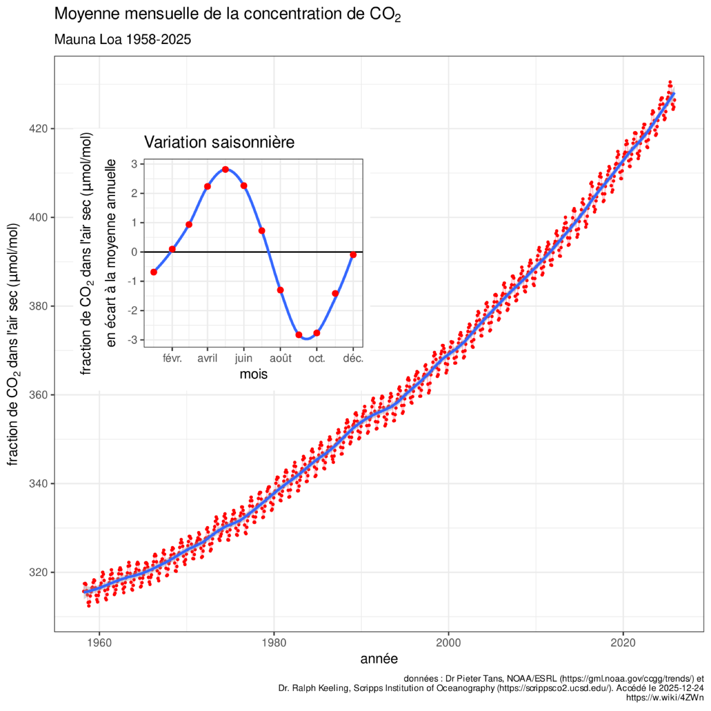

```{r}
#| include: false
source(here::here("R/theme_cours.R"))
source(here::here("R/cm10.R"))   # même fichier que la page de cours
```

## Fait de départ : France Stratégie relève la valeur du carbone (2025)

- En mars 2025, une commission d'experts réunie par France Stratégie fixe la « valeur de l'action pour le climat » à **256 € par tonne d'équivalent CO₂** évitée en 2025 (en euros de 2023), contre 187 € auparavant, et à **300 €** en 2030.

. . .

- Conséquence : ce prix trie les projets. Une action qui évite une tonne pour moins de 256 € est jugée rentable pour la collectivité.

. . .

- Le calcul repose sur un **taux d'actualisation de 3,2 %** par an.

[Sources : [*L'info durable*, 20/03/2025](https://www.linfodurable.fr/climat/climat-france-strategie-rehausse-la-valeur-du-carbone-49978) ; [OFCE, blog, 18/11/2025](https://www.ofce.fr/blog2024/fr/2025/20251113_LSFR/index.html).]{.wp-source}

::: {.notes}
0 h 00 – 0 h 04. Séance d'ouverture, non évaluée. Annoncer le fil : un prix pour le futur, puis qui paie. Demander à l'amphi : à votre avis, d'où sort ce chiffre de 256 € ? Transition : au même moment, le Nord et le Sud négocient.
:::

## Le second fait : à Bakou, le Nord s'engage à financer le Sud

- À la COP29 de Bakou, les pays développés s'engagent à fournir « au moins 300 milliards de dollars par an d'ici 2035 » aux pays en développement, au lieu de 100 milliards.

. . .

- Suite : la COP30 de Belém appelle à « au moins tripler » l'aide à l'adaptation d'ici 2035.
- La COP31 se tient à Antalya, en Turquie, du 9 au 20 novembre 2026.

[Sources : [AFP, *Connaissance des Énergies*, 24/11/2024](https://www.connaissancedesenergies.org/afp/cop29-les-principaux-points-de-laccord-arrache-bakou-241124) ; [*Connaissance des Énergies*, mis à jour le 17/03/2026](https://www.connaissancedesenergies.org/questions-et-reponses-energies/climat-que-faut-il-retenir-de-la-cop30-belem) ; [UNRIC, 02/03/2026](https://unric.org/de/unfccc-cop31-der-weg-nach-antalya/).]{.wp-source}

::: {.notes}
0 h 04 – 0 h 08. La page a été rédigée le 21/10/2026, avant la COP31 : signaler que les décisions d'Antalya ne sont pas encore connues. Question : pourquoi les pays développés paieraient-ils pour les autres ? Transition : deux faits intriguent.
:::

## Deux faits à expliquer et la question de la séance

::: {.incremental}
1. Une tonne de CO₂ émise aujourd'hui fera des dégâts pendant des décennies. Pourtant on lui donne un prix **aujourd'hui**, et ce prix dépend d'un simple taux.
2. Les pays qui ont le plus émis ne sont pas ceux qui subissent le plus, ni ceux qui émettent le plus aujourd'hui.
:::

. . .

**Question de la séance** : peut-on donner un prix au futur, et qui doit payer, du Nord ou du Sud ?

::: {.notes}
0 h 08 – 0 h 12. Trois outils du semestre (le prix, l'externalité, le taux) et un seul neuf : l'actualisation. Pari à main levée : 1 000 € de dommages dans un siècle valent-ils plus ou moins de 100 € aujourd'hui ? On garde la réponse pour l'exemple chiffré. Transition : les notions nécessaires.
:::

## Rappel : prix, externalité, taux, croissance, positif et normatif

::: {.rappel}
- **Prix** : ce qu'il faut céder pour obtenir une unité d'un bien ; il signale la rareté.
- **Externalité** : une activité impose aux autres un dommage qu'elle ne paie pas : Cms = Cm + Dm, où Dm est le dommage marginal. Sans correction, le marché va trop loin.
- **Taux réel** : r ≈ i − π, le taux nominal corrigé de l'inflation.
- **Croissance** g : variation, en % par an, du PIB ou du revenu par habitant.
- **Positif** : ce qui est, vérifiable ; **normatif** : ce qui devrait être, selon un jugement de valeur.
:::

::: {.notes}
0 h 12 – 0 h 16. Rappel rapide, sans redéfinir. Question : « Que fait le marché quand une externalité n'est pas corrigée ? » (Il va trop loin.) Transition : un dommage climatique a une particularité, il arrive tard.
:::

## Actualiser : ramener un montant futur à sa valeur d'aujourd'hui

Un dommage climatique arrive tard : la tonne de CO₂ émise en 2027 pèsera sur des récoltes et des côtes en 2060 ou en 2120. Il faut une règle de conversion entre les dates.

. . .

::: {#def-actualisation}
## Actualisation

**Actualiser**, c'est convertir un montant futur en sa valeur d'aujourd'hui. C'est l'opération inverse du placement : 100 € placés à 5 % deviennent 105 € dans un an ; donc 105 € dans un an valent 100 € aujourd'hui.
:::

::: {.notes}
0 h 16 – 0 h 20. Insister sur l'inverse du placement : placer fait grossir un montant d'aujourd'hui, actualiser fait maigrir un montant futur. Question : préférez-vous 100 € aujourd'hui ou 105 € dans un an ? Transition : à quel rythme réduire ?
:::

## Taux d'actualisation δ : le poids donné au futur

::: {#def-taux-actualisation}
## Taux d'actualisation

Le **taux d'actualisation** (δ) est le taux, en % par an, auquel on réduit la valeur d'un montant pour chaque année qui le sépare d'aujourd'hui. Plus δ est élevé, moins le futur pèse dans la décision.
:::

. . .

- La question « peut-on donner un prix au futur ? » devient alors : **quel taux choisir ?**
- Trois économistes y ont répondu différemment : Ramsey, Nordhaus, Stern.

::: {.notes}
0 h 20 – 0 h 23. Le symbole δ servira toute la séance ; ne pas le confondre avec r, le taux d'intérêt réel. Question : un δ plus élevé donne-t-il plus ou moins de poids à l'année 2100 ? (Moins.) Transition : la formule qui convertit.
:::

## Valeur actuelle et facteur d'actualisation : la formule

::: {#def-valeur-actuelle}
## Valeur actuelle

La **valeur actuelle** d'un montant reçu (ou d'un dommage subi) dans n années est :
$$\text{valeur actuelle} = \dfrac{\text{montant}}{(1 + \delta)^n}$$
Le facteur 1 ÷ (1 + δ)^n^ s'appelle le **facteur d'actualisation**. Il est compris entre 0 et 1.
:::

. . .

Avec la définition précédente : n = 1, δ = 5 %, 105 ÷ 1,05 = **100 €**.

::: {.notes}
0 h 23 – 0 h 27. Faire retrouver le 100 € avant le clic. Le facteur est entre 0 et 1 : un montant futur vaut toujours moins aujourd'hui, dès que δ est positif. Transition : le premier à avoir posé la question entre générations, Ramsey.
:::

## Ramsey (1928) : épargner pour ses descendants

::: {.auteur}
**Frank Ramsey** (1928), « [A Mathematical Theory of Saving](https://doi.org/10.2307/2224098) », *The Economic Journal* · école néoclassique (Cambridge). Ramsey cherche combien une nation doit épargner pour ses descendants. L'épargne optimale dépend de la richesse que l'épargne elle-même procurera aux générations suivantes.
:::

. . .

- L'**impatience pure** est la préférence pour le présent *seulement parce qu'il est le présent*.
- Ramsey la juge injustifiable : une pratique « éthiquement indéfendable », qui « vient seulement d'une faiblesse de l'imagination » (1928, p. 543 ; notre traduction).

::: {.notes}
0 h 27 – 0 h 32. Question : préférer le présent parce qu'il est le présent, est-ce défendable ? Transition : les économistes ont tiré de son modèle une règle.
:::

## Règle de Ramsey : impatience pure plus un terme lié à la croissance

$$\delta = \text{impatience pure} + \text{aversion à l'inégalité} \times g$$

::: {.incremental}
- **Premier terme** : l'impatience pure.
- **Second terme**, la croissance g : si nos petits-enfants sont plus riches, un euro de plus compte moins pour eux que pour nous, comme 100 € comptent moins pour un ménage aisé que pour un ménage modeste.
- **Aversion à l'inégalité** : à 0, un euro vaut un euro pour tous ; à 2, on donne beaucoup de poids au plus pauvre.
:::

::: {.notes}
0 h 32 – 0 h 38. La règle a été tirée ensuite du modèle de Ramsey, en y ajoutant la croissance. Question : qui, ici, attend des générations futures plus riches que nous ? Transition : Nordhaus va chercher le taux dans l'économie.
:::

## Nordhaus (1992) : le taux se lit dans les rendements du capital

::: {.auteur}
::: {.wp-portrait}
{fig-alt="Portrait photographique de William Nordhaus en 2018, homme âgé en buste."}
[2018 · Bengt Nyman, CC BY 2.0, Wikimedia Commons]{.wp-credit}
:::

**William Nordhaus** (1992), [*Science*](https://doi.org/10.1126/science.258.5086.1315) · école néoclassique. Premier modèle DICE : les émissions réchauffent la planète, le réchauffement détruit une part de la production. Avec un taux proche des rendements du capital, la politique optimale réduit les émissions progressivement.
:::

. . .

Le taux est proche du taux d'intérêt réel r. Rendement réel avant impôt du capital des entreprises américaines : « d'environ 7 % par an » pendant quarante ans ([Nordhaus, Yale, 2007](https://ycsg.yale.edu/sites/default/files/files/chapter5.pdf) ; notre traduction).

::: {.notes}
0 h 38 – 0 h 43. Prix Nobel 2018 (*The Conversation*, 12/11/2018). Un taux de « marché » : le prix du carbone monte avec le temps. Question : pourquoi un taux de marché ? (Ne pas sacrifier des placements plus rentables.) Transition : Stern répond que ce choix est éthique.
:::

## Stern (2006) : le choix du taux est d'abord éthique

::: {.auteur}
::: {.wp-portrait}
{fig-alt="Portrait photographique de Nicholas Stern en 2015, homme en buste."}
[2015 · Royal Society, CC BY-SA 4.0, Wikimedia Commons]{.wp-credit}
:::

**Nicholas Stern** (2006), [*The Stern Review*](https://researchonline.lse.ac.uk/id/eprint/3149) · économie publique. Rien ne justifie de compter moins le bien-être d'une personne parce qu'elle naîtra plus tard. Avec un taux faible, agir tôt et fort coûte moins cher que laisser faire.
:::

. . .

- Impatience pure presque nulle : taux réel d'équilibre de **1,4 % par an** (selon [Nordhaus, 2007](https://ycsg.yale.edu/sites/default/files/files/chapter5.pdf)).
- Sans action : « au moins 5 % du PIB mondial chaque année, maintenant et pour toujours » (cité par [Nordhaus, 2007](https://ycsg.yale.edu/sites/default/files/files/chapter5.pdf) ; notre traduction).

::: {.notes}
Stern ajoute : jusqu'à 20 % du PIB mondial en comptant plus de risques (cité par Nordhaus, 2007). 0 h 43 – 0 h 48. Rapport commandé par le gouvernement britannique, remis en octobre 2006, publié en 2007. Question : 1,4 % contre 7 %, d'où vient un tel écart ? Transition : relier l'actualisation à l'externalité.
:::

## Coût social du carbone : le dommage marginal Dm actualisé

Émettre une tonne de CO₂ impose aux autres, et surtout aux générations futures, un dommage qu'on ne paie pas.

. . .

::: {#def-cout-social-carbone}
## Coût social du carbone

Le **coût social du carbone** est la valeur actuelle de tous les dommages futurs causés par une tonne de CO₂ émise aujourd'hui. C'est le dommage marginal Dm de l'externalité climatique. Il dépend donc du taux δ.
:::

::: {.notes}
0 h 48 – 0 h 52. C'est le Dm du rappel : Cms = Cm + Dm. Question : si δ baisse, le coût social du carbone monte-t-il ou baisse-t-il ? (Il monte.) Transition : la France a pris une autre route.
:::

## Valeur de l'action pour le climat : un prix d'objectif

::: {#def-vac}
## Valeur de l'action pour le climat

La **valeur de l'action pour le climat** (VAC) est le prix d'une tonne de CO₂ évitée que retient l'État français pour évaluer les projets. Elle ne mesure pas les dommages : c'est le prix qui permet d'atteindre un objectif d'émissions donné (la trajectoire de la stratégie nationale bas-carbone, qui vise la neutralité en 2050) au moindre coût. Elle augmente chaque année au rythme du taux d'actualisation.
:::

[Source : [OFCE, 18/11/2025](https://www.ofce.fr/blog2024/fr/2025/20251113_LSFR/index.html).]{.wp-source}

::: {.notes}
0 h 52 – 0 h 55. Deux routes vers le prix d'une tonne : le coût social du carbone part des dommages, la VAC part d'un objectif d'émissions. Question : laquelle des deux routes oblige à chiffrer les dommages ? (Le coût social du carbone.) Transition : où le taux intervient-il dans tout cela ?
:::

## De l'émission au tri des projets : où le taux δ intervient

| Étape | Où δ intervient |
|---|---|
| 1. Émission, 2. dommages futurs | non |
| 3. Actualisation des dommages | **oui : δ faible, dommages lourds** |
| 4a. Coût social du carbone (dommages) | résultat sensible à δ |
| 4b. VAC (objectif d'émissions) | croît au rythme de δ |
| 5. Tri des projets | **oui : coûts et tonnes évitées actualisés** |

. . .

Le taux agit à presque toutes les étapes de calcul, et il en déplace le résultat.

::: {.notes}
0 h 55 – 0 h 59. Tableau abrégé de la page de cours. Deux routes : 2 à 4a par les dommages, 4b par l'objectif. Le taux n'intervient pas au moment d'émettre, mais dans tous les calculs qui suivent. Question : à quelle étape un taux plus faible alourdit-il les dommages ? (L'étape 3.) Transition : voir l'effet du taux sur un graphique.
:::

## Valeur actuelle (1/3) : à 1 %, le futur pèse encore

:::: {.columns}
::: {.column width="60%"}
```{r}
#| fig-width: 8
#| fig-height: 5.4
#| fig-alt: "Une courbe bleue décroissante part de 1 000 euros aujourd'hui et vaut 370 euros à 100 ans, pour un taux de 1 %. Une ligne verticale en pointillés marque 50 ans."
graphe_actualisation(base_size = 24, etape = 1)
```
:::

::: {.column width="40%"}
- Abscisse : dans combien d'années on reçoit 1 000 € (ou on subit 1 000 € de dommages).
- Ordonnée : leur valeur actuelle.
- À δ = 1 %, 1 000 € dans un siècle valent encore **370 €** aujourd'hui.
:::
::::

::: {.notes}
0 h 59 – 1 h 02. Graphique calculé avec la formule, sans données. Lire les axes avant la courbe. Question : où sera la courbe à 3 % ? Transition : on ajoute 3 %.
:::

## Valeur actuelle (2/3) : à 3 %, 1 000 € dans un siècle valent 52 €

:::: {.columns}
::: {.column width="60%"}
```{r}
#| fig-width: 8
#| fig-height: 5.4
#| fig-alt: "Même graphique, avec une seconde courbe ambre pour 3 % : elle vaut environ 230 euros à 50 ans et 52 euros à 100 ans."
graphe_actualisation(base_size = 24, etape = 2)
```
:::

::: {.column width="40%"}
::: {.incremental}
- À 3 %, la courbe descend beaucoup plus vite.
- À 100 ans : **52 €**, contre 370 € à 1 %.
- Les deux courbes partent du même point et s'écartent de plus en plus avec l'horizon.
:::
:::
::::

::: {.notes}
1 h 02 – 1 h 05. Lire aussi l'horizon de 50 ans : environ 230 € à 3 %. Question : pourquoi l'écart entre les courbes grandit-il avec l'horizon ? Transition : 5 %.
:::

## Valeur actuelle (3/3) : à 5 %, les mêmes 1 000 € valent 8 €

:::: {.columns}
::: {.column width="60%"}
```{r}
#| fig-width: 8
#| fig-height: 5.4
#| fig-alt: "Trois courbes décroissantes partent toutes de 1 000 euros aujourd'hui. La courbe bleue, pour un taux de 1 %, descend lentement et vaut 370 euros à 100 ans. La courbe ambre, pour 3 %, vaut environ 230 euros à 50 ans et 52 euros à 100 ans. La courbe rouge, pour 5 %, chute vite, vaut moins de 100 euros à 50 ans et 8 euros à 100 ans. Une ligne verticale en pointillés marque 50 ans."
graphe_actualisation(base_size = 24)
```
:::

::: {.column width="40%"}
::: {.incremental}
- À 5 % : **8 €** dans un siècle.
- L'écart entre 1 % et 5 % paraît faible sur une année ; sur un siècle, il multiplie la valeur actuelle par près de 50.
- Effet des **intérêts composés** : on réduit chaque année une somme déjà réduite.
:::
:::
::::

::: {.notes}
1 h 05 – 1 h 09. Revenir au pari de début de séance : 1 000 € dans un siècle valent plus de 100 € à 1 %, beaucoup moins à 3 % ou 5 %. Transition : refaire ces calculs à la main.
:::

## Exemple chiffré : actualiser à la main sur deux ans

::: {.incremental}
1. *Placer.* 100 € placés à 10 % deviennent 100 × 1,1 = 110 € dans un an, puis 110 × 1,1 = 121 € dans deux ans.
2. *Actualiser, à l'envers.* 121 € reçus dans deux ans valent 121 ÷ 1,1 ÷ 1,1 = **100 €** aujourd'hui, au taux de 10 %.
3. *La règle de 70.* Un montant actualisé à δ % par an est divisé par deux environ tous les 70 ÷ δ ans. C'est une approximation.
:::

::: {.notes}
1 h 09 – 1 h 14. Faire calculer chaque étape avant le clic, à la main. La règle de 70 évite les puissances : elle suffit pour un ordre de grandeur. Transition : l'appliquer à 7 % et à 1 %.
:::

## Règle de 70 : diviser par deux tous les 70 ÷ δ ans

:::: {.columns}
::: {.column width="60%"}
```{r}
#| fig-width: 8
#| fig-height: 5.4
#| fig-alt: "Courbe bleue de la valeur actuelle de 1 000 euros à 1 % : elle passe par environ 500 euros vers 70 ans et vaut 370 euros à 100 ans."
graphe_actualisation(base_size = 24, etape = 1)
```
:::

::: {.column width="40%"}
::: {.incremental}
- *À 7 %* : division par deux tous les 10 ans ; 1 000 → 500 → 250 → … → **environ 1 €**.
- *À 1 %* : tous les 70 ans ; 1 000 € dans 70 ans valent **environ 500 €**.
- Taux multiplié par 7, valeur divisée par environ 300.
:::
:::
::::

::: {.notes}
1 h 14 – 1 h 19. 7 % est le rendement cité par Nordhaus. En 100 ans à 7 %, on divise 10 fois par deux. Lire sur la courbe : à 1 %, environ 500 € vers 70 ans. Leçon : 370 € à 1 % contre à peine 1 € à 7 %. Transition : un tableau pour éviter les puissances.
:::

## Facteurs d'actualisation : multiplier le montant futur suffit

| Horizon | δ = 1 % | δ = 3 % | δ = 5 % |
|---|---|---|---|
| 50 ans | 0,61 | 0,23 | 0,09 |
| 100 ans | 0,370 | 0,052 | 0,008 |

: Facteurs d'actualisation 1 ÷ (1 + δ)^n^ (arrondis). Calcul de l'auteur.

. . .

- Le tableau donne les facteurs, calculés une fois pour toutes.
- Valeur actuelle = montant futur × facteur. Exemple : 1 000 € dans 50 ans à 3 % valent 1 000 × 0,23 = **230 €**.

::: {.notes}
1 h 19 – 1 h 22. Relier à la ligne verticale du graphique, à 50 ans : facteurs 0,61 ; 0,23 ; 0,09. Question : combien valent 1 000 € dans 100 ans à 5 % ? (8 €.) Transition : un projet concret.
:::

## Exemple chiffré : payer 100 aujourd'hui pour éviter 1 000 dans cent ans

Un pays peut dépenser **100 millions d'euros** aujourd'hui (une digue, une centrale moins émettrice) pour éviter **1 000 millions d'euros** de dommages dans 100 ans. Les chiffres sont fictifs.

::: {.incremental}
1. *La règle de décision.* On compare le coût d'aujourd'hui (100) à la valeur actuelle du dommage évité. Si elle dépasse 100, le projet vaut son coût.
2. *À 1 %.* 1 000 × 0,370 = **370**. C'est plus que 100 : on construit.
:::

::: {.notes}
1 h 22 – 1 h 26. Avant le clic : faut-il construire ? Vote à main levée. Transition : même projet, autres taux.
:::

## Le même projet est refusé à 3 % et à 5 %

:::: {.columns}
::: {.column width="60%"}
```{r}
#| fig-width: 8
#| fig-height: 5.4
#| fig-alt: "Les trois courbes de valeur actuelle de 1 000 euros : à 100 ans, 370 euros à 1 %, 52 euros à 3 %, 8 euros à 5 %."
graphe_actualisation(base_size = 24)
```
:::

::: {.column width="40%"}
::: {.incremental}
3. *À 3 %.* 1 000 × 0,052 = **52**. C'est moins que 100 : on ne construit pas.
4. *À 5 %.* 1 000 × 0,008 = **8**. Le projet paraît absurde.
:::
:::
::::

::: {.notes}
1 h 26 – 1 h 29. Les trois valeurs se lisent au bout des courbes, à 100 ans (en millions d'euros ici). Question : à partir de quel taux le projet bascule-t-il ? Transition : chercher le seuil.
:::

## Seuil de décision : le projet bascule vers 2,3 %

::: {.incremental}
5. *Le seuil.* Le projet vaut son coût tant que le facteur dépasse 100 ÷ 1 000 = 0,1.
    - De 1 000 à 100 : un peu plus de trois divisions par deux (1 000 → 500 → 250 → 125 → 100).
    - Une tous les 30 ans environ : 70 ÷ 30 ≈ **2,3 %**. Au-dessus, on ne construit pas.
6. *La leçon.* Mêmes ingénieurs, mêmes climatologues, même dommage. **Seul le taux change, et il retourne la décision.**
:::

::: {.notes}
1 h 29 – 1 h 34. La règle de 70 lue à l'envers : on connaît le délai de division par deux, on en tire le taux. Question : qui choisit ce taux, et selon quel critère ? Transition : une objection fréquente.
:::

## Point d'attention : actualiser n'ignore pas les générations futures

::: {.piege}
« Actualiser, c'est dire que les générations futures ne comptent pas. » Pas forcément.
:::

. . .

- Avec une impatience nulle, on actualise encore si l'on pense que le futur sera plus riche (règle de Ramsey).
- Un taux élevé peut se défendre *au nom* des générations futures : placer l'argent ailleurs à 7 % leur laisserait davantage, si on le leur transmet vraiment.
- Le désaccord porte sur la valeur du taux, pas sur le principe d'actualiser.

::: {.notes}
1 h 34 – 1 h 38. Sondage à main levée avant le clic : actualiser, est-ce mépriser l'avenir ? Insister sur « si on le leur transmet vraiment ». Transition : retrouver les taux de Stern et de Nordhaus.
:::

## Règle de Ramsey : deux réglages donnent 1,4 % et 5,5 %

::: {.incremental}
- **Réglage « à la Stern »** : impatience 0,1 %, aversion à l'inégalité 1, croissance 1,3 % : δ = 0,1 + 1 × 1,3 = **1,4 %**.
- **Réglage « à la Nordhaus »** : impatience 1,5 %, aversion à l'inégalité 2, croissance 2 % : δ = 1,5 + 2 × 2 = **5,5 %**.
- L'essentiel de l'écart vient du second terme : croissance attendue et aversion à l'inégalité.
:::

[Paramètres d'illustration : seuls le 1,4 % de Stern et l'impatience de 1,5 % du modèle DICE-2007 viennent de [Nordhaus (2007)](https://ycsg.yale.edu/sites/default/files/files/chapter5.pdf).]{.wp-source}

::: {.notes}
1 h 38 – 1 h 42. Faire calculer les deux taux avant chaque clic. Le reste des paramètres est fixé pour l'exemple. Question : lequel des deux termes pèse le plus dans l'écart ? Transition : que change le taux pour les émissions ?
:::

## Optimum d'émissions (1/3) : sans politique, on émet jusqu'en Q\*

:::: {.columns}
::: {.column width="60%"}
```{r}
#| fig-width: 6.4
#| fig-height: 4.6
#| fig-alt: "Émissions en abscisse, euros par tonne en ordonnée. Une droite bleue décroissante représente le bénéfice d'émettre D ; une droite horizontale ambre basse, le coût privé Cm. Elles se coupent en Q étoile."
graphe_cms_taux(base_size = 24, etape = 1)
```
:::

::: {.column width="40%"}
- En abscisse, les émissions Q.
- D mesure ce que rapporte une tonne de plus à celui qui émet (produire, chauffer, rouler).
- Le coût privé Cm est faible.
- Chacun émet jusqu'en **Q\***, où une tonne de plus ne rapporte plus que son coût privé.
:::
::::

::: {.notes}
1 h 42 – 1 h 45. C'est le graphique de l'externalité, avec un coût horizontal. Graphique théorique, valeurs fictives. Question : qui paie les dommages au-delà de l'optimum ? Transition : ajouter le dommage, qui dépend du taux.
:::

## Optimum d'émissions (2/3) : avec un taux élevé, Cms reste bas

:::: {.columns}
::: {.column width="60%"}
```{r}
#| fig-width: 6.4
#| fig-height: 4.6
#| fig-alt: "Même graphique, avec une droite horizontale ambre en tirets, Cms si le taux est élevé, un peu au-dessus de Cm ; elle coupe D en un optimum Q rond, à gauche de Q étoile."
graphe_cms_taux(base_size = 24, etape = 2)
```
:::

::: {.column width="40%"}
::: {.incremental}
- Le coût marginal social ajoute le coût social du carbone : Cms = Cm + Dm. Or Dm dépend du taux.
- **Taux élevé** : les dommages futurs s'effacent ; Cms est plus bas, l'optimum Q° est proche de Q\*. On réduit, mais moins et plus tard.
:::
:::
::::

::: {.notes}
1 h 45 – 1 h 48. Le déplacement vient de Dm, pas de D ni de Cm. Question : que se passe-t-il si l'on baisse le taux ? Transition : taux faible.
:::

## Optimum d'émissions (3/3) : avec un taux faible, Q° est bas

:::: {.columns}
::: {.column width="60%"}
```{r}
#| fig-width: 6.4
#| fig-height: 4.6
#| fig-alt: "Graphique avec les émissions en abscisse et des euros par tonne en ordonnée. Une droite bleue décroissante représente le bénéfice d'émettre D. Une droite horizontale ambre basse représente le coût privé Cm ; elle coupe D au point Q étoile, à droite. Deux droites horizontales ambre en tirets, plus hautes, représentent le coût marginal social : la plus basse, si le taux d'actualisation est élevé, coupe D en un optimum Q rond au milieu ; la plus haute, si le taux est faible, coupe D en un optimum Q rond à gauche."
graphe_cms_taux(base_size = 24)
```
:::

::: {.column width="40%"}
::: {.incremental}
- **Taux faible** : les dommages futurs restent lourds en valeur actuelle.
- Cms est haut, l'optimum Q° est bas.
- Il faut réduire fortement et vite.
- Lecture : Q° (δ faible) < Q° (δ élevé) < Q\*.
:::
:::
::::

::: {.notes}
1 h 48 – 1 h 51. Les dommages physiques sont les mêmes ; seul leur poids aujourd'hui change. Question : D et Cm sont les mêmes ; qu'est-ce qui sépare les deux optimums ? (Le taux, par Dm.) Transition : Nordhaus chiffre lui-même cet écart.
:::

## Taxe carbone optimale de Nordhaus : 30 $ ou 300 $

:::: {.columns}
::: {.column width="60%"}
```{r}
#| fig-width: 6.4
#| fig-height: 4.6
#| fig-alt: "Le graphique de l'optimum d'émissions : Cm bas, Cms si taux élevé, Cms si taux faible plus haut, et les optimums correspondants."
graphe_cms_taux(base_size = 24)
```
:::

::: {.column width="40%"}
::: {.incremental}
- Taxe optimale pour 2010 dans DICE : environ **30 $ par tonne de carbone**.
- Avec les paramètres éthiques de Stern : environ **300 $**.
- Soit environ 8 $ et 80 $ par tonne de CO₂.
:::
:::
::::

[Source : [Nordhaus, conférence de Yale, 2007](https://ycsg.yale.edu/sites/default/files/files/chapter5.pdf).]{.wp-source}

::: {.notes}
1 h 51 – 1 h 55. Une tonne de carbone correspond à environ 3,7 tonnes de CO₂ (44 ÷ 12). Ces dollars ne se comparent qu'avec prudence aux euros de 2023 de la VAC. Question : laquelle des deux droites Cms correspond à 300 $ ? (La plus haute, taux faible.) Transition : le prix français de la tonne.
:::

## Exemple chiffré : la VAC atteint 300 € en 2030

La VAC vaut **256 €** par tonne de CO₂ en 2025 (en euros de 2023) et croît au rythme du taux d'actualisation public, **3,2 %** par an.

::: {.incremental}
1. *Un an plus tard.* 256 × 1,032 ≈ 264 € : la VAC 2026 est d'environ **264 €**.
2. *Cinq ans plus tard.* On multiplie cinq fois par 1,032, soit par 1,17 environ : 256 × 1,17 ≈ **300 €** en 2030.
:::

[Sources : [OFCE, 18/11/2025](https://www.ofce.fr/blog2024/fr/2025/20251113_LSFR/index.html) ; [*L'info durable*, 20/03/2025](https://www.linfodurable.fr/climat/climat-france-strategie-rehausse-la-valeur-du-carbone-49978).]{.wp-source}

::: {.notes}
1 h 55 – 1 h 59. Faire calculer avant chaque clic. On retrouve le chiffre de la commission, vu en accroche. Question : pourquoi faire monter le prix au rythme du taux ? Transition : la réponse.
:::

## Pourquoi la VAC monte au rythme du taux d'actualisation

::: {.incremental}
3. Éviter une tonne en 2030 ou en 2025 compte autant pour l'objectif de 2050.
4. En valeur actuelle, les deux tonnes doivent donc avoir le même prix : 300 € en 2030, actualisés à 3,2 %, valent bien 256 € en 2025.
5. Sinon, il vaudrait mieux tout faire à la date où c'est le moins cher.
:::

. . .

On retrouve l'outil de la séance : actualiser, c'est comparer des montants à des dates différentes.

::: {.notes}
1 h 59 – 2 h 02. Faire le calcul inverse : 300 ÷ 1,17 ≈ 256. Question : si la VAC restait à 256 € pour toujours, quand réduirait-on ? (Plus tard, quand la tonne vaut moins en valeur actuelle.) Transition : à quoi sert la VAC en pratique.
:::

## Tri des projets : la pompe à chaleur passe, le biométhane non

::: {.incremental}
- Une pompe à chaleur évite une tonne pour environ **125 €** : moins que 256 €, elle est rentable pour la collectivité.
- Le biométhane coûte environ **393 €** la tonne évitée : au seul regard du carbone, il ne l'est pas.
- La VAC « ne doit pas être confondue avec un niveau souhaitable ou optimal de taxe carbone » : elle guide le calcul des projets, elle ne fixe pas un impôt.
:::

[Source : France Stratégie, cité par [*L'info durable*, 20/03/2025](https://www.linfodurable.fr/climat/climat-france-strategie-rehausse-la-valeur-du-carbone-49978).]{.wp-source}

::: {.notes}
2 h 02 – 2 h 05. La citation est du commissaire général de France Stratégie. Question : faut-il abandonner le biométhane ? (Pas forcément : on ne compte ici que le carbone.) Transition : qui gagne et qui perd selon le taux.
:::

## Entre générations, un taux élevé ménage le présent

::: {.incremental}
- **Taux élevé** : on réduit plus tard, quand on sera plus riche et que les techniques auront progressé.
    - La génération actuelle y gagne ; celle qui subira le réchauffement y perd, *sauf* si on lui transmet en échange plus de capital (usines, routes, savoirs).
- **Taux faible** : un effort tôt, au profit de générations qui seront, si la croissance continue, plus riches que nous.
:::

::: {.notes}
2 h 05 – 2 h 08. Question : qui devrait décider du taux, alors que ceux qui naîtront en 2100 n'ont pas de voix ? Transition : la répartition entre pays.
:::

## CO₂ cumulé depuis 1750 : États-Unis et UE en tête

:::: {.columns}
::: {.column width="60%"}
```{r}
#| fig-width: 8
#| fig-height: 5.4
#| fig-alt: "Barres horizontales bleues : part du CO2 émis de 1750 à 2024. États-Unis 23,5 %, Union européenne à 27 16,3 %, Chine 15,4 %, Inde 3,6 %, Afrique 2,9 %, France 2,2 %."
graphe_parts_co2(base_size = 24, etape = 1)
```
:::

::: {.column width="40%"}
- Le CO₂ s'accumule : ce qui réchauffe aujourd'hui, c'est le **stock** émis depuis deux siècles.
- Sur 1 849 milliards de tonnes émises de 1750 à 2024 : États-Unis **23,5 %**, UE à 27 **16,3 %**, Chine **15,4 %**.
:::
::::

::: {.notes}
2 h 08 – 2 h 11. CO₂ fossile et industriel émis sur le territoire, hors changement d'usage des sols. La France fait partie de l'UE à 27. Question : ces parts sont-elles grandes ou petites ? Il faut les rapporter à la population. Transition : on ajoute la population.
:::

## Parts du CO₂ cumulé et de la population : un écart Nord-Sud

:::: {.columns}
::: {.column width="60%"}
```{r}
#| fig-width: 8
#| fig-height: 5.4
#| fig-alt: "Diagramme en barres horizontales, deux barres par pays ou région. États-Unis : 23,5 % du CO2 cumulé, 4,2 % de la population. Union européenne à 27 : 16,3 % et 5,6 %. Chine : 15,4 % et 17,6 %. Inde : 3,6 % et 17,8 %. Afrique : 2,9 % et 18,3 %. France : 2,2 % et 0,8 %. Pour les États-Unis, l'Union européenne et la France, la barre bleue des émissions est bien plus longue que la barre grise de la population ; pour l'Inde et l'Afrique, c'est l'inverse."
graphe_parts_co2(base_size = 24)
```
:::

::: {.column width="40%"}
::: {.incremental}
- États-Unis et UE à 27 : près de 40 % du CO₂ cumulé avec moins de 10 % de la population mondiale.
- États-Unis : 23,5 % avec 4,2 %.
- Afrique : 2,9 % avec 18,3 %.
:::
:::
::::

::: {.notes}
2 h 11 – 2 h 14. Lire d'abord la barre grise, puis la bleue, pays par pays. Inde et Afrique : l'inverse des pays riches. Question : qui a « consommé » l'atmosphère ? Transition : pourquoi le stock compte plus que le flux.
:::

## Le stock de CO₂ monte tant que les émissions dépassent les puits

:::: {.columns}
::: {.column width="60%"}
{fig-alt="Courbe de la concentration de dioxyde de carbone à Mauna Loa. Elle monte presque en ligne droite de 316 en 1958 à environ 427 en 2025, avec une pente de plus en plus forte et de petites oscillations saisonnières. Un encart montre que ces oscillations varient de moins 3 à plus 3 autour de la moyenne annuelle."}
:::

::: {.column width="40%"}
::: {.incremental}
- Mauna Loa : environ 316 µmol/mol en 1958, 427 en 2025.
- De 2015 à 2024, les puits ont absorbé environ la moitié des émissions : 29 % les océans, 21 % les terres.
- Ce stock cause les dommages futurs que le taux pèse.
:::
:::
::::

[Graphique : Oeneis, d'après P. Tans (NOAA/ESRL) et R. Keeling (Scripps), CC BY-SA 4.0, Wikimedia Commons ; [Global Carbon Budget 2025, *ESSD*, 13/05/2026](https://essd.copernicus.org/articles/18/3211/2026/).]{.wp-source}

::: {.notes}
2 h 14 – 2 h 16. Unité : parties par million. La tendance ne redescend jamais, car chaque année ajoute au stock ; les oscillations annuelles viennent de la végétation de l'hémisphère nord. Question : si les émissions baissaient un peu demain, la concentration baisserait-elle ? (Non : tant que les émissions dépassent ce qu'absorbent les puits, elle continue de monter, moins vite.) Transition : quelle part du CO₂ émis reste dans l'air ?
:::

## Budget carbone : 40 à 50 % du CO₂ émis reste dans l'atmosphère

:::: {.columns}
::: {.column width="60%"}
```{r}
#| fig-width: 8
#| fig-height: 5.4
#| fig-alt: "Diagramme en barres, une par décennie, de 1965-1974 à 2015-2024. Chaque barre grise donne le CO2 émis en moyenne par an : 21, 25, 28, 32, 39 et 41 milliards de tonnes. La partie rouge, en bas de chaque barre, montre ce qui est resté dans l'atmosphère : 40 %, 46 %, 40 %, 45 %, 42 % et 50 % des émissions."
graphe_co2_reste_air(base_size = 24)
```
:::

::: {.column width="40%"}
::: {.incremental}
- Émissions mondiales de CO₂ : de **21** à **41 milliards de tonnes** par an en moyenne, de 1965-1974 à 2015-2024.
- À chaque décennie, **40 à 50 %** de ce CO₂ reste dans l'atmosphère.
- Plus le flux est grand, plus le stock monte vite.
:::
:::
::::

[Source : [Global Carbon Project, Global Carbon Budget 2025, données v1.0, ICOS](https://meta.icos-cp.eu/objects/qSjPBsV1drZnYdH-yCJMmkGn) (consulté le 22/10/2026).]{.wp-source}

::: {.notes}
2 h 16 – 2 h 18. Lire d'abord la barre grise (le flux de l'année), puis la partie rouge (ce qui s'ajoute au stock). Le reste est absorbé par les océans et la végétation, aux incertitudes de mesure près. Moyennes par décennie, car la hausse annuelle du stock varie beaucoup (69 % des émissions en 2024). Question : si les émissions restaient à 41 milliards de tonnes par an, le stock se stabiliserait-il ? (Non : il continuerait de monter.) Transition : le flux par habitant, lui, a changé.
:::

## Par habitant, la Chine dépasse l'UE chaque année depuis 2017

:::: {.columns}
::: {.column width="60%"}
```{r}
#| fig-width: 8
#| fig-height: 5.4
#| fig-alt: "Six courbes de 1990 à 2024. La courbe bleue des États-Unis, la plus haute, part d'environ 20 tonnes par habitant, reste autour de 20 tonnes jusqu'en 2007 puis baisse jusqu'à 14,2 tonnes. La courbe ambre de l'Union européenne à 27 baisse de 9,2 à 5,4 tonnes. La courbe rouge de la Chine monte de 2,2 à 8,7 tonnes et passe au-dessus de l'Union européenne vers 2013, durablement depuis 2017. La moyenne mondiale, en tirets noirs, reste entre 4 et 5 tonnes. L'Inde, en gris, monte de 0,7 à 2,2 tonnes ; l'Afrique, en pointillés gris, reste autour d'une tonne."
graphe_flux_co2(base_size = 24)
```
:::

::: {.column width="40%"}
::: {.incremental}
- De 1990 à 2024 : environ −30 % aux États-Unis, plus de −40 % dans l'UE.
- Chine : de 2,2 t à 8,7 t, multipliée par 4.
- Afrique : autour d'une tonne sur toute la période.
:::
:::
::::

::: {.notes}
2 h 18 – 2 h 20. En 2024 : États-Unis 14,2 t, Chine 8,7, UE 5,4, France 4,0, Inde 2,2, Nigérian 0,6, moyenne mondiale 4,7. Hors transports internationaux. Le cumul chinois (15,4 %) rattrape celui de l'UE (16,3 %). Question : la Chine est-elle du Nord ou du Sud ? Transition : la France, avec ses importations.
:::

## Empreinte carbone : la France émet aussi par ses importations

- **Empreinte carbone** de la France (tous gaz à effet de serre, importations comprises) : ce que consomment les Français, où que ce soit produit.
- **Émissions des résidents** : seulement ce qu'émettent les acteurs installés en France.

. . .

- L'écart, ce sont les émissions des pays qui produisent ce que la France importe.
- Ces chiffres ne se comparent pas aux 4,0 tonnes de CO₂ d'un Français en 2024 (CO₂ seul, sans les importations).

[Source : [Insee et SDES, *Insee Première* n° 2130, 13/10/2026](https://www.insee.fr/fr/statistiques/9074153?sommaire=8071406).]{.wp-source}

::: {.notes}
2 h 20 – 2 h 21. Question : un vêtement fabriqué en Asie et acheté en France, à qui compter ses émissions ? Transition : les deux mesures depuis 1990.
:::

## Empreinte carbone : 8,3 t par Français en 2025, contre 5,8 t émises

:::: {.columns}
::: {.column width="60%"}
```{r}
#| fig-width: 8
#| fig-height: 5.4
#| fig-alt: "Deux courbes de 1990 à 2025. La courbe bleue de l'empreinte carbone part de 12,1 tonnes par habitant, fluctue entre 10,7 et 12,1 tonnes jusqu'en 2002, monte jusqu'à 12,8 tonnes en 2008, puis baisse jusqu'à 8,3 tonnes en 2025. La courbe ambre des émissions des résidents part de 10,1 tonnes, oscille autour de 10 tonnes jusqu'à la fin des années 1990, puis baisse jusqu'à 5,8 tonnes. L'espace entre les deux courbes est grisé ; il est le plus large vers 2008."
graphe_empreinte_france(base_size = 24)
```
:::

::: {.column width="40%"}
::: {.incremental}
- Série révisée, tous gaz, 2025 : empreinte **8,3 t** par habitant, émissions des résidents **5,8 t**.
- Les deux baissent depuis 1990 ; l'écart est encore de **2,5 t**.
- Les émissions importées font environ **la moitié** de l'empreinte (296 Mt sur 571).
:::
:::
::::

[Source : [Insee et SDES, *Insee Première* n° 2130, 13/10/2026](https://www.insee.fr/fr/statistiques/9074153?sommaire=8071406) (consulté le 22/10/2026).]{.wp-source}

::: {.notes}
2 h 21 – 2 h 23. Série publiée le 13/10/2026, révisée : si un étudiant cite 9,4 t et 56 % pour 2023 (Rapport ODD 2024 de l'Insee), la nouvelle série donne 8,6 t et 52 % pour cette année-là. Tous gaz à effet de serre : ne pas comparer au CO₂ seul du graphique par habitant. 2025 provisoire. Question : la baisse des émissions des résidents suffit-elle à dire que la France pollue moins ? (Pas entièrement : une partie de ses émissions a lieu dans les pays qui produisent ce qu'elle importe.) Transition : alors, le Nord doit-il payer ?
:::

## Entre pays, la règle de Ramsey joue en sens inverse

::: {.incremental}
- Le second terme de la règle de Ramsey dit qu'un euro compte plus pour un plus pauvre.
- S'il justifie de compter moins nos descendants plus riches, il justifie aussi de compter plus un agriculteur sahélien qu'un cadre parisien.
- Le même raisonnement qui *réduit* l'effort entre générations *l'augmente* entre pays.
:::

::: {.notes}
2 h 23 – 2 h 26. Le point le plus subtil de la séance : prendre le temps. Question : qui accepte le premier argument et refuse le second ? Transition : ce que dit le droit international.
:::

## CCNUCC (1992) : responsabilité et capacité à payer

:::: {.columns}
::: {.column width="60%"}
```{r}
#| fig-width: 8
#| fig-height: 5.4
#| fig-alt: "Rappel du diagramme en barres : part du CO2 cumulé de 1750 à 2024 et part de la population en 2023, pour les États-Unis, l'Union européenne à 27, la Chine, l'Inde, l'Afrique et la France."
graphe_parts_co2(base_size = 24)
```
:::

::: {.column width="40%"}
::: {.incremental}
- Les pays agissent « en fonction de leurs responsabilités communes mais différenciées et de leurs capacités respectives » (art. 3.1).
- Deux critères : la responsabilité (le stock émis) et la capacité à payer (le revenu).
:::
:::
::::

::: {.notes}
2 h 26 – 2 h 28. Les pays développés doivent être « à l'avant-garde » (art. 3.1). La liste des pays développés qui financent les autres date de 1992 (art. 4.3 et annexe II). Question : la Chine de 2026 entre-t-elle dans les critères ? Transition : les négociations.
:::

## Les négociations traduisent le débat en milliards de dollars

::: {.incremental}
- **Bakou** : 300 milliards de dollars par an d'ici 2035, pour la transition énergétique et l'adaptation des pays en développement.
- La Chine a refusé de figurer parmi les contributeurs obligés : les contributions des pays non « développés » restent volontaires.
- **Belém** : l'aide à l'adaptation devrait passer d'environ 40 à 120 milliards par an d'ici 2035 ; l'enveloppe de 300 milliards n'a pas été relevée.
:::

[Sources : [AFP, *Connaissance des Énergies*, 24/11/2024](https://www.connaissancedesenergies.org/afp/cop29-les-principaux-points-de-laccord-arrache-bakou-241124) ; [*Connaissance des Énergies*, mis à jour le 17/03/2026](https://www.connaissancedesenergies.org/questions-et-reponses-energies/climat-que-faut-il-retenir-de-la-cop30-belem).]{.wp-source}

::: {.notes}
2 h 28 – 2 h 29. À l'intérieur d'un pays, la question se pose comme pour toute taxe : qui supporte le prix du carbone dépend de la part de l'énergie dans le budget et des possibilités de s'en passer. Question : pourquoi la contribution de la Chine reste-t-elle volontaire ? (Elle n'est pas dans la liste des pays développés de 1992.) Transition : où en sont les montants versés ?
:::

## Financement climat : 100 milliards de dollars atteints seulement en 2022

:::: {.columns}
::: {.column width="60%"}
```{r}
#| fig-width: 8
#| fig-height: 5.4
#| fig-alt: "Diagramme en barres bleues, une par année de 2016 à 2024 : 58,5 ; 71,6 ; 79,9 ; 80,4 ; 83,3 ; 89,6 ; 115,9 ; 132,8 et 136,7 milliards de dollars. Une ligne grise en tirets marque 100 milliards : les barres la dépassent à partir de 2022. Une ligne rouge en tirets, beaucoup plus haut, marque 300 milliards."
graphe_financement_climat(base_size = 24)
```
:::

::: {.column width="40%"}
::: {.incremental}
- L'objectif de 100 milliards par an, fixé pour 2020, n'est dépassé qu'en **2022** (115,9 milliards).
- En 2024 : **136,7 milliards**.
- Pour 300 milliards en 2035, il faudrait multiplier ce montant par **2,2** environ (dollars courants).
:::
:::
::::

[Source : [OCDE, *Climate Finance Provided and Mobilised by Developed Countries in 2013-2024*, 21/05/2026](https://www.oecd.org/en/publications/2026/05/climate-finance-provided-and-mobilised-by-developed-countries-in-2013-2024_532c847f/full-report/component-2.html), tableau 1 (consulté le 22/10/2026).]{.wp-source}

::: {.notes}
2 h 29 – 2 h 31. Financement public (bilatéral, multilatéral, crédits à l'exportation) et privé mobilisé, en dollars courants ; montants arrondis au milliard dans les barres. Le périmètre de l'objectif de Bakou n'est pas décrit dans cette source : la ligne à 300 milliards donne un ordre de grandeur. Question : qui devrait combler l'écart, alors que les contributions des pays non « développés » restent volontaires ? Transition : la controverse.
:::

## Controverse : un désaccord qui n'est pas seulement technique

**Analyse positive** (ce qui est : mécanismes et effets, vérifiables)

- Le résultat d'une évaluation climatique dépend d'abord du taux, puis de la fonction de dommages.

. . .

**Analyse normative** (ce qui devrait être : dépend de jugements de valeur)

- Faut-il une impatience pure ? Ramsey et Stern disent non ; d'autres invoquent les choix réels des épargnants.
- Quel poids donner à l'égalité, entre générations et entre pays ?
- Le rendement du capital comme repère, si l'argent épargné n'est pas investi pour les générations futures ?

::: {.notes}
2 h 31 – 2 h 34. Débat en amphi, 2 minutes, après le clic : et vous, quel taux ? Transition : le détail de l'analyse positive.
:::

## Analyse positive : « presque toute la différence » vient de l'actualisation

::: {.incremental}
- Pour Nordhaus, « presque toute la différence » entre le rapport Stern et les autres études vient de l'actualisation.
- Scénario le plus pessimiste de Stern : des pertes inférieures à 1 % de la production mondiale en 2050, d'environ 3 % en 2100. Actualisées à un taux très faible, elles deviennent une perte « maintenant » de 14 %.
- Coût social du carbone chez Nordhaus : 50 à 235 $ par tonne de carbone (14 à 64 $ par tonne de CO₂), à 5 % ou à 2,5 %.
:::

[Sources : [Nordhaus, conférence de Yale, 2007](https://ycsg.yale.edu/sites/default/files/files/chapter5.pdf) (notre traduction) ; [*The Conversation*, 12/11/2018](https://theconversation.com/retour-sur-la-polemique-autour-du-prix-nobel-deconomie-a-william-nordhaus-104891).]{.wp-source}

::: {.notes}
2 h 34 – 2 h 36. Les courbes de valeur actuelle vues plus tôt montrent le mécanisme : plus le taux est faible, plus les dommages lointains pèsent. Question : en passant de 5 % à 2,5 %, par combien le coût social du carbone est-il multiplié ? (Par près de 5.) Transition : le taux n'est pas le seul paramètre.
:::

## Analyse positive : la fonction de dommages déplace aussi Cms

:::: {.columns}
::: {.column width="60%"}
```{r}
#| fig-width: 6.4
#| fig-height: 4.6
#| fig-alt: "Rappel du graphique de l'optimum d'émissions : D, Cm, Cms si taux élevé et Cms si taux faible, avec les optimums correspondants."
graphe_cms_taux(base_size = 24)
```
:::

::: {.column width="40%"}
::: {.incremental}
- La **fonction de dommages** traduit un réchauffement en perte de production.
- Chez Nordhaus, 6 °C ne détruiraient que 10 % du PIB mondial.
- Plus cette perte est forte, plus Dm est haut, quel que soit le taux.
:::
:::
::::

[Source : [*The Conversation*, 12/11/2018](https://theconversation.com/retour-sur-la-polemique-autour-du-prix-nobel-deconomie-a-william-nordhaus-104891).]{.wp-source}

::: {.notes}
2 h 36 – 2 h 38. Sur le graphique : une perte plus forte relève les deux droites Cms à la fois. Question : 10 % du PIB pour 6 °C, est-ce plausible ? Transition : les positions en présence.
:::

## Positions : Nordhaus lit le taux, Stern le choisit, d'autres contestent

::: {.incremental}
- **Nordhaus, approche « descriptive »** : le taux se lit dans les rendements du marché ; un taux trop bas sacrifierait des investissements plus utiles (éducation, santé). Prix du carbone qui monte progressivement.
- **Stern, approche « prescriptive »** : un choix éthique, qu'aucun marché ne révèle. Réductions fortes et immédiates.
- **Critiques du calcul** (AFD, Pindyck) : « l'apparence de certitude » ; partir de la réalité physique, comme la VAC.
:::

[Sources : [*The Conversation*, 12/11/2018](https://theconversation.com/retour-sur-la-polemique-autour-du-prix-nobel-deconomie-a-william-nordhaus-104891) ; [OFCE, 18/11/2025](https://www.ofce.fr/blog2024/fr/2025/20251113_LSFR/index.html).]{.wp-source}

::: {.notes}
2 h 38 – 2 h 40. Stern : les générations futures ne participent pas aux marchés d'aujourd'hui. Les critiques viennent souvent de l'économie écologique ; Pindyck (MIT), lui-même bâtisseur de modèles économie-climat, montre que la critique vient aussi de l'intérieur de l'économie standard. Le choix du taux répond à la question : combien vaut, pour nous, le bien-être de ceux qui vivront après nous ? Question : de quelle approche êtes-vous le plus proche, et pourquoi ? Transition : le droit.
:::

## Le Conseil constitutionnel protège générations futures et autres peuples

::: {.droit}
[Décision n° 2023-1066 QPC du 27 octobre 2023](https://www.conseil-constitutionnel.fr/decision/2023/20231066QPC.htm) (Cigéo) : le législateur doit veiller à ce que « les choix destinés à répondre aux besoins du présent ne compromettent pas la capacité des générations futures et des autres peuples à satisfaire leurs propres besoins ».
:::

. . .

- Le texte vise les deux questions de la séance : les générations futures et les autres peuples.
- La loi a été jugée conforme : le juge contrôle le principe, il ne fixe pas de taux d'actualisation.

::: {.notes}
2 h 40 – 2 h 42. Cigéo : stockage des déchets radioactifs. Le Conseil s'appuie sur la Charte de l'environnement. Question : le juge pourrait-il imposer un taux d'actualisation ? (Non : il contrôle le principe.) Transition : ce qu'il faut retenir.
:::

## À retenir

::: {.retenir}
- Actualiser : valeur actuelle = montant ÷ (1 + δ)^n^.
- Sur un siècle, 1 000 € valent 370 € à 1 % et 8 € à 5 %.
- Règle de Ramsey : impatience pure + aversion à l'inégalité × croissance.
- Taux plus faible : coût social du carbone plus élevé, optimum d'émissions plus bas.
- États-Unis et UE : près de 40 % du CO₂ cumulé, moins de 10 % de la population.
- Le taux mêle des faits et un jugement de valeur.
:::

::: {.notes}
2 h 42 – 2 h 43. Reprendre la question de départ : on peut donner un prix au futur, mais ce prix dépend d'un taux qui contient un jugement ; qui doit payer relève de la responsabilité et de la capacité. Transition : le plan de dissertation.
:::

## Plan de dissertation : ce que dit l'outil, ce qu'il ne tranche pas

**Sujet** : peut-on donner un prix au futur, et qui doit payer, du Nord ou du Sud ?

. . .

**I. Ce que dit l'outil (positif)**

- A. L'actualisation donne un prix au futur ; le taux δ décide du résultat.
- B. Le stock émis et le revenu situent la responsabilité et la capacité de chaque pays.

. . .

**II. Ce qu'il ne tranche pas (normatif)**

- A. Le poids des générations futures : taux « descriptif » ou « prescriptif ».
- B. Le poids des pays les plus pauvres : le même argument joue entre pays.

::: {.notes}
2 h 43 – 2 h 45. Dernière diapo. Séance non évaluée. La fiche Méthodo en ligne détaille la méthode de dissertation.
:::
