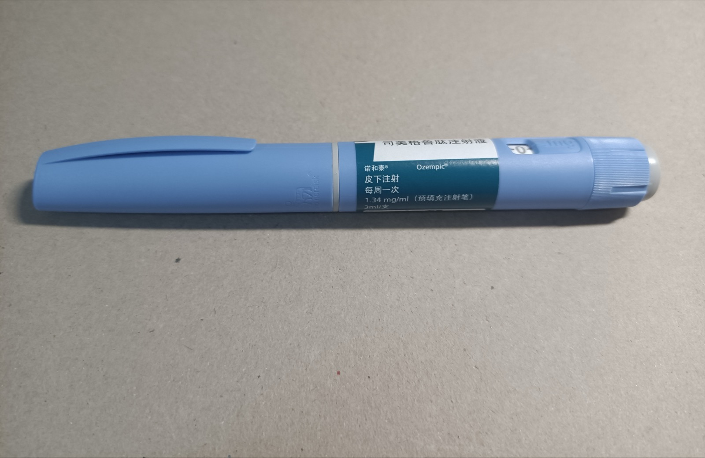

```{r}
#| include: false
source(here::here("R/theme_cours.R"))
source(here::here("R/cm3.R"))   # même fichier que la page de cours
```

## En décembre 2023, des médecins doivent cesser de démarrer des traitements par Ozempic

Déc. 2023 : l'ANSM gèle les nouveaux traitements par Ozempic, Victoza, Trulicity. 5 juin 2025 : reprise pour tous

Cause officielle : « une augmentation importante de la demande mondiale » (ministère de la Santé, 21/05/2024).

::: {.notes}
0 h 00 – 0 h 05. Accroche : qui connaît quelqu'un sous Ozempic ou Wegovy ? Faits arrêtés au 21/10/2026 : la pénurie est terminée.
:::

## Pourtant, son prix n'est pas fixé par un marché mais par l'État

{width=45% fig-alt="Photographie d'un stylo injecteur bleu clair posé sur un fond de carton gris, avec une étiquette verte portant le nom Ozempic et des caractères chinois."}

Une boîte d'Ozempic 1 mg : 76,58 € ; remboursement de 30 % (Base de données publique des médicaments, 21/10/2026).

::: {.notes}
0 h 05 – 0 h 09. Un stylo, un seul laboratoire pour le monde entier. Question : sur un marché ordinaire, que ferait le prix ?
:::

## Trois outils expliquent pourquoi le prix n'a pas réglé la pénurie

1. Le **prix administré**
2. Le **rationnement hors prix**
3. La **rigidité de l'offre**

::: {.notes}
0 h 09 – 0 h 12. Question de séance : pourquoi des diabétiques ont-ils manqué d'Ozempic, et pourquoi le prix n'a-t-il pas réglé la pénurie ?
:::

## Rappel : cinq notions suffisent pour la séance

::: {.rappel}
- **Équilibre** : à P\*, offre et demande égales (Q\*)
- **Déplacer** une courbe : D → D′
- **Élasticité** e : ΔQ (%) ÷ ΔP (%) ; |e| < 1, demande peu élastique
- **Brevet** : droit exclusif pendant 20 ans
- **Asymétrie d'information**
:::

::: {.notes}
0 h 12 – 0 h 17. Lire la page, ne pas redévelopper. Question : une hausse de prix du bien déplace-t-elle la demande ou glisse-t-elle dessus ?
:::

## Un prix fixé par l'État ne s'ajuste pas à la demande

::: {#def-prix-administre}
## Prix administré
Prix fixé par une autorité publique, et non par l'offre et la demande ; il ne change que par une nouvelle décision. En France : « fixé par le CEPS » (M. Coris et B. Bégaud, *The Conversation*, 02/06/2024).
:::

::: {.notes}
0 h 17 – 0 h 21. Un prix administré n'est pas forcément trop bas : tant que la demande est stable, il peut servir tous les patients.
:::

## Un choc de demande déplace la courbe vers la droite

::: {#def-choc-demande}
## Choc de demande
La quantité voulue *à chaque prix* change : D → D′. Choc **positif** : vers la droite.
:::

Pour Ozempic : demande mondiale en hausse, dont des non-diabétiques qui veulent maigrir, un **mésusage** (ANSM).

::: {.notes}
0 h 21 – 0 h 25. Mésusage : usage hors des indications autorisées.
:::

## Il y a pénurie quand, au prix en vigueur, la demande dépasse l'offre

::: {#def-penurie}
## Pénurie
Au prix en vigueur, quantité demandée > quantité offerte. Marché libre : le prix monte, l'écart se referme. Prix administré : l'écart demeure.
:::

::: {.notes}
0 h 25 – 0 h 29. Écart = quantité demandée − quantité offerte.
:::

## Quand le prix ne départage plus, une autre règle décide qui est servi

::: {#def-rationnement}
## Rationnement hors prix
- **File d'attente** : premier arrivé, premier servi
- **Critère** : une condition, par exemple médicale
- **Quota** : quantité limitée par vendeur ou acheteur
:::

::: {.notes}
0 h 29 – 0 h 34. L'ANSM combine critère et quota : « distribution fractionnée (contingentement quantitatif) » en octobre 2024 (ANSM, 03/10/2024).
:::

## À court terme, l'offre d'un médicament est rigide

::: {#def-offre-rigide}
## Offre rigide
La quantité offerte varie très peu avec le prix. Produire plus exige des usines et des autorisations, qui prennent des mois ou des années. À long terme, l'offre devient plus élastique.
:::

::: {.notes}
0 h 34 – 0 h 38. Question : pourquoi payer plus cher ne fait-il pas apparaître des stylos demain ?
:::

## Arrow : la santé n'est pas un marché comme les autres

::: {.auteur}
:::: {.wp-portrait}
{fig-alt="Portrait photographique de Kenneth J. Arrow en 1996, homme âgé aux cheveux blancs, en buste."}
[1996 · Linda A. Cicero, CC BY 3.0, Wikimedia Commons]{.wp-credit}
::::

**Kenneth J. Arrow** (1963), « Uncertainty and the Welfare Economics of Medical Care » · école néoclassique. Maladie imprévisible, patient moins informé que son médecin : la santé repose sur l'assurance, la confiance et des règles collectives.
:::

::: {.notes}
0 h 38 – 0 h 46. Trois traits. HAS : service médical rendu « modéré » (27/08/2025), remboursement à 30 % ; « important » en cas de maladie rénale chronique (16/09/2026), taux inchangé.
:::

## Un choc de demande sous un prix fixé crée une pénurie

```{r}
#| fig-width: 8
#| fig-height: 4.6
#| fig-alt: "Graphique offre-demande. La demande D est une droite décroissante bleue, l'offre O une droite croissante ambre très raide. Une seconde demande D prime, en tirets bleus, est décalée vers la droite. L'équilibre initial E se situe au prix P étoile, marqué prix fixé. Au prix P étoile, un trait rouge marqué pénurie va de l'offre jusqu'à D prime. Plus haut, un point creux E prime, marqué prix libre, se trouve à l'intersection de l'offre et de D prime."
graphe_penurie(base_size = 24)
```

::: {.notes}
0 h 46 – 0 h 55. Suivre la flèche D → D′. Le prix reste à P\* : la pénurie est le trait rouge. E′ : ce qu'un prix libre donnerait. Graphique théorique.
:::

## Chaque étape de la chaîne explique la suivante

1. **Choc** : D → D′ à chaque prix
2. **Prix fixé** : il ne signale plus la rareté
3. **Offre rigide** : quantité offerte proche de Q\*
4. **Pénurie**, donc rationnement
5. **Règle médicale** : le dossier décide, pas le revenu

::: {.notes}
0 h 55 – 1 h 01. Tableau de la page. Demander à l'amphi de refaire la chaîne sans le support.
:::

## Pénurie n'est pas rareté

::: {.piege}
Tout médicament est rare. Il y a pénurie seulement quand, *au prix fixé*, la demande dépasse l'offre, comme entre fin 2023 et juin 2025. Seule la pénurie oblige à rationner autrement que par le prix.
:::

::: {.notes}
1 h 01 – 1 h 05. Erreur très fréquente en copie.
:::

## Exemple : à 75 €, l'offre et la demande sont égales à 100

Marché fictif : Q en milliers de boîtes par mois, P en euros.

| P (€) | 75 | 125 | 175 | 225 | 275 |
|---|---|---|---|---|---|
| D | 100 | 90 | 80 | 70 | 60 |
| D′ | 160 | 150 | 140 | 130 | 120 |
| O | 100 | 105 | 110 | 115 | 120 |

P\* = 75 €, Q\* = 100. e = −10 ÷ 66,7 ≈ **−0,15**.

::: {.notes}
1 h 05 – 1 h 11. De 75 à 125 € : prix +66,7 %, quantité −10 %. Prix fixé de 75 €, arrondi des 76,58 € réels.
:::

## Après le choc, il manque 60 000 boîtes au prix fixé

- D′ = D + 60 à chaque prix
- À 75 € : on demande 160, on offre 100
- Il manque **60** milliers de boîtes, soit 60 ÷ 160 = **37,5 %** des demandes

::: {.notes}
1 h 11 – 1 h 17. Calcul à faire à la main avec l'amphi.
:::

## À prix libre, l'offre rigide fait surtout monter le prix

- À 275 € : 120 demandés, 120 offerts
- Prix : **+267 %** ; quantité : **+20 %**
- Sur 60 000 boîtes manquantes, 20 000 produites en plus ; 40 000 patients renoncent
- Recette : 7,5 → 33 millions d'euros par mois

::: {.notes}
1 h 17 – 1 h 24. 100 000 × 75 € = 7,5 M€ ; 120 000 × 275 € = 33 M€. La hausse paie surtout la pénurie, pas un effort de production.
:::

## Avec une offre rigide, libérer le prix change surtout qui est servi

```{r}
#| fig-width: 8
#| fig-height: 4.6
#| fig-alt: "Deux graphiques côte à côte, avec la même demande D, la même demande déplacée D prime en tirets et le même prix fixé de 75 euros. Dans chacun, un trait rouge horizontal à 75 euros va de 100 à 160 milliers de boîtes. À gauche, panneau A, l'offre est très raide : elle coupe D prime au point creux de 275 euros et 120 milliers de boîtes. À droite, panneau B, l'offre est plus plate : elle coupe D prime au point creux de 150 euros et 145 milliers de boîtes."
graphe_rigidite(base_size = 24)
```

À 75 €, les deux offres valent 100 : à prix fixé, seul le déplacement d'une courbe (O → O′, ou une demande qui recule) referme la pénurie.

::: {.notes}
1 h 24 – 1 h 30. Panneau B, long terme : prix +100 %, quantité +45 %, 15 000 demandes abandonnées seulement. Exemple fictif.
:::

## Pause

15 minutes.

::: {.notes}
1 h 30 – 1 h 45. Pause.
:::

## Même pénurie, mais la règle de rationnement change les perdants

Exemple fictif : 100 000 boîtes pour 160 000 demandes.

| Groupe | Demandes (milliers) |
|---|---|
| Diabétiques déjà traités | 80 |
| Nouveaux, maladie des artères | 20 |
| Autres nouveaux diabétiques | 30 |
| Pour maigrir | 30 |

::: {.notes}
1 h 45 – 1 h 52. Une boîte par patient. Chiffres fictifs.
:::

## La file d'attente interrompt 30 000 traitements, le critère médical aucun

- **File** : 62,5 % de chances d'être servi ; 30 000 traitements interrompus
- **Critère de l'ANSM** : 80 000 + 20 000 = 100 000, aucun traitement interrompu
- **Prix libre** : 120 000 boîtes à 275 €, sans garantie que ce soient les plus malades

::: {.notes}
1 h 52 – 2 h 00. Piège : « le critère a supprimé la pénurie » est faux. Il manque toujours 60 000 boîtes : la règle décide seulement qui subit la pénurie. Le quota par pharmacie doit être combiné avec une autre règle.
:::

## Entre 2023 et 2025, l'État a rationné puis freiné la demande remboursée

| Date | Décision |
|---|---|
| Déc. 2023 | Ne plus commencer de traitement |
| 14/03/2024 | Réservé aux diabétiques de type 2 avec maladie des artères |
| 01/02/2025 | Formulaire du médecin pour le remboursement |
| 05/06/2025 | Ozempic et Victoza de nouveau disponibles |

Sources : ANSM ; Vidal, 16/01/2025

::: {.notes}
2 h 00 – 2 h 06. Sources : ANSM, Vidal 16/01/2025. Septembre-octobre 2024 : reprise progressive sous contingentement. En juin 2025 : « la fin des tensions d'approvisionnement », sans que le prix ait servi à les résorber.
:::

## Les boîtes remboursées cessent de croître en 2024, année du rationnement

```{r}
#| fig-width: 8
#| fig-height: 4.6
#| fig-alt: "Diagramme en barres empilées, une barre par année de 2020 à 2024. Le total passe de 4,29 millions de boîtes en 2020 à 5,12 en 2021, 6,25 en 2022, 7,48 en 2023 et 7,49 en 2024. La part bleue d'Ozempic grossit chaque année. La part ambre de Trulicity augmente jusqu'en 2023 puis diminue en 2024. La part rouge de Victoza diminue chaque année."
graphe_boites_aglp1(base_size = 24)
```

Compatible avec une quantité bloquée par l'offre, sans le prouver : une baisse de la demande donnerait le même chiffre. Source : Assurance Maladie, Medic'AM (21/10/2026).

::: {.notes}
2 h 06 – 2 h 13. +19,7 % en 2023, +0,1 % en 2024. Ozempic +24,6 %, Trulicity −7,7 %, Victoza −49,8 %. On observe la quantité vendue, la plus petite des deux. Les boîtes non remboursées n'y figurent pas.
:::

## Le prix d'Ozempic n'a pas répondu au choc de demande

```{r}
#| fig-width: 8
#| fig-height: 4.6
#| fig-alt: "Graphique à points reliés. En abscisse, les boîtes d'Ozempic remboursées, en millions, de 0 à 4 ; en ordonnée, le prix moyen d'une boîte, en euros, de 0 à 100. Cinq points bleus, de 2020 à 2024, vont de gauche à droite à une hauteur proche de 80 euros, avec une légère baisse à 77,8 euros en 2024 : la ligne est presque horizontale."
graphe_prix_ozempic(base_size = 24)
```

Boîtes ×4,9 ; prix moyen de 80,0 € à 77,8 € (−2,7 %). Source : Assurance Maladie, Medic'AM (21/10/2026).

::: {.notes}
2 h 13 – 2 h 20. Les points ne tracent ni une offre ni une demande : ce sont les couples quantité-prix observés chaque année.
:::

## Ozempic s'écarte du prix plafond sur quatre points

1. Un prix **négocié** avec un seul fabricant, Novo Nordisk
2. Une offre **mondiale et rigide**
3. Une demande qui passe par le **médecin et l'assurance**
4. Pour l'État, un **choc de demande** mondiale

::: {.notes}
2 h 20 – 2 h 24. Brevet : un seul fabricant. Un prix français plus élevé aurait peut-être attiré des stylos aux dépens d'autres pays : déduction du modèle, non fait observé.
:::

## Le modèle éclaire le mécanisme, pas la cause

Il explique **pourquoi** une pénurie dure à prix fixe et pourquoi il faut alors rationner autrement.

Il ne permet pas de conclure qu'un prix plus élevé aurait évité la pénurie d'Ozempic.

::: {.notes}
2 h 24 – 2 h 27. Le ministère invoque un choc de demande mondiale ; le député auteur de la question écrite voyait un médicament « vendu en France à un prix d'achat très bas » (JO du 20/02/2024) (sa question visait surtout le Trulicity).
:::

## À vous : refaire le raisonnement sur Wegovy et Mounjaro en 2026

Depuis le 15 juin 2026, remboursés à 65 % dans l'obésité sévère (Caducée.net, 29/05/2026).

1. Le **choc** : le remboursement baisse le prix payé ; la demande, en fonction du prix public, se déplace-t-elle vers la droite ?
2. L'**offre** : peut-elle suivre ?
3. Le **rationnement** : quelle règle ?

::: {.notes}
2 h 27 – 2 h 31. IMC d'au moins 40, ou d'au moins 35 avec maladie associée. Population visée : environ un million de personnes (Vidal, 28/05/2026). Laisser 2 minutes de réflexion.
:::

## Le critère médical protège les patients déjà traités, pas les nouveaux

- **Santé** : les nouveaux patients sans maladie des artères perdent
- **Revenu** : à 275 €, un patient modeste renonce avant un patient aisé
- **Territoire, génération** : effet non chiffré par les sources de la séance
- **Fabricant** : il ne profite pas de la rente de pénurie

::: {.notes}
2 h 31 – 2 h 37. Le reste à charge dépend de la complémentaire santé. Contingentement : un patient peut trouver son traitement dans une officine et pas dans une autre. Par déduction, non chiffrée : le critère protège les patients installés depuis plus longtemps dans la maladie.
:::

## À court terme, un prix plus élevé fait peu produire

- **Court terme**, offre rigide : un prix plus élevé rationne surtout par la capacité à payer
- **Long terme**, médicaments anciens : « la politique du prix toujours plus bas prévaut » (Coris et Bégaud, 02/06/2024)

::: {.notes}
2 h 37 – 2 h 42. L'article ne porte pas sur Ozempic, médicament récent. Elle pousse à produire dans des pays à bas coûts, ce qui « accentue la dépendance et le risque de pénuries ».
:::

## Le prix ne suffit pas, et la responsabilité du fabricant est discutée

- Suisse et Allemagne, prix supérieurs, « sont aussi touchés » (Public Sénat, 06/07/2023)
- Test-Achats : « principalement la faute » de Novo Nordisk (14/11/2023)

::: {.notes}
2 h 42 – 2 h 47. Industriels : prix français trop faibles sur les médicaments anciens ; la rapporteure du Sénat juge l'analyse trop courte. Le Sénat appelle à un « pilotage public », tout en envisageant des hausses de prix « sous certaines conditions ».
:::

## Trois jugements restent ouverts : qui servir, combien payer, quelle liberté

- **Qui servir d'abord ?** Les plus malades, les premiers arrivés, ou ceux qui paient le plus ?
- **Combien payer ?** Coût pour l'Assurance maladie, effet incertain à court terme
- **Quelle liberté** pour le médecin ?

::: {.notes}
2 h 47 – 2 h 52. Normatif : l'analyse ne tranche pas. Vote à main levée : qui servir d'abord ?
:::

## Les écoles divergent sur le poids de l'offre de demain et de l'accès aux soins

- **Approche par le marché** : le prix est un signal ; un prix bas prépare les pénuries de demain
- **Économie de la santé** (Arrow) : des priorités médicales collectives servent mieux qu'un prix libre

::: {.notes}
2 h 52 – 2 h 56. Les deux camps partent du même cadre néoclassique. Le débat porte moins sur le mécanisme, admis par tous, que sur le poids donné à l'offre de demain et à l'accès de chacun aux soins aujourd'hui.
:::

## Le droit agit ici sur la demande remboursée, non sur le prix

::: {.droit}
Code de la sécurité sociale, art. L162-19-1 : remboursement « subordonné au renseignement par le prescripteur d'éléments relatifs aux circonstances et indications ». Appliqué à Ozempic depuis le 1^er^ février 2025 (Vidal, 16/01/2025).
:::

::: {.notes}
2 h 56 – 2 h 58. Loi de financement de la sécurité sociale pour 2024, art. 73 ; décret n° 2024-968 du 30 octobre 2024.
:::

## Un prix fixé ne règle pas une pénurie : il faut choisir qui servir

::: {.retenir}
- Prix administré : si D → D′, la pénurie demeure
- Sans prix, il faut rationner : file, critère ou quota
- La règle décide **qui** subit la pénurie
- À prix fixé, seul le déplacement d'une courbe (O → O′, ou une demande qui recule) referme la pénurie
- La santé n'est pas un marché ordinaire (Arrow, 1963)
:::

::: {.notes}
2 h 58 – 3 h 00. Revenir au pari du début : le prix pouvait-il régler la pénurie ?
:::

## Le plan de dissertation : ce que dit l'outil, ce qu'il ne tranche pas

**I. Ce que dit l'outil** : D → D′ au prix fixé donne une pénurie, qu'il faut rationner.

**II. Ce qu'il ne tranche pas** : un prix plus élevé aurait-il évité la pénurie ? Qui servir d'abord ?

::: {.notes}
3 h 00. Fin de séance. TD 3 : prix bloqués.
:::
