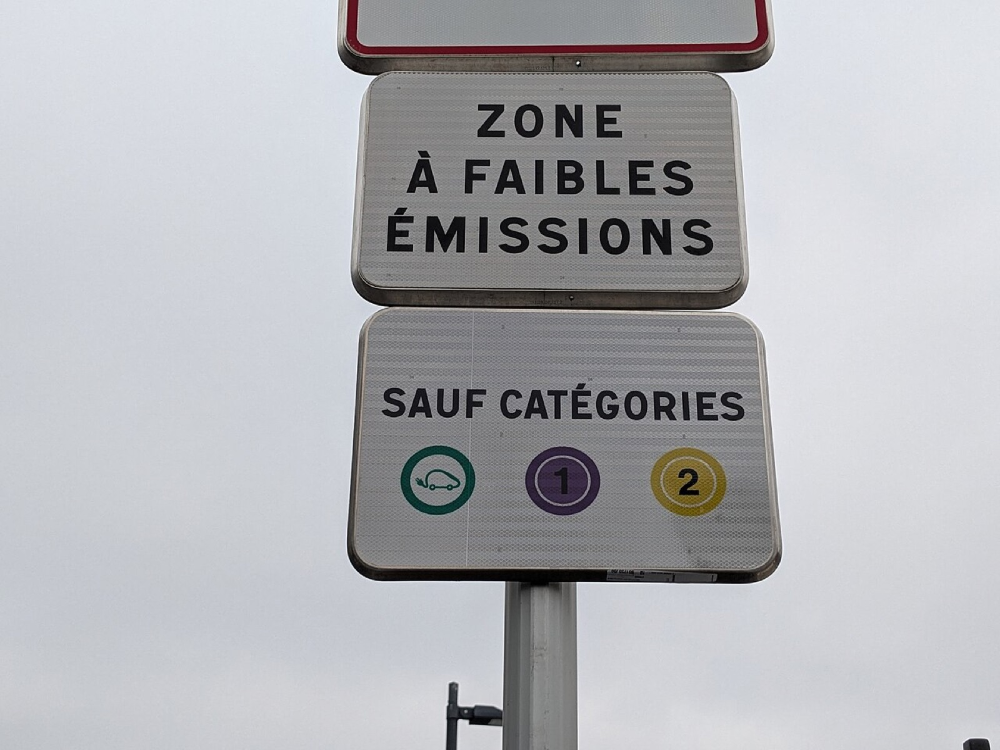
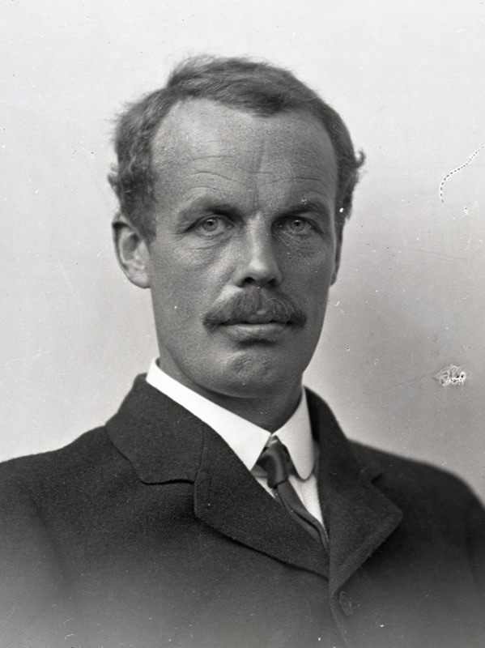
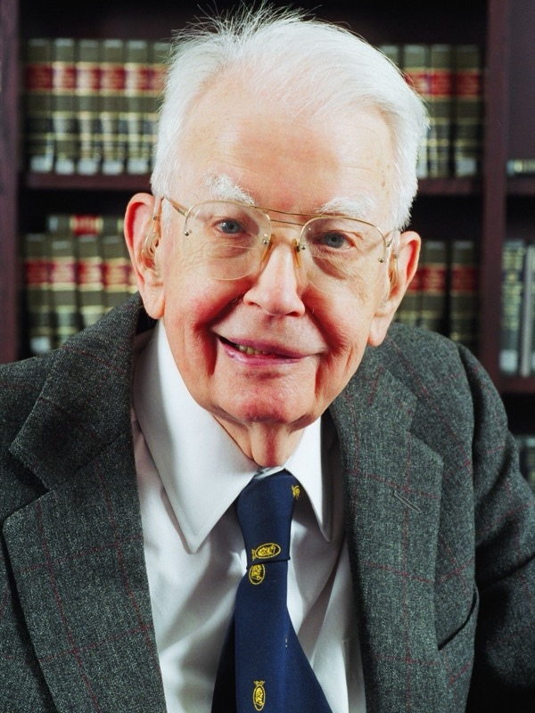

```{r}
#| include: false
source(here::here("R/theme_cours.R"))
source(here::here("R/cm5.R"))   # même fichier que la page de cours
```

## Le 8 octobre 2026, le débat sur la suppression des ZFE s'arrête à minuit, sans vote

- Texte non adopté (LCP, 09/10/2026, [lien](https://lcp.fr/actualites/zfe-le-rn-ne-parvient-pas-a-faire-voter-leur-suppression-lors-de-sa-niche-parlementaire))
- 21 mai 2026 : article censuré pour vice de procédure (décision n° 2026-903 DC)
- 25 agglomérations de l'Hexagone avaient une ZFE au 1^er^ janvier 2025 (*The Conversation*, 11/06/2026)

::: {.notes}
0 h 00 – 0 h 06. Accroche. Qui connaît la vignette Crit'Air dans l'amphi ? Le statut juridique est arrêté au 21/10/2026 ; le raisonnement n'en dépend pas. À Clermont-Ferrand, la restriction ne vise que les véhicules utilitaires (Insee Analyses n° 124, 27/08/2026).
:::

## Une ZFE interdit les voitures les plus anciennes, repérées par leur vignette

{fig-alt="Photographie d'un poteau portant deux panneaux : en haut « Zone à faibles émissions », en bas « Sauf catégories » avec trois pastilles, véhicule électrique en vert, Crit'Air 1 en violet et Crit'Air 2 en jaune." width=60%}

::: {.notes}
0 h 06 – 0 h 10. Lecture : seuls passent les électriques, Crit'Air 1 et 2. Une voiture plus ancienne ne peut pas entrer, quel que soit le nombre de kilomètres parcourus.
:::

## Trois faits intriguent

1. Tous admettent que la pollution nuit à la santé, mais la mesure divise.
2. Les ZFE font baisser les émissions, mais bien moins que la baisse totale (Insee, 27/08/2026).
3. Les ménages modestes, qui polluent peu, changent souvent de voiture.

::: {.notes}
0 h 10 – 0 h 14. Question à l'amphi : lequel de ces trois faits vous surprend le plus ? Ne pas répondre encore.
:::

## Qui doit payer la transition automobile : le pollueur, le contribuable ou le riverain ?

Trois outils :

- le coût marginal social
- taxe, norme ou subvention
- l'effet propre d'une politique

::: {.notes}
0 h 14 – 0 h 18. Annoncer le plan. Cette séance est la première du programme du CC2.
:::

## Rappel : une externalité, c'est un coût que personne ne paie

::: {.rappel}
- **Externalité** : l'action d'un agent modifie le bien-être d'un autre sans compensation.
- **Cm** : coût d'une unité de plus ; **D** : bénéfice marginal.
- **Perte sèche** : surplus perdu quand on s'écarte de la meilleure quantité.
:::

::: {.notes}
0 h 18 – 0 h 24. Rappels à lire vite : incidence (celui qui verse un impôt n'est pas toujours celui qui le supporte) ; positif et normatif. Ne pas redévelopper.
:::

## Le marché oublie la pollution : Pigou propose une taxe égale au dommage

::: {.auteur}
:::: {.wp-portrait}
{fig-alt="Portrait photographique d'Arthur Cecil Pigou vers 1920, homme en costume, en buste."}
[Vers 1920 · John Palmer Clarke, domaine public, Wikimedia Commons]{.wp-credit}
:::

**Arthur Cecil Pigou** (1920), *The Economics of Welfare* · école néoclassique. Le coût privé est inférieur au coût social, et le marché produit trop. Une taxe égale au dommage de la dernière unité rapproche les deux.
:::

::: {.notes}
0 h 24 – 0 h 29. L'automobiliste compare ce que le trajet lui apporte à carburant, usure, temps. Il ne compte pas les oxydes d'azote et les particules fines que respirent les riverains.
:::

## Le coût pour la société dépasse le coût privé : Cms = Cm + Dm

::: {#def-dommage-marginal}
## Dommage marginal
**Dm** : coût que la dernière unité impose aux autres, sans compensation.
:::

::: {#def-cout-marginal-social}
## Coût marginal social
**Cms = Cm + Dm**.
:::

::: {.notes}
0 h 29 – 0 h 33. Ici, Dm est le coût pour la santé des riverains d'un trajet de plus en voiture polluante. Avec une externalité négative, Cms est au-dessus de Cm.
:::

## Le marché s'arrête en Q*, la société voudrait s'arrêter en Q°

::: {#def-optimum}
## Optimum social
**Q°** : D égale Cms. Le marché s'arrête en **Q\***, où D égale Cm. Avec une externalité négative, Q\* > Q° : on roule trop.
:::

::: {.notes}
0 h 33 – 0 h 40. Question à l'amphi : l'optimum, est-ce zéro pollution ? Non. Un trajet qui vaut 20 € à son auteur et coûte 6 € à la société mérite d'être fait ; seuls sont de trop les trajets qui valent moins que ce qu'ils coûtent à tous.
:::

## Entre Q° et Q*, chaque trajet coûte plus qu'il ne rapporte : c'est la perte sèche

```{r}
#| label: fig-externalite
#| fig-width: 8
#| fig-height: 4.6
#| fig-alt: "Graphique avec une demande D décroissante en bleu, une droite horizontale Cm en ambre au niveau P étoile et une droite horizontale Cms en tirets ambre au niveau P étoile plus Dm. Une flèche rouge marquée Dm mesure l'écart entre les deux droites. La demande coupe Cm au point E, en Q étoile, et Cms au point E rond, en Q rond, à gauche de Q étoile. Un triangle rouge marqué perte sèche relie E rond, le point de Cms au-dessus de E, et E."
graphe_externalite(base_size = 24)
```

Graphique théorique.

::: {.notes}
0 h 40 – 0 h 48. Lecture : les trajets entre Q° et Q* valent moins que ce qu'ils coûtent à la société ; le triangle rouge est la perte sèche. Chaque trajet rapporte à son auteur plus que Cm, mais moins que Cms.
:::

## Exemple chiffré : un trajet vaut 12 − Q, coûte 4 € et pollue pour 2 €

Agglomération fictive. Q en milliers de trajets par jour, P en euros.

- Valeur d'un trajet : P = 12 − Q
- Cm = 4 € ; Dm = 2 €

::: {.notes}
0 h 48 – 0 h 52. Le premier trajet vaut presque 12 €, le 8 000^e^ seulement 4 €.
:::

## Marché : Q* = 8 000 trajets. Optimum : Q° = 6 000

1. Marché : 12 − Q = 4, donc **Q\* = 8**
2. Cms = 4 + 2 = **6 €**
3. Optimum : 12 − Q = 6, donc **Q° = 6**

2 000 trajets de trop.

::: {.notes}
0 h 52 – 0 h 58. Faire calculer à l'amphi avant de projeter, à la main.
:::

## Les 2 000 trajets de trop font perdre 2 000 € par jour

- Le 6 001^e^ trajet vaut 6 € et coûte 6 € : il ne perd rien.
- Le 8 000^e^ vaut 4 € et coûte 6 € : il perd 2 €.
- Perte sèche = ½ × 2 × 2 = **2 000 € par jour**

::: {.notes}
0 h 58 – 1 h 03. En moyenne, les 2 000 trajets de trop perdent 1 € chacun. C'est le triangle de la figure.
:::

## Pause

Reprise dans 15 minutes.

::: {.notes}
1 h 03 – 1 h 18. Pause. Reprise sur la taxe.
:::

## Une taxe de 2 € ramène les conducteurs à 6 000 trajets

```{r}
#| label: fig-taxe
#| fig-width: 8
#| fig-height: 4.6
#| fig-alt: "Même graphique que le précédent, sans le triangle rouge. Un rectangle gris marqué recette égale t fois Q rond s'étend de l'axe vertical jusqu'à Q rond, entre Cm et Cms. La flèche rouge entre Cm et Cms est marquée t égale Dm."
graphe_externalite(taxe = TRUE, base_size = 24)
```

Chiffres fictifs. Recette : 2 × 6 = 12 000 € par jour.

::: {.notes}
1 h 18 – 1 h 25. Avec t = Dm = 2 €, le trajet coûte 6 € au conducteur : il s'arrête de lui-même en Q°. Les riverains gagnent 2 × 2 000 = 4 000 € ; les conducteurs perdent 2 000 € de surplus sur les trajets abandonnés. Bilan +2 000 €, exactement la perte sèche supprimée.
:::

## Les 12 000 € de taxe ne sont pas perdus : ils passent à l'État

::: {.piege}
« La taxe coûte plus cher aux conducteurs, donc à la société. » C'est faux : la recette est un **transfert**, que l'État peut rendre.
:::

::: {.notes}
1 h 25 – 1 h 29. Taxe et norme bien ciblée font le même gain pour la société (+2 000 € par jour) ; seul change qui paie.
:::

## Une norme mal ciblée peut faire plus de mal que de bien

- Bien ciblée (les trajets à 4–6 €) : +2 000 €
- Une ZFE interdit des vignettes, pas les trajets les moins utiles.
- Si elle écarte 2 000 trajets à 10 € : 4 000 − 12 000 = **−8 000 €**

::: {.notes}
1 h 29 – 1 h 35. Les conducteurs écartés perdent chacun 10 − 4 = 6 €, soit 12 000 € par jour ; la pollution évitée reste de 4 000 €. Pour la subvention : l'État paie 2 € par trajet évité, on retombe à 6 000 trajets, mais le contribuable paie 4 000 € par jour.
:::

## Même objectif, quatre payeurs différents

| Instrument | Qui paie ? |
|---|---|
| Taxe t = 2 € | les conducteurs : 12 000 € + 2 000 € |
| Norme bien ciblée | les conducteurs écartés : 2 000 € |
| Subvention | les contribuables : 4 000 € |
| Rien | les riverains : 16 000 € |

Chiffres fictifs, montants par jour.

::: {.notes}
1 h 35 – 1 h 42. Dans les trois premières lignes, les riverains subissent encore 12 000 € de pollution par jour. La taxe applique le principe pollueur-payeur ; la norme ne fait payer que l'effort ; la subvention fait payer le contribuable. Question à l'amphi : quel instrument choisiriez-vous, et pourquoi ?
:::

## Choisir un instrument, c'est choisir qui détient le droit

::: {.auteur}
:::: {.wp-portrait}
{fig-alt="Portrait photographique de Ronald Coase en 2003, homme âgé à lunettes, en buste."}
[2003 · University of Chicago Law School, licence Attribution, Wikimedia Commons]{.wp-credit}
:::

**Ronald Coase** (1960), « The Problem of Social Cost » · école de Chicago. Le dommage est réciproque. Si les droits sont clairs et la négociation peu coûteuse, les parties trouvent la bonne quantité ; le droit décide de qui paie.
:::

::: {.notes}
1 h 42 – 1 h 47. Dans une grande agglomération, les coûts de transaction sont trop élevés : l'État tranche. Si les riverains ont droit à un air sain, les automobilistes paient ; sinon, riverains ou contribuable paient.
:::

## Fixer le prix ou la quantité : tout dépend de l'erreur la plus grave

::: {.auteur}
:::: {.wp-portrait}
{fig-alt="Portrait photographique de Martin Weitzman en 2015, homme âgé à lunettes, en buste."}
[2015 · European University Institute, CC BY-SA 2.0, recadré, Wikimedia Commons]{.wp-credit}
:::

**Martin Weitzman** (1974), « Prices vs. Quantities » · économie publique. Quantité si le dommage grimpe vite au-delà d'un seuil, plus vite que le coût de l'effort ; prix si le dommage de chaque unité est à peu près le même.
:::

::: {.notes}
1 h 47 – 1 h 52. Le régulateur connaît mal le coût de l'effort de dépollution. Une taxe fixe le prix mais laisse la quantité incertaine ; une norme fixe la quantité mais laisse le coût incertain.
:::

## Avec une demande incertaine, la taxe fixe le prix et la norme fixe la quantité

```{r}
#| label: fig-weitzman
#| fig-width: 8
#| fig-height: 4.4
#| fig-alt: "Deux graphiques côte à côte avec deux demandes parallèles, D en trait plein et D prime en tirets, et un coût Cm horizontal à 4 euros. À gauche, panneau A, une droite en tirets ambre Cm plus t à 6 euros coupe D à 5 et D prime à 7 ; un trait rouge sous les points marque la quantité incertaine, de 5 à 7. À droite, panneau B, une droite verticale noire marquée norme, à 6, coupe D à 5 euros et D prime à 7 euros ; un trait rouge vertical près de l'axe marque le coût incertain, de 5 à 7 euros."
graphe_weitzman(base_size = 24)
```

Chiffres fictifs.

::: {.notes}
1 h 52 – 1 h 58. Panneau A : taxe, 5 000 ou 7 000 trajets. Panneau B : norme de 6 000 trajets, le dernier trajet permis vaut 5 € ou 7 €. La taxe rend la quantité incertaine, la norme rend le coût incertain. Demande basse P = 11 − Q ou haute P = 13 − Q, une chance sur deux.
:::

## Si le dommage est constant, la taxe tombe juste ; s'il grimpe, la norme l'emporte

- Dm = 2 € toujours : la norme se trompe de 1 000 trajets, soit **500 € de perte par jour**.
- Dommage qui grimpe au-delà de 6 000 : la norme garantit 6 000.

::: {.notes}
1 h 58 – 2 h 03. Chaque erreur coûte un petit triangle : ½ × 1 × 1 = 500 €.
:::

## Pour le NO₂, le droit européen fixe un plafond : c'est l'argument de Weitzman

- Valeurs limites de concentration ; la France condamnée pour des dépassements « de manière systématique et persistante » (*The Conversation*, 11/06/2026)
- Pour le CO₂, un prix se défend : le dommage d'une tonne de plus est à peu près constant.

::: {.notes}
2 h 03 – 2 h 08. Ce seuil est fixé par le droit : au-delà, la sanction rend le dépassement très coûteux. Une ZFE n'en est qu'une approximation : elle interdit des vignettes sans plafonner les émissions.
:::

## Pour juger une politique, il faut comparer avec ce qui se serait passé sans elle

::: {#def-contrefactuel}
## Contrefactuel et effet propre
Le **contrefactuel** est ce qui se serait passé sans la politique. L'**effet propre** est l'écart entre l'observé et ce contrefactuel.
:::

::: {.notes}
2 h 08 – 2 h 12. On ne l'observe jamais : on l'estime en suivant des territoires comparables qui ne l'ont pas appliquée.
:::

## Deux différences isolent l'effet : −39 − (−34) = −5 points

Chiffres fictifs.

- Villes à ZFE : 100 → 61, soit −39 %
- Villes témoins : 100 → 66, soit −34 %
- Effet propre : **5 points**, et non 39 %

::: {.notes}
2 h 12 – 2 h 17. Un point de pourcentage est l'écart entre deux pourcentages. Cette méthode s'appelle les doubles différences.
:::

## Pour les oxydes d'azote, la ZFE explique 4,6 points sur une baisse de 38,9 %

```{r}
#| label: fig-effet-zfe
#| fig-width: 8
#| fig-height: 4.6
#| fig-alt: "Graphique en barres horizontales pour trois polluants. Oxydes d'azote : moins 38,9 % observé, moins 34,3 % estimé sans ZFE, effet moins 4,6 points. Particules fines : moins 31,1 % observé, moins 29,6 % sans ZFE, effet moins 1,4 point. Dioxyde de carbone : moins 10,0 % observé, moins 8,2 % sans ZFE, effet moins 1,7 point."
graphe_effet_zfe(base_size = 24)
```

Source : Insee, *Insee Analyses* n° 124, 27/08/2026.

::: {.notes}
2 h 17 – 2 h 24. Champ : ZFE mises en place jusqu'en 2023, sauf Nice, Grenoble et Toulouse ; de trois ans avant à deux ans après. L'Insee compare neuf intercommunalités à 26 sans ZFE. Intervalle de confiance : la fourchette dans laquelle le contrefactuel se situe très probablement.
:::

## L'essentiel du verdissement du parc se serait produit sans ZFE

```{r}
#| label: fig-parc-zfe
#| fig-width: 8
#| fig-height: 5.6
#| fig-alt: "Graphique en barres horizontales pour cinq groupes de vignettes. Crit'Air 1 et électriques : plus 88,4 % observé, plus 82,6 % sans ZFE, effet plus 5,8 points. Crit'Air 2 : moins 4,3 % observé, plus 2,8 % sans ZFE, effet moins 7,1 points. Crit'Air 3 : moins 34,5 % observé, moins 30,0 % sans ZFE, effet moins 4,5 points. Crit'Air 4 : moins 53,6 % observé, moins 48,1 % sans ZFE, effet moins 5,5 points. Crit'Air 5 et non classées : moins 64,1 % observé, moins 62,0 % sans ZFE, effet non significatif."
graphe_parc_zfe(base_size = 24)
```

Source : Insee, *Insee Analyses* n° 124, 27/08/2026.

::: {.notes}
2 h 24 – 2 h 30. Pour les Crit'Air 5 et non classées, la baisse observée (−64,1 %) reste dans l'intervalle de confiance du contrefactuel : on ne peut pas dire que la ZFE y soit pour quelque chose.
:::

## « La ZFE a fait baisser les émissions de 38,9 % » est faux, et « elle ne sert à rien » aussi

::: {.piege}
Elles auraient baissé de 34,3 % sans ZFE. L'effet est petit, mais mesuré et différent de zéro. Un avant-après ne suffit jamais : il faut un contrefactuel.
:::

::: {.notes}
2 h 30 – 2 h 34. Question à l'amphi : que répondre à quelqu'un qui dit « les émissions ont baissé grâce aux ZFE » ?
:::

## La norme vise la vignette, pas le kilomètre

- Les voitures des résidents ne roulent pas significativement moins.
- Crit'Air 5 et non classées : environ 6 % du parc trois ans avant la ZFE, moins de 5 % à sa mise en place.
- Environ 12 600 contraventions liées aux ZFE en 2019, 2 300 en 2024 (Insee, 27/08/2026)

::: {.notes}
2 h 34 – 2 h 38. La ZFE change quelle voiture on conduit, pas combien on roule. Les ménages réagissent dès l'annonce de 2019 : la norme agit par les anticipations. Une taxe par kilomètre pollué jouerait sur les deux.
:::

## Les ménages modestes changent de voiture, alors qu'ils polluent peu au total

- Effet plus marqué dans les communes à revenu intermédiaire ou modeste (Insee, 27/08/2026)
- Île-de-France : les 20 % les plus pauvres, 9 % de la pollution automobile (Poulhès, 23/06/2025)

::: {.notes}
2 h 38 – 2 h 43. C'est l'étape 7 de l'exemple : la norme demande l'effort selon l'âge de la voiture, pas selon la pollution émise. Huit villes étudiées : employés et ouvriers les plus touchés dans six (Liotta, 27/11/2024). Gains de santé : les études divergent (surtout aux plus riches à Paris, l'inverse à Bruxelles, selon Liotta ; « également répartis » en région parisienne, selon une étude citée par Poulhès) ; la question reste ouverte.
:::

## Une taxe sur le carburant toucherait plus souvent les ménages ruraux

```{r}
#| label: fig-carburant
#| fig-width: 8
#| fig-height: 4.6
#| fig-alt: "Graphique en barres horizontales pour trois territoires, avec deux barres chacun. Urbain : 9,0 % aux prix de 2021, 18,8 % aux prix du printemps 2026. Rural : 13,5 % et 29,0 %. Ensemble : 10,6 % et 22,4 %."
graphe_carburant(base_size = 24)
```

Source : Insee, *Insee Première* n° 2125, 08/09/2026.

::: {.notes}
2 h 43 – 2 h 49. Part des ménages avec voiture consacrant plus d'un mois de revenu par an au carburant. En 2021 : 13,5 % en rural, 9,0 % en urbain ; aux prix du printemps 2026, 29,0 % contre 18,8 %. Changer d'instrument, c'est changer de perdants. Par génération : 77,9 % des ménages très exposés ont un membre en emploi.
:::

## Le coût tombe sur les propriétaires de vieilles voitures, le bénéfice sur les habitants de la zone

| Étape | Qui est concerné |
|---|---|
| 1. La règle | Propriétaires de voitures anciennes |
| 2. La réaction | Ménages modestes et intermédiaires |
| 3. Le parc | Territoires sans restriction, non voisins |
| 4. L'air | Habitants de la zone |

::: {.notes}
2 h 49 – 2 h 51. Source : synthèse de la page (Insee, 27/08/2026 ; 08/09/2026). Ce ne sont pas toujours les mêmes personnes. Leasing social 2025 : 50 000 aides, environ 49 600 utilisées, financées par les CEE (L'Info durable, 30/12/2025) ; effet d'aubaine possible.
:::

## Le Conseil constitutionnel a censuré la suppression des ZFE sans se prononcer sur le fond

::: {.droit}
Décision n° 2026-903 DC du 21 mai 2026 : censure pour une raison de procédure (article 45 de la Constitution), l'article supprimant les ZFE ayant été ajouté à la loi sans lien avec son contenu initial. Au 21/10/2026, les ZFE restent en vigueur.
:::

::: {.notes}
2 h 51 – 2 h 53. La censure porte sur la forme, pas sur le fond : le juge ne dit pas si supprimer les ZFE est bon ou mauvais.
:::

## Ce que l'analyse établit, et ce qui relève d'un jugement

- **Positif** : la pollution est une externalité ; l'effet propre des ZFE est modeste.
- **Normatif** : qui détient le droit ? efficacité ou équité ? quel poids à la santé ?

::: {.notes}
2 h 53 – 2 h 56. Les positions : suppression jugée injuste (France 24, 29/05/2025 ; exposé des motifs de la proposition de loi n° 2970, 23/06/2026) ; Liotta : accompagner ; Poulhès : l'argument social ne justifie pas la suppression. Aucune position partisane. Le statut au 21/10/2026 : les ZFE restent en vigueur.
:::

## Ce qu'il faut retenir

::: {.retenir}
- Cms = Cm + Dm : le marché produit trop.
- Une taxe égale à Dm mène à Q° ; sa recette est un transfert.
- Taxe, norme, subvention : même quantité, payeurs différents.
- Dommage qui grimpe : norme ; dommage constant : prix.
- Effet propre = observé − contrefactuel : 4,6 points sur 38,9 % (Insee, 27/08/2026).
:::

::: {.notes}
2 h 56 – 2 h 59. Qui doit payer relève d'un jugement ; l'analyse dit qui paie avec chaque instrument.
:::

## Plan de dissertation : ce que dit l'outil, ce qu'il ne tranche pas

I. Ce que dit l'analyse : Cms, Q°, instruments, effet propre

II. Ce qu'elle ne tranche pas : qui détient le droit, efficacité contre équité

::: {.notes}
2 h 59 – 3 h 00. Annoncer le CC2 et la suite. Sujet type : « Faut-il garder les ZFE ? ».
:::
