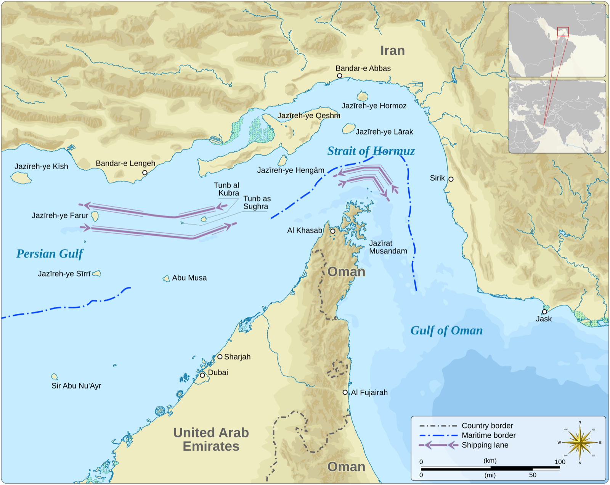

```{r}
#| include: false
source(here::here("R/theme_cours.R"))
source(here::here("R/cm7.R"))   # même fichier que la page de cours
```

## Le fait de départ : la fermeture du détroit d'Ormuz (28/02/2026)

- La guerre déclenchée le 28/02/2026 ferme de fait le détroit d'Ormuz (Insee, *Note de conjoncture*, 24/03/2026).

. . .

- Conséquence sur les prix : inflation de la zone euro à **3,8 %** en septembre 2026, contre 2,2 % un an plus tôt ; l'énergie en apporte 1,7 point (Eurostat, 16/10/2026).

. . .

- Réaction de la BCE : taux de dépôt de 2,00 % à **2,25 %** (17/06/2026), puis **2,50 %** (16/09/2026) (BCE).

. . .

**Question de la séance** : pourquoi la BCE relève-t-elle ses taux face à un choc d'énergie ?

::: {.notes}
0 h 00 – 0 h 04. Faits arrêtés au 21/10/2026. La BCE se réunit de nouveau les 28-29/10 et les 16-17/12/2026 (BCE, calendrier) : si les taux ont changé, le raisonnement reste valable. Dans les heures suivant le 28/02, le détroit est fermé de fait. Énergie : +18,9 % sur un an ; hors énergie : +2,3 % (Eurostat, communiqué du 16/10/2026). Décisions des 11/06 et 10/09, en vigueur quelques jours plus tard ; ce sont les premières hausses depuis 2023 ; le taux était à 2,00 % depuis le 11/06/2025. Question à l'amphi : qui a remarqué la hausse des prix de l'énergie ces derniers mois ? Transition : où se trouve ce détroit ?
:::

## Le détroit d'Ormuz : un obstacle physique, et non monétaire

:::: {.columns}
::: {.column width="60%"}
{height="380px" fig-alt="Carte en couleurs du détroit d'Ormuz. Le golfe Persique, à gauche, communique avec le golfe d'Oman, à droite, par un passage étroit entre la côte iranienne au nord et la péninsule omanaise de Musandam au sud. Deux couloirs de navigation, l'un dans chaque sens, sont tracés en violet et suivent ce passage. Les Émirats arabes unis bordent le golfe Persique au sud."}

[Carte : Goran tek-en, CC BY-SA 4.0, Wikimedia Commons (d'après OpenStreetMap).]{.wp-source}
:::

::: {.column width="40%"}
- Tout le trafic maritime entre le golfe Persique et l'océan passe par ce passage étroit, entre l'Iran et Oman.

::: {.fragment}

- L'obstacle est un passage bloqué : une hausse des taux ne le lève pas.
- La BCE ne produit pas de pétrole.
:::
:::
::::

::: {.notes}
0 h 04 – 0 h 07. Les flèches violettes sont les couloirs de navigation, un dans chaque sens. Question à l'amphi : une banque centrale peut-elle agir sur le prix du pétrole ? Transition : que deviennent les prix du pétrole et du gaz ?
:::

## Pétrole et gaz : le choc de 2026 est plus faible qu'en 2022

:::: {.columns}
::: {.column width="60%"}
```{r}
#| fig-width: 8
#| fig-height: 5.4
#| fig-alt: "Deux graphiques en lignes côte à côte, de 2021 à septembre 2026, avec des pointillés fin février 2022 et fin février 2026. À gauche, le baril de Brent en euros : pic à 114 € en juin 2022, puis 101 € en septembre 2026, après une remontée brutale en mars et avril 2026. À droite, le gaz européen en euros par mégawattheure : pic à 236 € en août 2022, puis 75 € en septembre 2026."
graphe_petrole_gaz(base_size = 24)
```

[Sources : Banque mondiale, Pink Sheet ; BCE, taux de change (consultés le 22/10/2026).]{.wp-source}
:::

::: {.column width="40%"}
- Brent : 60 € (févr. 2026), **103 €** (avril), 101 € (sept.) ; pic de 2022 : 114 €.

::: {.fragment}

- Gaz : **75 €** le MWh (sept. 2026), environ trois fois moins qu'en août 2022 (236 €).
- C'est surtout le gaz qui distingue les deux chocs.
:::
:::
::::

::: {.notes}
0 h 07 – 0 h 10. Prix moyens du mois, en euros (prix publiés en dollars, convertis au taux de change moyen du mois). Ce sont des prix de gros : le Brent est un pétrole brut de référence, le TTF le prix du gaz aux Pays-Bas, référence en Europe ; ce ne sont pas les prix payés par les ménages. Chaque panneau a sa propre échelle. MWh : mégawattheure. Question : pourquoi le gaz compte-t-il autant pour l'Europe ? Transition : la BCE a déjà connu un tel choc, en 2022.
:::

## Le précédent de 2022 : 10,6 % d'inflation, dix hausses de taux

:::: {.columns}
::: {.column width="60%"}
```{r}
#| fig-width: 8
#| fig-height: 5.4
#| fig-alt: "Graphique en lignes de 2021 à fin 2026. Le taux de dépôt de la BCE, en bleu et en escalier, reste à moins 0,5 % jusqu'en juillet 2022, monte par marches jusqu'à 4 % en septembre 2023, redescend à 2 % en juin 2025, puis remonte à 2,5 % en septembre 2026. L'inflation de la zone euro, en ambre, culmine à 10,6 % en octobre 2022, oscille autour de 2 % en 2024 et 2025, puis remonte à 3,8 % en septembre 2026. Une ligne pointillée marque la cible de 2 %."
graphe_taux_inflation(base_size = 24, etape = 1)
```
:::

::: {.column width="40%"}
- Après l'invasion de l'Ukraine, l'inflation de la zone euro atteint **10,6 %** en octobre 2022.

::: {.fragment}

- La BCE relève alors ses taux **dix fois**, de juillet 2022 à septembre 2023 : le taux de dépôt passe de −0,50 % à **4,00 %**.
:::
:::
::::

::: {.notes}
0 h 10 – 0 h 13. Lire le graphique : le taux de dépôt est en escalier, il ne change qu'aux décisions de la BCE ; l'inflation est la variation des prix sur un an, chaque mois. Question : que voit-on en 2026 par rapport à 2022 ? Transition : trois faits intriguent.
:::

## Trois faits à expliquer, une question, deux outils

::: {.incremental}
1. La BCE ne produit pas de pétrole : relever un taux d'intérêt ne rouvre pas un détroit.
2. En 2026, elle agit dès 3,2 % d'inflation (mai 2026) ; en 2022, à 8,6 % (juin 2022) (Eurostat).
3. En 2026, elle relève son taux de 0,50 point ; en 2022-2023, de 4,50 points.
:::

. . .

**Question** : pourquoi relever les taux face à un choc d'énergie, et pourquoi pas de la même façon en 2022 et en 2026 ? Deux outils : le **taux d'intérêt réel** et la **règle de Taylor**.

::: {.notes}
0 h 13 – 0 h 16. Faire réagir l'amphi à chaque fait avant le clic suivant. Fait 2 : l'inflation retenue est celle du mois qui précède la première hausse. Transition : avant les outils, les notions nécessaires.
:::

## Rappel : inflation, grandeurs nominales et réelles, taux d'intérêt

::: {.rappel}
- **Inflation** : hausse générale et durable des prix. On la mesure par la variation, sur un an, d'un indice des prix à la consommation.
- **Nominal et réel** : une grandeur **nominale** est mesurée en euros courants ; une grandeur **réelle** est corrigée de la hausse des prix et mesure ce que l'on peut acheter.
- **Taux d'intérêt** : prix du crédit, en pourcentage par an de la somme prêtée.
:::

::: {.notes}
0 h 16 – 0 h 19. Rappel rapide, sans redéfinir longuement. Question : un salaire qui augmente moins vite que les prix augmente-t-il en nominal, en réel, ou les deux ? (En nominal seulement ; en réel, il baisse.) Transition : trois autres notions.
:::

## Rappel : création monétaire, choc d'offre, positif et normatif

::: {.rappel}
- **Création monétaire** : les banques créent de la monnaie quand elles accordent des crédits ; la banque centrale fournit aux banques la monnaie dont elles ont besoin entre elles (CM 6).
- **Choc d'offre** : événement qui déplace la courbe d'offre (O → O′) ; un choc négatif fait monter le prix et baisser la quantité (CM 1).
- **Positif et normatif** : ce qui est (on peut le vérifier) et ce qui devrait être (cela dépend d'un jugement).
:::

::: {.notes}
0 h 19 – 0 h 22. Lien à garder en tête : si la banque centrale rend le crédit plus cher, les banques prêtent moins, donc créent moins de monnaie. Transition : la première théorie relie monnaie et prix.
:::

## Théorie quantitative : trop de monnaie pour trop peu de biens

::: {.auteur}
::: {.wp-portrait}
{fig-alt="Portrait photographique de Milton Friedman en 1976, homme âgé à lunettes, en buste."}
[1976 · UPI, domaine public, Wikimedia Commons]{.wp-credit}
:::

**Irving Fisher** (1911), *The Purchasing Power of Money* ; **Milton Friedman et Anna J. Schwartz** (1963), *A Monetary History of the United States, 1867-1960* · théorie quantitative, puis école monétariste. Si la quantité de monnaie augmente plus vite que la production, les prix finissent par monter.
:::

. . .

Friedman et Schwartz l'illustrent sur près d'un siècle d'histoire américaine : les grands mouvements de la monnaie accompagnent ceux des prix.

::: {.notes}
0 h 22 – 0 h 26. Portrait : Milton Friedman. Fisher : New York, Macmillan ; Friedman et Schwartz : Princeton University Press. Question : si la production double et la monnaie aussi, les prix montent-ils ? Transition : Fisher l'écrit en une équation.
:::

## L'équation des échanges de Fisher : M × V = P × T

$$M \times V = P \times T$$

- M : quantité de monnaie ; V : vitesse de circulation (combien de fois un euro sert dans l'année).
- P : niveau des prix ; T : volume des transactions (en gros, la production).

. . .

En taux de variation, et de façon approchée :

$$\Delta M + \Delta V \approx \Delta P + \Delta T \quad \text{(en \%)}$$

::: {.notes}
0 h 26 – 0 h 30. Expliquer V avec un exemple oral : un même billet sert plusieurs fois dans l'année. La relation en taux de variation est une approximation. Question : si M et T augmentent au même rythme et que V ne change pas, que fait P ? Transition : un exemple chiffré.
:::

## Théorie quantitative : un exemple chiffré

Hypothèses : la monnaie augmente de 10 % par an, sa vitesse ne change pas, la production augmente de 2 %.

::: {.incremental}
1. Variation de M : **+10 %** ; variation de V : **0**.
2. Variation de T : **+2 %**.
3. Variation de P ≈ 10 + 0 − 2 = **8 %** par an.
4. Lecture : la monnaie qui croît plus vite que la production se retrouve dans les prix.
:::

::: {.notes}
0 h 30 – 0 h 34. Faire trouver chaque étape avant le clic. Nombres fictifs. Question : que se passe-t-il si la vitesse de circulation augmente aussi ? (Les prix montent davantage.) Transition : cette théorie explique-t-elle 2022 et 2026 ?
:::

## Théorie quantitative : elle explique la durée, pas le départ

::: {.incremental}
- Appliquée à 2022 et 2026, elle n'explique pas le **départ** de la hausse, qui vient d'un choc d'offre sur l'énergie.
- Elle éclaire ce qui pourrait la faire **durer**.
- Le choc ne devient une inflation durable que s'il se **diffuse** aux autres prix et aux salaires.
- En rendant le crédit plus cher, la banque centrale freine la création de monnaie et la dépense.
:::

::: {.notes}
0 h 34 – 0 h 38. Insister : départ (choc d'offre) et durée (diffusion) sont deux questions différentes. Question : comment savoir si la hausse s'est diffusée ? Transition : il faut une mesure de l'inflation qui retire l'énergie.
:::

## IPCH et inflation hors énergie : définitions

::: {#def-inflation}
## IPCH et inflation hors énergie

L'**IPCH** mesure les prix de la même façon dans tous les pays de l'Union européenne ; c'est celui que suit la BCE. L'**inflation hors énergie** retire les prix de l'énergie, mais garde l'alimentation : elle montre si la hausse s'est diffusée. L'inflation **hors énergie et alimentation** retire aussi l'alimentation, l'alcool et le tabac.
:::

. . .

- L'Insee publie aussi l'IPC, propre à la France : en septembre 2026, 3,1 % selon l'IPC, 3,4 % selon l'IPCH (Insee, 15/10/2026).

::: {.notes}
0 h 38 – 0 h 42. Source IPC : Insee, Informations rapides n° 247, 15/10/2026. IPCH : indice des prix à la consommation harmonisé. L'énergie varie beaucoup, d'où l'intérêt de la retirer. Question : lequel des deux indices la BCE suit-elle ? (L'IPCH.) Transition : deuxième théorie, celle du taux d'intérêt.
:::

## Fisher (1930) : pour l'emprunteur, ce qui compte est le taux réel

::: {.auteur}
::: {.wp-portrait}
{fig-alt="Portrait photographique d'Irving Fisher en 1927, homme à moustache et lunettes, en buste."}
[1927 · Bain News Service, domaine public, Wikimedia Commons]{.wp-credit}
:::

**Irving Fisher** (1930), *The Theory of Interest* · école néoclassique. Le taux d'intérêt affiché (nominal) mélange deux choses : la rémunération du prêteur et la compensation de la hausse des prix.
:::

. . .

Ce qui guide les décisions d'emprunt et d'épargne est le taux **réel**, à peu près égal au taux nominal moins l'inflation anticipée.

::: {.notes}
0 h 42 – 0 h 45. New York, Macmillan. Question : emprunteriez-vous à 4 % si vous saviez que les prix vont monter de 10 % ? Transition : la définition précise.
:::

## Taux d'intérêt réel et relation de Fisher : définition

::: {#def-taux-reel}
## Taux d'intérêt réel et relation de Fisher

Le **taux d'intérêt réel** r mesure ce que rapporte vraiment un prêt, en pouvoir d'achat : $r \approx i - \text{inflation anticipée}$, où i est le taux nominal. Avec l'inflation observée π, on obtient le taux réel **ex post** (« après coup ») : $r \approx i - \pi$.
:::

. . .

- Un taux réel **négatif** : le prêteur perd du pouvoir d'achat, l'emprunteur en gagne.

::: {.notes}
0 h 45 – 0 h 49. Distinguer l'inflation anticipée (définition) et l'inflation observée (taux réel ex post, celui qu'on calcule dans la suite). Question : en 2022, qui gagne, l'emprunteur ou le prêteur ? Transition : troisième théorie, la règle de Taylor.
:::

## Taylor (1993) : relever le taux directeur plus que l'inflation

::: {.auteur}
**John B. Taylor** (1993), « Discretion versus policy rules in practice », *Carnegie-Rochester Conference Series on Public Policy*, 39 · nouvelle synthèse. Une règle simple décrit bien la politique de la banque centrale des États-Unis de 1987 à 1992 : le taux directeur monte avec l'inflation et avec l'activité.
:::

. . .

Quand l'inflation augmente de 1 point, le taux doit monter de **plus** de 1 point, pour que le taux réel augmente et freine la dépense.

::: {.notes}
0 h 49 – 0 h 52. Pages 195-214. Faire le lien avec Fisher : si le taux nominal monte autant que l'inflation, le taux réel ne change pas. Question : quel taux fixe la BCE ? Transition : les taux directeurs.
:::

## Taux directeurs et points de base : définitions

::: {#def-taux-directeur}
## Taux directeurs et points de base

Les **taux directeurs** sont les trois taux que la BCE fixe pour les banques. La **facilité de dépôt** rémunère l'argent que les banques laissent chez elle au jour le jour ; le **refinancement** est le coût d'un prêt de la BCE à une semaine ; le **prêt marginal**, d'un prêt au jour le jour. Un **point de base** vaut un centième de point.
:::

. . .

- Depuis le 16/09/2026 : 2,50 % (dépôt), 2,65 % (refinancement), 2,90 % (prêt marginal) (BCE, consulté le 22/10/2026).

::: {.notes}
0 h 52 – 0 h 56. Les trois taux bougent en général ensemble. Exemple : 0,25 point = 25 points de base. Question : la hausse de juin 2026, en points de base ? (25.) Transition : la règle de Taylor tient aussi compte de l'activité.
:::

## Écart de production et cible d'inflation de la BCE

::: {#def-ecart-production}
## Écart de production

L'**écart de production** est la différence, en pourcentage, entre la production effective et la production que l'économie peut réaliser sans tension sur les prix. Il est négatif en récession, positif en surchauffe. On ne l'observe pas directement : on l'estime.
:::

. . .

- Cible de la BCE (stratégie de 2021, réaffirmée en juin 2025) : « viser une inflation de 2 % à moyen terme », avec un engagement « symétrique » : une inflation trop basse est aussi indésirable.

::: {.notes}
0 h 56 – 0 h 59. Citation complète : « viser une inflation de 2 % à moyen terme est le meilleur moyen de maintenir la stabilité des prix » (BCE, Déclaration relative à la stratégie de politique monétaire, 2021 ; page « Évaluation de notre stratégie », consultée le 22/10/2026). Transition : premier outil, le calcul du taux réel.
:::

## Exemple chiffré (1/2) : prêter à 4 % quand les prix montent de 10 %

Vous prêtez 10 000 € pour un an, au taux nominal i = 4 %.

::: {.incremental}
1. *Ce que vous recevez* : 10 000 × 1,04 = **10 400 €**.
2. *Ce qu'il faudrait* : si π = 10 %, 10 000 × 1,10 = **11 000 €** pour acheter ce que 10 000 € achetaient.
3. *Le gain réel* : il manque 11 000 − 10 400 = 600 €, soit 6 % de la somme prêtée : $r \approx 4 - 10 =$ **−6 %**.
:::

::: {.notes}
0 h 59 – 1 h 04. Faire calculer à la main avant chaque clic. Question : qui est gagnant ici ? (L'emprunteur : il rembourse en euros qui valent moins.) Transition : même prêt, inflation plus faible.
:::

## Exemple chiffré (2/2) : le même prêt avec 2 % d'inflation

::: {.incremental}
4. *Avec π = 2 %* : il vous faut 10 200 € ; vous en recevez 10 400. Vous gagnez 200 €, soit $r \approx 4 - 2 =$ **+2 %**.
5. *Conclusion* : le même taux nominal de 4 % avantage l'emprunteur quand l'inflation est de 10 %, le prêteur quand elle est de 2 %.
:::

. . .

- La relation est approchée : le calcul exact donne −5,5 % au lieu de −6 %. L'écart est faible tant que les taux restent de quelques points.

::: {.notes}
1 h 04 – 1 h 08. Le calcul exact (10 400 ÷ 11 000 − 1) n'est pas exigé ; l'approximation suffit pour le cours. Question : en 2022, le taux de dépôt était bien inférieur à l'inflation : qui gagnait ? Transition : appliquons la relation au taux de la BCE.
:::

## Taux réel de la BCE (1/2) : l'écart entre taux et inflation

:::: {.columns}
::: {.column width="60%"}
```{r}
#| fig-width: 8
#| fig-height: 5.4
#| fig-alt: "Taux de dépôt de la BCE, en bleu et en escalier, et inflation de la zone euro, en ambre, de 2021 à fin 2026, avec la cible de 2 % en pointillé. L'inflation reste au-dessus du taux de dépôt de 2021 à l'automne 2023, puis repasse au-dessus en 2026."
graphe_taux_inflation(base_size = 24, etape = 1)
```
:::

::: {.column width="40%"}
- Le taux réel ex post est l'**écart vertical** entre les deux courbes : $r \approx i - \pi$.

::: {.fragment}

- Inflation au-dessus du taux de dépôt : taux réel **négatif**.
- Taux de dépôt au-dessus : taux réel **positif**.
:::
:::
::::

::: {.notes}
1 h 08 – 1 h 11. Faire repérer à l'amphi les périodes où l'ambre est au-dessus du bleu. Question : où l'écart est-il le plus grand ? Transition : mesurons-le.
:::

## Taux réel de la BCE (2/2) : −9,9 % en octobre 2022

:::: {.columns}
::: {.column width="60%"}
```{r}
#| fig-width: 8
#| fig-height: 5.4
#| fig-alt: "Même graphique, avec deux traits verticaux rouges entre le taux de dépôt et l'inflation : en octobre 2022, de 0,75 % à 10,6 %, soit un taux réel d'environ moins 9,9 %, le plus bas de la période ; en septembre 2026, de 2,5 % à 3,8 %, soit environ moins 1,3 %."
graphe_taux_inflation(base_size = 24)
```
:::

::: {.column width="40%"}
::: {.incremental}
- **Oct. 2022** : 0,75 − 10,6 ≈ **−9,9 %**, le plus bas.
- **Oct. 2023** : 4,00 − 2,9 ≈ **+1,1 %**, quinze mois après la première hausse.
- **Sept. 2026** : 2,50 − 3,8 ≈ **−1,3 %**.
:::
:::
::::

::: {.notes}
1 h 11 – 1 h 15. Octobre 2022 : malgré deux hausses, emprunter reste très avantageux. Il faut attendre octobre 2023 pour que le taux réel devienne positif. En septembre 2026, il reste négatif. Question : la politique de 2026 est-elle restrictive au sens de Fisher ? Transition : attention au taux dont on parle.
:::

## Point d'attention : quel taux directeur, et quelle inflation

::: {.piege}
« Le taux directeur est passé de 0 % à 4 %. »
:::

. . .

- **Vrai** pour le taux de refinancement : 0 % jusqu'en juillet 2022, 4 % en juin 2023.
- **Faux** pour le taux de dépôt : −0,50 %, puis 4 % en septembre 2023 (BCE).
- Il faut dire de quel taux on parle, et de quelle inflation (ensemble, hors énergie).

::: {.notes}
1 h 15 – 1 h 18. Sondage à main levée avant le clic : la phrase est-elle juste ? Dans ce cours, on suit le taux de dépôt. Transition : comment une hausse du taux agit-elle sur les prix ?
:::

## Transmission de la politique monétaire : cinq étapes

Quand la BCE relève ses taux :

::: {.incremental}
1. **Les banques** : se refinancer coûte plus cher ; elles relèvent les taux de leurs crédits.
2. **Ménages et entreprises** : emprunter coûte plus, épargner rapporte plus ; on emprunte et on dépense moins.
3. **La monnaie** : moins de crédits, c'est moins de monnaie créée.
4. **La demande** : la dépense ralentit ; prix et salaires accélèrent moins.
5. **Les anticipations** : si l'on croit au retour à 2 %, prix et salaires se fixent en conséquence.
:::

::: {.notes}
1 h 18 – 1 h 22. Le tableau complet est dans la page. Question : à quelle étape un étudiant qui veut emprunter sent-il la hausse ? (Étape 2.) Transition : l'étape 1 se voit dans les chiffres.
:::

## Étape 1 : les banques répercutent la hausse, avec retard

:::: {.columns}
::: {.column width="60%"}
```{r}
#| fig-width: 8
#| fig-height: 5.4
#| fig-alt: "Taux de dépôt de la BCE, en bleu et en escalier, et taux des nouveaux crédits à l'habitat en France, en ambre, de 2021 à fin 2026. Le taux des crédits, environ 1,1 % en 2021, monte jusqu'à 3,6 % en décembre 2023, redescend lentement vers 3 % en 2025, puis remonte à 3,2 % en août 2026."
graphe_credit_habitat(base_size = 24)
```
:::

::: {.column width="40%"}
::: {.incremental}
- Crédits à l'habitat, France : 1,1 % (déc. 2021), **3,6 %** (déc. 2023), trois mois après la dernière hausse.
- Ils redescendent moins : 3,0 % (déc. 2025), avec un taux de dépôt à 2 % ; 3,2 % (août 2026).
:::
:::
::::

::: {.notes}
1 h 22 – 1 h 26. Le taux des crédits est une moyenne mensuelle des crédits accordés dans le mois, connue jusqu'en août 2026. La répercussion est partielle et retardée, et la baisse de 2024-2025 encore moins répercutée. Question : pourquoi les banques ne répercutent-elles pas tout, tout de suite ? Transition : cette chaîne agit sur la demande ; on le montre sur un graphique.
:::

## Offre et demande agrégées (1/4) : l'équilibre initial E

:::: {.columns}
::: {.column width="60%"}
```{r}
#| fig-width: 6.4
#| fig-height: 4.6
#| fig-alt: "Graphique avec la production Q en abscisse et le niveau général des prix P en ordonnée. La demande agrégée D, droite décroissante bleue, coupe l'offre agrégée O, droite croissante ambre, en E, au niveau des prix P étoile et à la production Q étoile."
graphe_offre_demande_agregees(etape = 0, base_size = 24)
```
:::

::: {.column width="40%"}
- **Offre agrégée** O : ce que les entreprises produisent.
- **Demande agrégée** D : ce que ménages, entreprises et État achètent ; elle baisse quand les prix montent.
- P : niveau général des prix ; Q : production totale.
:::
::::

::: {.notes}
1 h 26 – 1 h 29. On reprend l'offre et la demande du CM 1 pour l'ensemble des biens. D baisse quand les prix montent, car la même monnaie achète moins. Graphique théorique, sans chiffres. Transition : le choc d'énergie.
:::

## Offre et demande agrégées (2/4) : le choc d'énergie déplace O vers O′

:::: {.columns}
::: {.column width="60%"}
```{r}
#| fig-width: 6.4
#| fig-height: 4.6
#| fig-alt: "Même graphique : l'offre se déplace vers la gauche de O à O prime, en tirets, avec une flèche. Nouvel équilibre E prime, à un niveau des prix plus élevé, P étoile prime, et une production plus faible, Q étoile prime."
graphe_offre_demande_agregees(etape = 1, base_size = 24)
```
:::

::: {.column width="40%"}
::: {.incremental}
1. **Le choc** : l'énergie renchérit, produire coûte plus cher ; l'offre passe de O à O′.
2. **Le résultat** : l'économie passe de E à E′ ; les prix montent (P\* → P\*′), la production baisse (Q\* → Q\*′).
:::
:::
::::

::: {.notes}
1 h 29 – 1 h 32. C'est le choc d'offre du rappel, appliqué à toute l'économie. Question : la BCE peut-elle ramener O′ en O ? (Non : elle ne rouvre pas le détroit.) Transition : que fait alors une hausse des taux ?
:::

## Offre et demande agrégées (3/4) : la hausse des taux, de D à D′

:::: {.columns}
::: {.column width="60%"}
```{r}
#| fig-width: 6.4
#| fig-height: 4.6
#| fig-alt: "Même graphique : la demande se déplace aussi vers la gauche, de D à D prime, en tirets bleus. Nouvel équilibre E seconde, à un niveau des prix intermédiaire, P étoile seconde, entre P étoile et P étoile prime, et à la production la plus faible, Q étoile seconde."
graphe_offre_demande_agregees(etape = 2, base_size = 24)
```
:::

::: {.column width="40%"}
::: {.incremental}
3. **La hausse des taux** : la demande passe de D à D′.
4. **Le résultat** : de E′ à E″ ; les prix montent moins (P\*″ au lieu de P\*′), mais la production baisse encore (Q\*″).
:::
:::
::::

::: {.notes}
1 h 32 – 1 h 35. C'est la transmission (étapes 2 à 4) qui déplace D. La hausse des taux agit sur la demande, pas sur l'offre d'énergie. Question : qui perd entre E′ et E″ ? Transition : le dilemme de la banque centrale.
:::

## Offre et demande agrégées (4/4) : le dilemme entre inflation et activité

:::: {.columns}
::: {.column width="60%"}
```{r}
#| fig-width: 6.4
#| fig-height: 4.6
#| fig-alt: "Figure complète : équilibres E, E prime et E seconde. E prime a le prix le plus élevé ; E seconde a un prix intermédiaire et la production la plus faible."
graphe_offre_demande_agregees(base_size = 24)
```
:::

::: {.column width="40%"}
::: {.incremental}
- **Choc d'offre** : plus d'inflation (E′) ou moins d'activité (E″).
- **Choc de demande** : pas de dilemme ; freiner une demande qui s'emballe réduit à la fois l'inflation et la surchauffe.
:::
:::
::::

::: {.notes}
1 h 35 – 1 h 39. Faire comparer E′ et E″ au tableau. Question : dans quel cas le dilemme est-il le plus dur ? Transition : pourquoi agir quand même ? Parce que le danger est la diffusion de la hausse.
:::

## Effets de second tour : le choc devient une inflation durable

::: {#def-second-tour}
## Effets de second tour

On parle d'**effets de second tour** quand une hausse de prix initiale (ici l'énergie) se diffuse aux autres prix et aux salaires : les entreprises répercutent leurs coûts, les salariés demandent des hausses pour compenser, ce qui relève encore les coûts.
:::

. . .

- Le choc devient alors une inflation durable : c'est ce que la hausse des taux cherche à empêcher.

::: {.notes}
1 h 39 – 1 h 41. Lien avec la théorie quantitative : le départ vient de l'énergie, la durée vient de la diffusion. Question : quel indicateur montre une diffusion ? (L'inflation hors énergie.) Transition : la BCE juge, le 10/09/2026, que les salaires ne réagissent pas encore ; vérifions sur les données.
:::

## Salaires négociés : rattrapage de 2023 à 2025, pas d'accélération en 2026

:::: {.columns}
::: {.column width="60%"}
```{r}
#| fig-width: 8
#| fig-height: 5.4
#| fig-alt: "Graphique en lignes par trimestre, de 2021 au deuxième trimestre 2026, avec la cible de 2 % en pointillé. L'inflation, en ambre, culmine près de 10 % fin 2022 puis revient vers 2 % en 2024 et 2025 et remonte à 3,0 % en 2026. Les salaires négociés, en bleu, restent sous l'inflation en 2021 et 2022, la dépassent de la fin de 2023 à 2025, sauf au troisième trimestre 2025, puis valent 2,6 % en 2026 au premier trimestre, au-dessus de l'inflation (2,1 %), et 2,4 % au deuxième, au-dessous (3,0 %)."
graphe_salaires_inflation(base_size = 24)
```

[Sources : BCE, salaires négociés ; Eurostat, IPCH (consultés le 22/10/2026).]{.wp-source}
:::

::: {.column width="40%"}
- 2022 : salaires **3,2 %** sur un an (4^e^ trimestre), inflation proche de 10 %.
- Fin 2023 à 2025 (sauf 3^e^ trimestre 2025) : les salaires augmentent plus vite que les prix ; c'est le rattrapage.

::: {.fragment}

- 2026 : **2,6 %** puis **2,4 %**, contre 2,9 % fin 2025 : pas d'accélération (BCE : « à ce stade », pas de réaction notable).
:::
:::
::::

::: {.notes}
1 h 41 – 1 h 45. Déclaration de politique monétaire de la BCE du 10/09/2026 (notre traduction) : « plus les prix de l'énergie restent élevés, plus ils risquent de faire monter l'inflation au-delà » de l'énergie ; « à ce stade », les salaires ne réagissent pas de façon notable au choc (étape 4 de la transmission). Salaires négociés : hausses prévues par les accords collectifs ; zone euro, variation sur un an, par trimestre. La série est heurtée en 2024-2025 (primes ponctuelles, notamment en Allemagne). Être au-dessus des prix ne suffit pas : un effet de second tour se verrait à une accélération des salaires après le choc ; or ils ralentissent en 2026 (2,6 % puis 2,4 %, contre 2,9 % fin 2025). Deux trimestres seulement ont suivi le choc : les salaires n'ont pas encore réagi. Question : pourquoi les salaires suivent-ils les prix avec retard ? Transition : et les anticipations d'inflation ?
:::

## Anticipations d'inflation : hausse à un an, ancrage à cinq ans

:::: {.columns}
::: {.column width="60%"}
```{r}
#| fig-width: 8
#| fig-height: 5.4
#| fig-alt: "Graphique en lignes d'avril 2022 à août 2026, avec des pointillés à 2 % et au 28 février 2026. L'inflation attendue par les ménages dans 12 mois, en ambre, bondit de 2,5 % à 4,0 % en mars 2026 puis redescend à 3,0 % en août ; dans 3 ans, en bleu, elle vaut 2,9 % en août 2026. Celle des prévisionnistes dans cinq ans, en noir, reste à 2,0 %."
graphe_anticipations(base_size = 24)
```

[Source : BCE, enquêtes CES et SPF (consultées le 22/10/2026).]{.wp-source}
:::

::: {.column width="40%"}
- Ménages, à un an : 2,5 % (févr. 2026), **4,0 %** (mars), 3,0 % (août).
- Prévisionnistes, à cinq ans : toujours **2,0 %**.

::: {.fragment}

- Ménages, à trois ans : 2,9 % en août 2026, contre 2,5 % en février. La BCE voit pourtant la plupart des mesures à long terme « autour de 2 % ».
:::
:::
::::

::: {.notes}
1 h 45 – 1 h 49. BCE, 10/09/2026 : la plupart des mesures des anticipations d'inflation à long terme se situent « autour de 2 % », même si les anticipations à court terme restent élevées. Ménages : médiane des réponses à l'enquête de la BCE auprès des consommateurs de 11 pays (série commencée en avril 2022). Prévisionnistes professionnels : moyenne, 2,04 % au troisième trimestre 2026. L'ancrage « autour de 2 % » vaut pour la plupart des mesures, pas pour toutes : les ménages attendent plus de 2 % à trois ans. Lien avec l'étape 5 de la transmission. Question : si les anticipations à long terme restent à 2 %, faut-il monter fort ? Pourquoi la BCE regarde-t-elle surtout l'horizon de cinq ans ? Transition : la règle de Taylor donne un ordre de grandeur.
:::

## Règle de Taylor : la formule et ses quatre termes

$$i = 2\ \% + \pi + 0{,}5 \times (\pi - 2\ \%) + 0{,}5 \times \text{écart de production}$$

::: {.incremental}
- 2 % : le taux réel « normal » retenu par Taylor ;
- π : compense l'inflation ;
- 0,5 × (π − 2 %) : corrige l'écart à la cible de 2 % ;
- 0,5 × écart de production : tient compte de l'activité.
:::

. . .

Avec un écart de production nul : $i = 1 + 1{,}5 \times \pi$.

::: {.notes}
1 h 49 – 1 h 52. Faire vérifier la simplification : 2 + π + 0,5π − 1 = 1 + 1,5π. Le coefficient 1,5, supérieur à 1, traduit l'idée de Taylor : le taux monte plus que l'inflation. Transition : la règle sur un graphique.
:::

## Règle de Taylor (1/3) : la règle et la droite du taux réel nul

:::: {.columns}
::: {.column width="60%"}
```{r}
#| fig-width: 6.4
#| fig-height: 4.6
#| fig-alt: "Graphique avec l'inflation de 0 à 11 % en abscisse et le taux directeur de 0 à 18 % en ordonnée. La droite bleue de la règle de Taylor part de 1 % et monte plus vite que la droite pointillée grise du taux réel nul, i égale pi, qui part de 0."
graphe_taylor(base_size = 24, etape = 1)
```
:::

::: {.column width="40%"}
- Droite pointillée : i = π, taux réel nul.
- Au-dessus, le taux réel est **positif** ; au-dessous, **négatif**.

::: {.fragment}

- La règle monte plus vite (pente 1,5) : plus l'inflation est forte, plus le taux réel conseillé est élevé.
:::
:::
::::

::: {.notes}
1 h 52 – 1 h 54. Écart de production nul. Question : la droite bleue coupe-t-elle la droite pointillée ? (Non, pas pour une inflation positive.) Transition : un exemple chiffré.
:::

## Exemple chiffré : la règle quand l'inflation passe de 2 % à 4 %

Écart de production nul.

::: {.incremental}
1. *π = 2 %* : i = 2 + 2 + 0,5 × (2 − 2) + 0 = **4 %** ; taux réel 4 − 2 = 2 %, le taux « normal ».
2. *π = 4 %* : i = 2 + 4 + 0,5 × (4 − 2) + 0 = **7 %**.
3. *Comparaison* : inflation +2 points, taux +3 points ; taux réel de 2 % à 7 − 4 = **3 %** : la politique devient plus restrictive.
4. *Récession* (écart −2 %) : on retire 0,5 × 2 = 1 point, i = **6 %**.
:::

::: {.notes}
1 h 54 – 1 h 58. Faire calculer chaque ligne avant le clic. Étape 4 : la règle demande moins de rigueur quand l'activité est faible. Transition : placer ces deux points sur le graphique.
:::

## Règle de Taylor (2/3) : les deux points de l'exemple

:::: {.columns}
::: {.column width="60%"}
```{r}
#| fig-width: 6.4
#| fig-height: 4.6
#| fig-alt: "Même graphique, avec deux points noirs sur la droite de la règle de Taylor : 4 % de taux pour 2 % d'inflation et 7 % de taux pour 4 % d'inflation, reliés aux axes par des pointillés."
graphe_taylor(base_size = 24, etape = 2)
```
:::

::: {.column width="40%"}
- 2 % d'inflation : taux de **4 %**.
- 4 % d'inflation : taux de **7 %**.

::: {.fragment}

- L'inflation monte de 2 points, le taux de 3 points : on s'éloigne de la droite pointillée, le taux réel monte.
:::
:::
::::

::: {.notes}
1 h 58 – 2 h 00. Les deux points sont au-dessus de la droite pointillée : taux réel positif (2 %, puis 3 %). Question : où placer la BCE ? Transition : les points observés.
:::

## Règle de Taylor (3/3) : la BCE loin sous la règle, un repère

:::: {.columns}
::: {.column width="60%"}
```{r}
#| fig-width: 6.4
#| fig-height: 4.6
#| fig-alt: "Figure complète : règle de Taylor, droite du taux réel nul et deux points de l'exemple ; deux triangles rouges sous la droite pointillée, BCE en septembre 2026 à 3,8 % d'inflation et 2,5 % de taux, et BCE en octobre 2022 à 10,6 % d'inflation et 0,75 % de taux."
graphe_taylor(base_size = 24)
```
:::

::: {.column width="40%"}
::: {.incremental}
- **Oct. 2022** : inflation 10,6 %, dépôt 0,75 % ; la règle donne ≈ **17 %** (hors énergie : 11,5 %).
- **Sept. 2026** : inflation 3,8 %, dépôt 2,50 % ; la règle donne ≈ **6,7 %** (hors énergie : 4,5 %).
- Deux points **au-dessous** de la droite pointillée : taux réel négatif.
:::
:::
::::

::: {.notes}
2 h 00 – 2 h 05. Sources des points : BCE ; Eurostat (consultés le 21/10/2026). Règle : 1 + 1,5 × π. Inflation hors énergie d'octobre 2022 : 6,9 % (Eurostat), arrondie à 7 %. Le choix de l'inflation change beaucoup le résultat : la règle est un repère, pas une prescription. Question : lequel des deux points est le plus éloigné de la règle ? La BCE a-t-elle eu tort de rester si bas ? Transition : la règle repose sur des hypothèses fortes.
:::

## Les limites de la règle : trois hypothèses fortes

::: {.incremental}
1. Un taux réel « normal » de 2 %, calculé par Taylor pour les États-Unis.
2. Un écart de production nul, alors qu'une croissance faible (0,9 % prévus en 2026 par la BCE, 10/09/2026) peut creuser un écart négatif.
3. Le choix de l'inflation : totale ou hors énergie.
:::

. . .

- Surtout, la règle ne distingue pas l'origine de l'inflation : elle réagit de la même façon à un choc d'offre et à un choc de demande.

::: {.notes}
2 h 05 – 2 h 08. Écart négatif si la croissance reste inférieure à celle que l'économie peut soutenir sans tension. Relier au dilemme : face à un choc d'offre, suivre la règle à la lettre ajoute une baisse d'activité. Question : quelle hypothèse vous semble la plus fragile en 2026 ? Transition : comparons les deux épisodes.
:::

## 2022-2023 et 2026 : deux chocs d'énergie, deux réponses

| | 2022-2023 | 2026 |
|---|---|---|
| Première décision de hausse | 21/07/2022 | 11/06/2026 |
| Inflation du mois précédent | 8,6 % (juin) | 3,2 % (mai) |
| Énergie, sur un an | 41,5 % (oct.) | 18,9 % (sept.) |
| Hors énergie | 6,9 % (oct.) | 2,3 % (sept.) |
| Hors énergie et alimentation | 5,0 % (oct.) | 2,5 % (sept.) |
| Taux de dépôt | −0,50 % → 4,00 %, 10 hausses | 2,00 % → 2,50 %, 2 hausses |

[Sources : BCE (décisions et taux) ; Eurostat, prc_hicp_minr (consulté le 21/10/2026).]{.wp-source}

::: {.notes}
2 h 08 – 2 h 10. Lire le tableau ligne par ligne. En octobre 2022, les prix hors énergie montent de 6,9 %, dont une part vient de l'alimentation (13,1 %), autre choc d'offre. Même hors énergie et alimentation, ils montent de 5,0 % : le choc s'est doublé d'effets de second tour. En septembre 2026, 2,5 % hors énergie et alimentation, à peine au-dessus de la cible. Transition : le graphique de la diffusion.
:::

## Diffusion de l'inflation (1/2) : l'inflation d'ensemble, 2021-2026

:::: {.columns}
::: {.column width="60%"}
```{r}
#| fig-width: 8
#| fig-height: 5.4
#| fig-alt: "Inflation d'ensemble de la zone euro, en ambre, de 2021 à septembre 2026, avec une ligne pointillée à la cible de 2 %. Elle culmine à 10,6 % en octobre 2022, revient autour de 2 % en 2024 et 2025, puis remonte à 3,8 % en septembre 2026."
graphe_inflation_diffusion(base_size = 24, etape = 1)
```
:::

::: {.column width="40%"}
- L'inflation d'ensemble culmine à **10,6 %** en octobre 2022.
- Elle remonte à **3,8 %** en septembre 2026.

::: {.fragment}

- Cette courbe seule ne dit pas si le choc d'énergie s'est diffusé au reste des prix.
:::
:::
::::

::: {.notes}
2 h 10 – 2 h 12. Question à l'amphi : quelle courbe faudrait-il ajouter pour savoir si le choc s'est diffusé ? (L'inflation hors énergie.) Transition : on ajoute les deux séries « hors ».
:::

## Diffusion de l'inflation (2/2) : en 2022, pas en 2026

:::: {.columns}
::: {.column width="60%"}
```{r}
#| fig-width: 8
#| fig-height: 5.4
#| fig-alt: "Même graphique avec l'inflation hors énergie, en bleu, qui culmine à 7,9 % en mars 2023, et l'inflation hors énergie et alimentation, en noir, qui culmine aussi en mars 2023, à 5,7 %. En 2026, seule l'inflation d'ensemble remonte ; les deux autres restent entre 2 et 2,6 %."
graphe_inflation_diffusion(base_size = 24)
```
:::

::: {.column width="40%"}
::: {.incremental}
- Hors énergie et alimentation, l'inflation culmine cinq mois plus tard : **5,7 %** en mars 2023. Le choc a gagné le reste des prix.
- En 2026, la courbe d'ensemble remonte seule : 2,2 % à 2,6 % hors énergie et alimentation.
:::
:::
::::

::: {.notes}
2 h 12 – 2 h 15. Lecture : si les courbes « hors énergie » montent, le choc s'est diffusé ; c'est le cas en 2022-2023, pas en 2026 (Eurostat). Question : qu'en conclure pour la BCE de 2026 ? Transition : elle agit plus tôt, et moins fort.
:::

## En 2026, la BCE agit plus tôt et reste prudente

::: {.incremental}
- **Plus tôt** : sa réaction de 2022 avait été « jugée tardive » (AFP, *La Libre*, 11/06/2026). Agir tôt et peu vise les anticipations (étape 5) : montrer que la cible de 2 % tient avant que les salaires ne s'ajustent.
- **Prudente** : le 10/09/2026, elle prévoit une inflation de 3,0 % (2026), 2,5 % (2027), 2,1 % (2028), et décide « réunion par réunion », sans s'engager sur une trajectoire de taux.
:::

. . .

- Elle arbitre entre deux risques : plus d'inflation si elle attend, moins d'activité si elle monte fort.

::: {.notes}
2 h 15 – 2 h 18. Croissance prévue : 0,9 %, 1,4 % et 1,5 % (BCE, 10/09/2026, notre traduction). Les deux risques sont ceux du graphique offre-demande agrégées : E′ ou E″. Question : quel risque jugez-vous le plus grave ? Transition : un autre écart s'est refermé, entre la France et l'Allemagne.
:::

## France et Allemagne : un écart d'inflation refermé en 2026

::: {.incremental}
- **Octobre 2022** : inflation (IPCH) de 11,6 % en Allemagne, contre 7,1 % en France (Eurostat).
- **Le bouclier tarifaire** a divisé par deux l'effet de l'énergie en France : de mi-2021 à mi-2022, 5,3 % d'inflation, contre 8,4 % sans bouclier (Insee Analyses n° 75, 01/09/2022).
- **Septembre 2026** : 3,4 % en France, 3,3 % en Allemagne (Eurostat, 16/10/2026).
:::

::: {.notes}
2 h 18 – 2 h 20. Le bouclier tarifaire est une aide publique : il réapparaîtra dans la controverse. Question : un bouclier fait-il disparaître le coût de l'énergie, ou le déplace-t-il ? (Il le déplace vers le contribuable.) Transition : qui paie l'inflation et la hausse des taux ?
:::

## Effets de répartition par revenu : énergie et épargne réglementée

::: {.incremental}
- **Énergie** : de mi-2021 à mi-2022, même avec le bouclier, +3,3 points d'inflation pour les 10 % les plus modestes, +2,7 pour les 10 % les plus aisés (Insee Analyses n° 75).
- **Épargne** : la hausse des taux rémunère celle des ménages qui en ont ; les 30 % les moins dotés possèdent moins de 40 000 €, presque uniquement en livrets réglementés (Picault et Burietz, *The Conversation*, 04/10/2026).
- **Livret A** : 1,7 % depuis le 01/08/2026, soit un taux réel ≈ 1,7 − 3,1 = **−1,4 %**.
:::

::: {.notes}
2 h 20 – 2 h 23. Le taux des livrets réglementés est fixé par l'État et ne suit les taux de la BCE qu'en partie et avec retard (Service-public.fr). 3,1 % : inflation française de septembre 2026 (IPC, Insee). Question : qui, dans l'amphi, a un livret A ? Transition : emprunteurs, prêteurs et générations.
:::

## Emprunteurs, prêteurs et générations : les nouveaux emprunteurs paient

:::: {.columns}
::: {.column width="60%"}
```{r}
#| fig-width: 8
#| fig-height: 5.4
#| fig-alt: "Taux de dépôt de la BCE et taux des nouveaux crédits à l'habitat en France, de 2021 à fin 2026 : le taux des crédits passe d'environ 1,1 % en 2021 à 3,6 % en décembre 2023."
graphe_credit_habitat(base_size = 24)
```
:::

::: {.column width="40%"}
::: {.incremental}
- Inflation surprise : l'emprunteur à taux fixe gagne, son prêteur perd.
- Hausse des taux : les **nouveaux** emprunteurs paient ; entreprises françaises, 1,08 % (juil. 2021), 4,42 % (juil. 2023).
- Un jeune ménage paie le nouveau taux.
:::
:::
::::

::: {.notes}
2 h 23 – 2 h 26. Source des taux des entreprises : Picault et Burietz, The Conversation, 04/10/2026. Génération : un jeune ménage qui emprunte pour acheter un premier logement paie le nouveau taux ; un ménage qui a fini de rembourser et place son épargne en profite, tant que l'inflation ne dépasse pas ce taux. Question : qui, dans l'amphi, est dans quelle situation ? Transition : un taux unique pour des pays différents.
:::

## Un seul taux pour vingt et un pays : taux réel négatif dans vingt

:::: {.columns}
::: {.column width="60%"}
```{r}
#| fig-width: 9
#| fig-height: 6.2
#| fig-alt: "Barres horizontales triées : inflation de septembre 2026 dans les 21 pays de la zone euro et dans la zone euro, en noir, à 3,8 %. Un trait vertical bleu marque le taux de dépôt, 2,50 %. Seule la barre de Malte, 2,4 %, s'arrête avant le trait ; la plus longue est celle de la Lituanie, 6,1 %, suivie de la Bulgarie, 5,6 %."
graphe_inflation_pays(base_size = 24)
```

[Sources : Eurostat ; BCE (consultés le 22/10/2026).]{.wp-source}
:::

::: {.column width="40%"}
- Trait bleu : taux de dépôt, **2,50 %** ; à droite du trait, le taux réel est négatif.
- Espagne : 2,50 − 5,0 = **−2,5 %** ; France −0,9 % ; Allemagne −0,8 %.

::: {.fragment}

- Seule Malte (2,4 %) est à gauche ; Lituanie (6,1 %) : **−3,6 %**.
- Même décision, freinage inégal : le prix d'une monnaie unique.
:::
:::
::::

::: {.notes}
2 h 26 – 2 h 30. Depuis l'entrée de la Bulgarie (01/01/2026), 21 pays (Eurostat). Taux réel ex post : taux de dépôt moins l'inflation observée de septembre 2026 (Eurostat, mis à jour le 16/10/2026) ; Italie −1,7 % (4,2 %), Bulgarie environ −3,1 % (5,6 %), Malte environ +0,1 %. Plus la barre dépasse le trait, moins la hausse des taux freine la dépense dans le pays. Question : quel pays aurait voulu un taux plus élevé ? (La Lituanie, la Bulgarie, puis l'Espagne.) Pourquoi Malte et la Lituanie ne souhaiteraient-elles pas le même taux ? Transition : fallait-il relever les taux ?
:::

## Controverse : relever les taux face à un choc d'énergie

**Analyse positive** (ce qui est : mécanismes et effets, vérifiables)

- La hausse des taux agit sur la demande et les anticipations, pas sur l'énergie : moins d'inflation, moins d'activité.
- 2022 : taux réel très négatif plus d'un an, inflation diffusée ; 2026 : hors énergie proche de 2 %.

. . .

**Analyse normative** (ce qui devrait être : dépend de jugements de valeur)

- Combien d'emplois perdre pour revenir à 2 % un an plus tôt ? Qui paie : emprunteurs ou contribuables ? Qui décide : une institution non élue ?

::: {.notes}
2 h 30 – 2 h 34. Débat en amphi après le clic, trois minutes. Qui doit porter le coût : les emprunteurs, par des taux plus élevés, ou les contribuables, par des aides publiques comme le bouclier tarifaire ? Préciser à chaque réponse ce qui est de l'ordre du jugement. Transition : les écoles en présence.
:::

## Controverse : monétaristes et keynésiens, même mécanisme, autre outil

::: {.incremental}
- **Monétaristes** (Friedman) **et nouvelle synthèse** (Taylor) : l'inflation durable est monétaire ; la banque centrale doit être crue. Attendre est dangereux : si les anticipations décrochent, il faudra monter les taux beaucoup plus haut.
- **Keynésiens** : une inflation venue de l'énergie ne se combat pas par la demande ; relever les taux ajoute une récession au choc. Mieux vaut des aides budgétaires ciblées.
:::

. . .

- Les deux écoles admettent le mécanisme ; elles divergent sur le risque de diffusion, le coût d'une récession et le meilleur outil.

::: {.notes}
2 h 34 – 2 h 37. Citations (La Libre/AFP, 11/06/2026) : D. Schumacher (KfW, banque publique allemande) juge que la BCE devait « envoyer le signal aux marchés financiers, mais aussi aux entreprises et aux ménages » ; le même jour, É. Dor (IÉSEG, école de commerce) juge que la hausse « risque d'amplifier la contraction de l'activité ». Les aides ciblées protègent les ménages et limitent la diffusion. Transition : qui décide, et selon quelles règles ?
:::

## Et le droit ? Stabilité des prix et indépendance de la BCE

::: {.droit}
L'objectif principal de la BCE, la **stabilité des prix**, et son **indépendance** sont fixés par le traité sur le fonctionnement de l'Union européenne (art. 127 et 130) : la BCE ne peut « solliciter ni accepter des instructions » des institutions européennes ou des gouvernements.
:::

. . .

- Les taux sont décidés par le Conseil des gouverneurs : les six membres du directoire et les gouverneurs des banques centrales nationales.
- Changer ce mandat suppose de réviser les traités : aucun gouvernement ne peut le faire seul.

::: {.notes}
2 h 37 – 2 h 39. Les gouvernements s'engagent à ne pas chercher à influencer la BCE (BCE, page « Indépendance »). Transition : ce qu'il faut retenir.
:::

## À retenir

::: {.retenir}
- Une inflation durable suppose que la monnaie augmente plus vite que la production (théorie quantitative).
- Ce qui guide l'emprunt et l'épargne est le taux réel : r ≈ i − π (relation de Fisher).
- Pour freiner l'inflation, le taux doit monter plus que l'inflation (règle de Taylor).
- Face à un choc d'offre, la hausse des taux réduit l'inflation au prix d'une activité plus faible.
- BCE : +4,50 points en 2022-2023, après la diffusion ; +0,50 point en 2026, tôt.
- Choisir entre inflation et activité relève d'un jugement normatif.
:::

::: {.notes}
2 h 39 – 2 h 42. Reprendre la question de départ : la BCE ne rouvre pas le détroit ; elle agit sur la demande et sur les anticipations pour empêcher la diffusion. En 2026, elle a agi tôt, en visant les anticipations ; confier ce choix à une banque centrale indépendante relève aussi d'un jugement normatif. Transition : le plan de dissertation.
:::

## Plan de dissertation : ce que disent les outils, ce qu'ils ne tranchent pas

**Sujet** : la BCE doit-elle relever ses taux face à un choc d'énergie ?

. . .

**I. Ce que disent les outils (positif)**

- A. Taux réel (Fisher) et règle de Taylor : le taux doit monter plus que l'inflation.
- B. Transmission : la hausse freine la demande, pas l'offre ; elle limite la diffusion.

. . .

**II. Ce qu'ils ne tranchent pas (normatif)**

- A. L'origine du choc et le coût en activité et en emplois.
- B. Qui porte le coût, et qui décide : une institution non élue.

::: {.notes}
2 h 42 – 2 h 45. Dernière diapo. Séparer le positif du normatif ; la règle ne distingue pas choc d'offre et choc de demande. La fiche Méthodo en ligne détaille la méthode de dissertation.
:::
