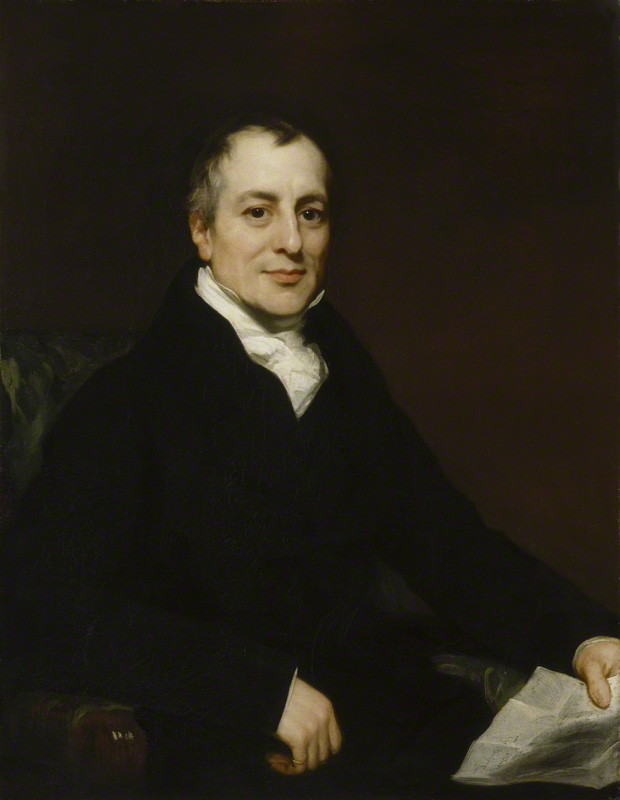
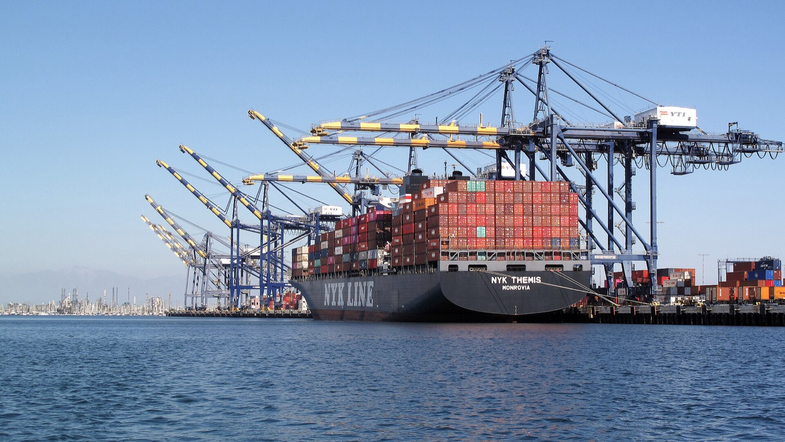

```{r}
#| include: false
source(here::here("R/theme_cours.R"))
source(here::here("R/cm9.R"))   # même fichier que la page de cours
```

## Le fait de départ : le « Jour de la libération » (02/04/2025)

- Le 2 avril 2025, que l'administration américaine baptise « Jour de la libération », les États-Unis relèvent leurs droits de douane sur presque tous leurs partenaires.

. . .

- Droit de douane moyen américain : 4,9 % en janvier 2025, 24,2 % le 2 avril, encore environ 15 % en février 2026.
- Recettes douanières brutes : 202,4 Md\$ sur l'exercice 2025, 317,8 Md\$ sur l'exercice 2026, soit +57 %.

. . .

**Question de la séance** : à quoi servent les droits de douane ?

[Sources : Guimbard, CEPII, *The Conversation*, 22/07/2026 ; Trésor des États-Unis, *Monthly Treasury Statement*, téléchargé le 21/10/2026, calcul de l'auteur.]{.wp-source}

::: {.notes}
0 h 00 – 0 h 05. Accueil. Le fait de départ est la décision américaine du 2 avril 2025 ; la hausse du droit moyen et des recettes en sont les conséquences. Les douanes encaissaient 7,9 Md\$ en octobre 2024 et 33,1 Md\$ en octobre 2025 ; l'exercice 2026 va d'octobre 2025 à septembre 2026 ; +57 % est un calcul de l'auteur. En février 2026, le droit moyen vaut trois fois son niveau de départ. Question à l'amphi : qui a suivi l'actualité sur les « taxes Trump » ? L'argent rentre : alors, qui paie ? Laisser proposer. Cette séance est la dernière du programme du CC2 ; elle n'a pas de TD et n'est évaluée que dans la partie cours. Transition : deux questions précises.
:::

## Objectifs affichés, coûts réels : deux questions et deux outils

::: {.incremental}
1. Le droit est versé à la frontière par l'importateur : qui le paie **vraiment**, l'exportateur étranger, l'importateur, le consommateur ?
2. L'échange enrichit les deux partenaires : pourquoi taxer ses propres achats ?
:::

. . .

- **Objectifs affichés** : recettes, industrie naissante ou en difficulté, rapport de force, sécurité économique, carbone importé (MACF).
- **Outils** : l'avantage comparatif (d'où viennent les gains) ; l'analyse en surplus (qui paie, qui gagne, ce qui est perdu).

::: {.notes}
0 h 05 – 0 h 09. Les objectifs affichés : procurer des recettes à l'État, protéger une industrie naissante ou en difficulté, peser dans une négociation commerciale, réduire la dépendance envers un fournisseur étranger (sécurité économique, souveraineté), faire payer le carbone importé avec le mécanisme d'ajustement carbone aux frontières (MACF) européen. On confronte ces objectifs à ce que les droits coûtent, et à qui. Savoir si un objectif vaut ce qu'il coûte relève d'un jugement : ce sera la controverse, sans trancher. Question : quel objectif vous paraît le plus convaincant ? Transition : cinq notions nécessaires.
:::

## Rappel : cinq notions nécessaires pour la séance

::: {.rappel}
- **Coût d'opportunité** : ce à quoi on renonce pour obtenir quelque chose.
- **Surplus** : du consommateur, prix qu'il était prêt à payer moins prix payé ; du producteur, prix reçu moins Cm. Des aires sur le graphique.
- **Perte sèche** : surplus perdu par rapport à la meilleure quantité.
- **Incidence** : celui qui verse la taxe n'est pas forcément celui qui la supporte.
- **Solde commercial** : exportations moins importations.
:::

::: {.notes}
0 h 09 – 0 h 14. Rappel court, dans les mots de la page. Coût d'opportunité : une heure passée à produire du blé est une heure qui ne produit pas de vêtements. Surplus : aires entre les courbes et la droite de prix. Perte sèche : échanges qui n'ont plus lieu, ou production plus coûteuse que l'importation. Incidence : tout dépend de la réaction des prix et des quantités. Importations : achats de biens à l'étranger ; exportations : ventes à l'étranger. Question : « Qui supporte une taxe sur l'essence ? » Transition : d'où viennent les gains de l'échange.
:::

## Ricardo (1817) : l'échange enrichit même le pays le moins productif

::: {.auteur}
::: {.wp-portrait}
{fig-alt="Portrait peint de David Ricardo en 1821, homme en buste, habit sombre."}
[1821 · Thomas Phillips, domaine public, Wikimedia Commons]{.wp-credit}
:::

**David Ricardo** (1817), *On the Principles of Political Economy and Taxation*, chap. 7 · école classique. Un pays gagne à se spécialiser dans les biens où son désavantage est le plus faible, même s'il est moins productif que son partenaire pour tous les biens.
:::

. . .

Ce qui compte n'est pas la productivité comparée des pays, mais le **coût d'un bien mesuré en l'autre bien**, à l'intérieur de chaque pays.

::: {.notes}
0 h 14 – 0 h 18. Ricardo écrit à Londres, chez John Murray, en 1817. L'idée choque l'intuition : un pays moins productif partout aurait quelque chose à gagner. Question à l'amphi : un pays moins productif en tout a-t-il intérêt à commercer ? Faire voter avant le clic. Transition : deux notions à distinguer.
:::

## Avantage absolu et avantage comparatif : définitions

::: {#def-avantage-comparatif}
## Avantage absolu, avantage comparatif
Un pays a un **avantage absolu** dans un bien s'il le produit avec moins de travail que son partenaire. Il a un **avantage comparatif** dans un bien si son **coût d'opportunité** y est plus faible : il renonce à moins d'autres biens pour en produire une unité.
:::

. . .

- Un pays peut n'avoir aucun avantage absolu.
- Il a toujours un avantage comparatif dès que ses coûts d'opportunité diffèrent de ceux de son partenaire.

::: {.notes}
0 h 18 – 0 h 22. Définition mot pour mot. Insister : l'avantage absolu compare des heures de travail entre pays ; l'avantage comparatif compare, à l'intérieur de chaque pays, ce qu'il faut sacrifier d'un bien pour produire l'autre. Question : un pays peut-il avoir un avantage comparatif dans les deux biens ? (Non : s'il renonce à moins de blé pour les vêtements, il renonce à plus de vêtements pour le blé.) Transition : une image tirée du monde du droit.
:::

## L'avocate et son assistant : les écarts de coûts d'opportunité

- Une avocate tape plus vite que son assistant : elle a l'avantage absolu dans la frappe.

. . .

- Elle a pourtant intérêt à lui confier la frappe : chaque heure qu'elle y passerait est une heure de plaidoirie perdue, beaucoup plus coûteuse.

. . .

- Le gain de l'échange vient des **écarts de coûts d'opportunité**, pas des écarts de productivité.

::: {.notes}
0 h 22 – 0 h 25. Image utile pour les étudiants de Droit. Question : quel est le coût d'opportunité d'une heure de frappe pour l'avocate ? (Une heure de plaidoirie.) Et pour l'assistant ? Transition : le même raisonnement, chiffré, entre deux pays.
:::

## Exemple chiffré : deux pays, deux biens, un avantage comparatif

| | Blé (1 tonne) | Vêtements (1 lot) | Heures disponibles |
|---|---|---|---|
| Pays A | 2 h | 4 h | 120 h |
| Pays B | 12 h | 6 h | 240 h |

::: {.incremental}
1. *Avantage absolu* : A produit les deux biens avec moins d'heures que B (2 h contre 12 h, 4 h contre 6 h).
2. *Coûts d'opportunité* : un lot coûte 4 ÷ 2 = **2 t de blé** dans A, 6 ÷ 12 = **0,5 t** dans B.
3. B a un avantage comparatif dans les vêtements, A dans le blé.
:::

::: {.notes}
0 h 25 – 0 h 30. Pays fictifs ; le travail est le seul facteur. Faire calculer les étudiants avant chaque clic. Dans A, un lot de vêtements prend 4 h, le temps de produire 2 tonnes de blé ; dans B, il prend 6 h, le temps de produire 0,5 tonne. Les vêtements coûtent moins de blé dans B. Question : quel est le coût d'opportunité d'une tonne de blé dans B ? (2 lots.) Transition : on représente ce que chaque pays peut produire seul.
:::

## Gains de l'échange (1/3) : frontières de production de A et de B

```{r}
#| fig-width: 8
#| fig-height: 4
#| out-width: 80%
#| fig-alt: "Deux graphiques côte à côte, vêtements en abscisse et blé en ordonnée. Pays A : frontière de production allant de 60 tonnes de blé à 30 lots de vêtements. Pays B : frontière allant de 20 tonnes de blé à 40 lots."
graphe_ricardo(base_size = 24, etape = 1)
```

. . .

Chaque droite est la **frontière de production** : tout ce qu'un pays peut produire seul avec ses heures. A : 60 t de blé ou 30 lots ; B : 20 t ou 40 lots.

::: {.notes}
0 h 30 – 0 h 33. A : 120 ÷ 2 = 60 t s'il ne fait que du blé, 120 ÷ 4 = 30 lots s'il ne fait que des vêtements. B : 240 ÷ 12 = 20 t, ou 240 ÷ 6 = 40 lots. Question : où lit-on le coût d'opportunité ? (A sacrifie 60 t pour 30 lots : 2 t par lot ; B sacrifie 20 t pour 40 lots : 0,5 t par lot.) Transition : sans échange, où se placent-ils ?
:::

## Gains de l'échange (2/3) : en autarcie, 40 tonnes et 35 lots

```{r}
#| fig-width: 8
#| fig-height: 4
#| out-width: 80%
#| fig-alt: "Mêmes frontières de production ; un cercle vide marque l'autarcie : 15 lots et 30 tonnes pour le pays A, 20 lots et 10 tonnes pour le pays B."
graphe_ricardo(base_size = 24, etape = 2)
```

. . .

Chaque pays consacre la moitié de ses heures à chaque bien. A : 30 t et 15 lots ; B : 10 t et 20 lots. À deux : **40 t et 35 lots**.

::: {.notes}
0 h 33 – 0 h 36. A : 60 ÷ 2 = 30 t et 60 ÷ 4 = 15 lots ; B : 120 ÷ 12 = 10 t et 120 ÷ 6 = 20 lots. Le cercle vide est sur la frontière : chaque pays consomme ce qu'il produit. Question : peut-on faire mieux avec les mêmes heures ? Transition : la spécialisation.
:::

## Spécialisation : plus des deux biens avec les mêmes heures

::: {.incremental}
1. *Spécialisation* : A ne fait que du blé, 120 ÷ 2 = **60 t** ; B ne fait que des vêtements, 240 ÷ 6 = **40 lots**.
2. *Comparaison* : à deux, 60 t et 40 lots, contre 40 t et 35 lots en autarcie.
3. *Lecture* : il y a plus des deux biens, avec les mêmes heures de travail.
:::

::: {.notes}
0 h 36 – 0 h 39. Faire trouver 60 et 40 avant le clic. Le gain total, +20 t et +5 lots, vient seulement de ce que chacun produit le bien où son coût d'opportunité est le plus faible. Question : à quel prix A et B doivent-ils échanger pour que les deux y gagnent ? Transition : l'échange, sur le graphique.
:::

## Gains de l'échange (3/3) : chaque pays consomme au-delà de sa frontière

```{r}
#| fig-width: 8
#| fig-height: 4
#| out-width: 80%
#| fig-alt: "Figure complète. Pays A : une flèche bleue mène de l'autarcie (15 lots, 30 tonnes) au point avec échange, 20 lots et 40 tonnes, au-dessus de la frontière. Pays B : une flèche verticale mène de l'autarcie (20 lots, 10 tonnes) au point avec échange, 20 lots et 20 tonnes, au-dessus de la frontière."
graphe_ricardo(base_size = 24, etape = 3)
```

. . .

A vend 20 t de blé à B contre 20 lots. A consomme 40 t et 20 lots (au lieu de 30 et 15) ; B, 20 t et 20 lots (au lieu de 10 et 20).

::: {.notes}
0 h 39 – 0 h 43. Point bleu : la consommation quand A ne fait que du blé, B que des vêtements, et qu'ils échangent 20 tonnes contre 20 lots. A garde 60 − 20 = 40 t ; B garde 40 − 20 = 20 lots. Lecture : avec l'échange, chaque pays consomme au-delà de ce qu'il pourrait produire seul. Question : qui gagne le plus ? Transition : pourquoi ce prix d'échange convient aux deux.
:::

## Le prix d'échange se situe entre les deux coûts d'opportunité

::: {.incremental}
- **A** obtient un lot pour 1 t de blé, alors qu'il lui en coûterait **2 t** de le produire.
- **B** obtient 1 t de blé pour un lot, alors qu'il lui en coûterait **2 lots** de la produire.
- Le prix d'échange, un lot pour une tonne, tombe **entre** les deux coûts d'opportunité (2 t dans A, 0,5 t dans B) : c'est la condition pour que chacun gagne.
:::

::: {.notes}
0 h 43 – 0 h 46. Dans B, une tonne de blé coûte 12 h, le temps de produire 2 lots. Question : et si le prix était de 3 t de blé par lot ? (A n'aurait plus intérêt à acheter : il produit un lot pour 2 t.) Transition : une objection fréquente.
:::

## Point d'attention : moins productif partout, et pourtant gagnant

::: {.piege}
« Un pays moins productif en tout n'a rien à vendre, il sera envahi. » C'est confondre avantage absolu et avantage comparatif.
:::

. . .

- Le pays B de l'exemple est moins productif pour les deux biens, et il gagne pourtant à l'échange.
- Sa faible productivité se paie dans ses **salaires**, plus bas, pas dans l'absence d'échange.

::: {.notes}
0 h 46 – 0 h 49. Sondage à main levée avant le clic : « B a-t-il intérêt à échanger ? » Transition : Ricardo dit que le pays gagne ; tous ses habitants gagnent-ils ?
:::

## Heckscher (1919) et Ohlin (1933) : gagnants et perdants dans chaque pays

::: {.auteur}
::: {.wp-portrait}
{fig-alt="Portrait photographique d'Eli Heckscher, homme en costume, en buste."}
[Eli Heckscher · photographe inconnu, domaine public, Wikimedia Commons]{.wp-credit}
:::

::: {.wp-portrait}
{fig-alt="Portrait photographique de Bertil Ohlin en 1950, homme en costume, en buste."}
[1950 · photographe inconnu, CC BY-SA 4.0, redimensionné, Wikimedia Commons]{.wp-credit}
:::

**Eli Heckscher** (1919) et **Bertil Ohlin** (1933) · école néoclassique. Un pays exporte les biens qui utilisent beaucoup le facteur dont il est bien doté (travail qualifié, terres, capital) et importe ceux qui utilisent le facteur qui lui manque.
:::

. . .

**Stolper et Samuelson** (1941) : l'ouverture enrichit les détenteurs du facteur abondant et appauvrit ceux du facteur rare.

::: {.notes}
0 h 49 – 0 h 54. Heckscher, « Utrikeshandelns verkan på inkomstfördelningen », *Ekonomisk Tidskrift* ; Ohlin, *Interregional and International Trade*, Harvard University Press. Stolper et Samuelson, « Protection and Real Wages », 1941, en tirent la conséquence. Question : quel est le facteur abondant de la France ? Le facteur rare ? Transition : ce que cela change au message de Ricardo.
:::

## Le pays gagne à l'ouverture, pas tous ses habitants

::: {.incremental}
- **Ricardo** : le pays gagne à l'échange.
- **Heckscher et Ohlin** : tous ses habitants ne gagnent pas.
- Dans un pays riche en travail qualifié, l'ouverture profite aux ingénieurs et pèse sur les ouvriers, d'abord dans les industries concurrencées.
- Un droit de douane, de même, **déplace des gains et des pertes** entre des groupes.
:::

::: {.notes}
0 h 54 – 0 h 57. Ce point prépare les effets de répartition : les perdants de l'ouverture sont concentrés, donc audibles. Question à l'amphi : qui sont les perdants de l'ouverture dans un pays comme la France ? Transition : on passe à l'outil qui mesure ces déplacements, le droit de douane.
:::

## Droit de douane : une taxe sur un bien importé

::: {#def-droit-douane}
## Droit de douane
Un **droit de douane** (ou tarif douanier) est une taxe prélevée sur un bien importé, au passage de la frontière. Il est **ad valorem** quand il représente un pourcentage de la valeur du bien (15 %), **spécifique** quand c'est un montant par unité, noté t (10 € par tee-shirt).
:::

. . .

Le droit **NPF** (« nation la plus favorisée ») est le droit de base qu'un membre de l'Organisation mondiale du commerce (OMC) applique à tous ses partenaires, sauf accord particulier.

::: {.notes}
0 h 57 – 1 h 01. Définition mot pour mot, en deux temps. Les droits américains de 2025 sont surtout ad valorem ; l'exemple chiffré utilisera un droit spécifique, plus simple à dessiner. Question : un droit de 10 € par tee-shirt est-il ad valorem ou spécifique ? Transition : de quoi dépend l'effet du droit sur les prix.
:::

## Petit pays : le prix mondial Pw est donné

::: {#def-petit-pays}
## Petit pays, prix mondial
Un pays est **petit** sur un marché quand ses achats sont trop faibles pour modifier le prix mondial, noté **Pw**. Il prend ce prix comme donné : sans droit de douane, le prix intérieur est égal à Pw ; avec un droit t, il devient Pw + t.
:::

. . .

- Un **grand pays** achète assez pour faire bouger le prix que fixent les exportateurs.
- « Qui paie ? » est une question d'**incidence** : elle ne se règle pas en regardant qui remplit la déclaration en douane.

::: {.notes}
1 h 01 – 1 h 04. Sur un bien importé, un droit de douane fonctionne comme n'importe quelle taxe. On commence par le petit pays, plus simple ; on reviendra au grand pays ensuite. Question : la France est-elle petite sur le marché mondial des tee-shirts ? Transition : on construit le graphique pas à pas.
:::

## Droit de douane (1/4) : sans droit, le prix intérieur est Pw

:::: {.columns}
::: {.column width="60%"}
```{r}
#| fig-width: 6.4
#| fig-height: 4.6
#| fig-alt: "Graphique offre-demande d'un bien importé : demande D bleue décroissante, offre intérieure O ambre croissante, droite horizontale au prix mondial Pw ; au prix Pw, la production vaut Q1 et la consommation Q4 ; une flèche marque les importations sans droit, de Q1 à Q4."
graphe_tarif(chiffres = FALSE, base_size = 24, etape = 1)
```
:::

::: {.column width="40%"}
::: {.incremental}
- Le pays achète au prix mondial **Pw**, inférieur au prix où O coupe D.
- Au prix Pw, on produit **Q₁** et on consomme **Q₄**.
- On importe la différence, de Q₁ à Q₄.
:::
:::
::::

::: {.notes}
1 h 04 – 1 h 07. Graphique théorique. O est l'offre intérieure : les producteurs du pays. Sans commerce, le prix serait au croisement de O et D, plus haut. Question : pourquoi les producteurs du pays ne vendent-ils pas plus que Q₁ ? (Au-delà, leur Cm dépasse Pw.) Transition : l'État impose un droit t.
:::

## Droit de douane (2/4) : le prix intérieur monte à Pw + t

:::: {.columns}
::: {.column width="60%"}
```{r}
#| fig-width: 6.4
#| fig-height: 4.6
#| fig-alt: "Même graphique avec une seconde droite horizontale, en tirets, au prix Pw plus t ; la production passe de Q1 à Q2, la consommation de Q4 à Q3 ; la flèche des importations avec droit, de Q2 à Q3, est plus courte."
graphe_tarif(chiffres = FALSE, base_size = 24, etape = 2)
```
:::

::: {.column width="40%"}
::: {.incremental}
1. Le pays est petit : les exportateurs vendent toujours à Pw ; le prix intérieur monte **de tout le droit**.
2. Production : de Q₁ à **Q₂** ; consommation : de Q₄ à **Q₃**.
3. Les importations se réduisent.
:::
:::
::::

::: {.notes}
1 h 07 – 1 h 11. Le prix monte de t y compris pour les biens produits dans le pays : les producteurs protégés vendent aussi à Pw + t. Question : pourquoi les importations baissent-elles deux fois ? (Plus de production intérieure, moins de consommation.) Transition : qui gagne ?
:::

## Droit de douane (3/4) : les producteurs gagnent a, l'État encaisse c

:::: {.columns}
::: {.column width="60%"}
```{r}
#| fig-width: 6.4
#| fig-height: 4.6
#| fig-alt: "Même graphique avec deux aires entre Pw et Pw plus t : a, un trapèze ambre à gauche de l'offre, et c, un rectangle gris entre Q2 et Q3."
graphe_tarif(chiffres = FALSE, base_size = 24, etape = 3)
```
:::

::: {.column width="40%"}
::: {.incremental}
- **a** : les producteurs du pays vendent plus cher et plus ; leur surplus augmente.
- **c** : l'État perçoit t sur chaque bien importé, de Q₂ à Q₃.
- a et c sont des **transferts** venus des consommateurs.
:::
:::
::::

::: {.notes}
1 h 11 – 1 h 14. Aire c : hauteur t, largeur les importations avec droit. Aire a : entre Pw et Pw + t, à gauche de l'offre. Question : qui finance a et c ? (Les consommateurs, qui paient t de plus.) Transition : ce que personne ne récupère.
:::

## Droit de douane (4/4) : b + d, la perte sèche

:::: {.columns}
::: {.column width="60%"}
```{r}
#| fig-width: 6.4
#| fig-height: 4.6
#| fig-alt: "Figure complète : entre Pw et Pw plus t, quatre aires, a ambre, b triangle rouge entre l'offre et Q2, c rectangle gris, d triangle rouge entre Q3 et la demande."
graphe_tarif(chiffres = FALSE, base_size = 24, etape = 4)
```
:::

::: {.column width="40%"}
::: {.incremental}
- Consommateurs : **− (a + b + c + d)**.
- Producteurs : **+ a** ; État : **+ c**.
- **b + d**, en rouge, n'est récupéré par personne : c'est la **perte sèche**.
:::
:::
::::

::: {.notes}
1 h 14 – 1 h 18. Une partie de la perte des consommateurs va aux producteurs protégés (a), une partie à l'État (c) ; le reste (b et d) n'est récupéré par personne. b : production plus coûteuse que l'importation ; d : achats qui n'ont plus lieu. Question : quelle aire disparaîtrait si l'offre intérieure était verticale ? (b.) Transition : on chiffre.
:::

## Exemple chiffré : un droit de 10 € sur les tee-shirts

Marché fictif : Q en millions de tee-shirts par an, P en euros.

::: {.incremental}
- Demande intérieure D : Q = 100 − P ; offre intérieure O : Q = P.
- Prix mondial : Pw = 20 €. Droit : t = 10 € par tee-shirt, soit **50 %** du prix mondial.
- Sans droit, au prix de 20 € : demande 80, production 20, importations **60**.
- Avec droit, au prix de 30 € : demande 70, production 30, importations **40**.
:::

::: {.notes}
1 h 18 – 1 h 21. Faire calculer chaque ligne avant le clic : 100 − 20 = 80, 80 − 20 = 60 ; 100 − 30 = 70, 70 − 30 = 40. Le tableau complet est dans la page. Question : de combien les importations baissent-elles, et pour quelles deux raisons ? Transition : sur le graphique.
:::

## Exemple chiffré (1/3) : les importations passent de 60 à 40 millions

:::: {.columns}
::: {.column width="60%"}
```{r}
#| fig-width: 6.4
#| fig-height: 4.6
#| fig-alt: "Graphique des tee-shirts : demande D, Q égale 100 moins P ; offre O, Q égale P ; droites horizontales à Pw égal 20 euros et Pw plus t égal 30 euros ; quantités 20, 30, 70 et 80 millions ; importations sans droit de 20 à 80, avec droit de 30 à 70."
graphe_tarif(chiffres = TRUE, base_size = 24, etape = 2)
```
:::

::: {.column width="40%"}
::: {.incremental}
- Production : de 20 à **30** millions.
- Consommation : de 80 à **70** millions.
- Importations : de 60 à **40** millions.
- Le prix intérieur monte de 20 € à 30 €.
:::
:::
::::

::: {.notes}
1 h 21 – 1 h 25. Les 20 millions d'importations en moins se décomposent en 10 millions produits dans le pays et 10 millions d'achats abandonnés. Question : sur ces 20 millions, combien sont désormais produits dans le pays ? Transition : chiffrer les aires.
:::

## Exemple chiffré (2/3) : producteurs + 250 M€, État + 400 M€

:::: {.columns}
::: {.column width="60%"}
```{r}
#| fig-width: 6.4
#| fig-height: 4.6
#| fig-alt: "Même graphique des tee-shirts avec l'aire a, trapèze ambre entre 20 et 30 euros à gauche de l'offre, et l'aire c, rectangle gris de 30 à 70 millions."
graphe_tarif(chiffres = TRUE, base_size = 24, etape = 3)
```
:::

::: {.column width="40%"}
::: {.incremental}
1. *Producteurs* : (20 + 30) ÷ 2 × 10 = **250 M€** par an (a).
2. *État* : 10 € × 40 millions = **400 M€** (c).
3. a et c sont des **transferts** : les consommateurs les paient.
:::
:::
::::

::: {.notes}
1 h 25 – 1 h 29. Aire a : un trapèze, bases 20 et 30 millions, hauteur 10 €. Les producteurs vendent plus cher et plus. Aire c : un rectangle, 40 millions de tee-shirts importés fois 10 €. Faire calculer à main levée avant chaque clic. Transition : ce que perdent les consommateurs.
:::

## Exemple chiffré (3/3) : consommateurs − 750 M€, perte sèche 100 M€

:::: {.columns}
::: {.column width="60%"}
```{r}
#| fig-width: 6.4
#| fig-height: 4.6
#| fig-alt: "Figure complète des tee-shirts : aires a, b, c et d entre 20 et 30 euros ; les triangles rouges b et d sont la perte sèche."
graphe_tarif(chiffres = TRUE, base_size = 24, etape = 4)
```
:::

::: {.column width="40%"}
::: {.incremental}
4. *Consommateurs* : (80 + 70) ÷ 2 × 10 = **750 M€** par an (a + b + c + d).
5. *Bilan* : 750 − 250 − 400 = **100 M€** par an perdus par le pays : la perte sèche.
:::
:::
::::

::: {.notes}
1 h 29 – 1 h 33. Les consommateurs paient 10 € de plus : sur les 70 millions qu'ils achètent encore, ils perdent 700 M€ par an ; sur les 10 millions auxquels ils renoncent, ils perdent en moyenne 5 €, soit 50 M€. Les aires valent a = 250, b = 50, c = 400 et d = 50 M€. Question : qui récupère les 100 M€ ? (Personne.) Transition : d'où vient cette perte.
:::

## Perte sèche : produire trop cher, acheter moins

::: {.incremental}
6. *Aire b* : (30 − 20) × 10 ÷ 2 = **50 M€**. Le pays produit 10 millions de tee-shirts qui lui coûtent entre 20 et 30 €, alors qu'il pourrait les importer à 20 €.
7. *Aire d* : (80 − 70) × 10 ÷ 2 = **50 M€**. 10 millions d'achats n'ont plus lieu, alors que les acheteurs étaient prêts à payer plus que le prix mondial.
8. *Lecture* : le droit **transfère** 650 M€ et en **détruit** 100, six fois moins.
:::

::: {.notes}
1 h 33 – 1 h 37. 650 = 250 + 400 : des consommateurs vers les producteurs et l'État. b : le coût marginal des producteurs du pays dépasse Pw ; d : surplus d'acheteurs qui renoncent. Question : pourquoi le transfert est-il politiquement plus visible que la perte sèche ? Transition : une erreur fréquente sur « qui paie ».
:::

## Point d'attention : dans un petit pays, l'étranger ne paie pas le droit

:::: {.columns}
::: {.column width="60%"}
```{r}
#| fig-width: 6.4
#| fig-height: 4.6
#| fig-alt: "Graphique des tee-shirts : le prix mondial reste à 20 euros, le prix intérieur passe à 30 euros ; les importations passent de 60 à 40 millions."
graphe_tarif(chiffres = TRUE, base_size = 24, etape = 2)
```
:::

::: {.column width="40%"}
::: {.piege}
« Le droit est payé par l'étranger, puisque c'est son produit qui est taxé. »
:::

::: {.fragment}

L'exportateur reçoit toujours 20 € : il vend moins, au même prix. Les acheteurs du pays paient les 10 €. Regarder **qui voit son prix changer**.
:::
:::
::::

::: {.notes}
1 h 37 – 1 h 40. Sondage avant le clic : qui paie les 10 € ? Il faut regarder qui voit son prix changer, pas qui est nommé dans la loi. Question à l'amphi : dans quel cas l'étranger paierait-il une partie ? (Si le pays est grand et que les exportateurs baissent leur prix hors droit.) Transition : le grand pays.
:::

## Grand pays : la part payée par l'étranger, exemple chiffré

Même droit de 10 € par tee-shirt, dans un **grand pays** : s'il achète moins, des exportateurs étrangers baissent leur prix hors droit pour garder leurs ventes, ici de 20 € à 19 €.

::: {.incremental}
1. *Prix intérieur* : 19 + 10 = 29 € : les acheteurs paient **9 €** de plus.
2. *Exportateurs* : ils reçoivent 1 € de moins, donc paient **1 €** du droit.
3. *Incidence* : baisse du prix hors droit ÷ droit = 1 ÷ 10 = **10 %** payés par l'étranger, **90 %** dans le pays.
:::

::: {.notes}
1 h 40 – 1 h 44. Formule à retenir : part payée par l'étranger = baisse de son prix hors droit ÷ droit. Faire calculer avant chaque clic. Question : quelle part paierait l'étranger s'il baissait son prix de 5 € ? (50 %.) Transition : le pays gagne-t-il pour autant ?
:::

## Grand pays : 42 M€ payés par l'étranger, 81 M€ de perte sèche

::: {.incremental}
4. À 29 €, on demande 71 millions, on en produit 29 : on importe **42 millions**.
5. L'étranger paie 1 € × 42 millions = **42 M€** par an.
6. Perte sèche : b + d = 9 × 9 ÷ 2 + 9 × 9 ÷ 2 = **81 M€** par an.
7. Le pays reste perdant : une baisse de 1 € du prix étranger ne suffit pas.
:::

. . .

Un grand pays gagne à un droit modéré si l'étranger paie plus que la perte sèche, sans représailles.

::: {.notes}
1 h 44 – 1 h 48. Encore faut-il que les fournisseurs baissent vraiment leurs prix et que leurs gouvernements ne répliquent pas : c'est ce que mesurent les études empiriques. Question : les États-Unis sont-ils un grand pays ? Pariez avant de voir les données. Transition : les droits américains de 2025-2026.
:::

## Droits américains 2025-2026 : des taux qui changent vite

| Date | Mesure |
|:---|:---|
| 21/08/2025 | Accord UE-États-Unis : droit américain plancher de 15 %, NPF compris |
| 20/02/2026 | La Cour suprême annule les droits fondés sur une loi d'urgence (IEEPA) |
| 24/02 → 24/07/2026 | Surtaxe temporaire de 10 % (section 122) |
| Depuis le 24/07/2026 | UE : 10 % (section 301) ; automobiles européennes : 15 % (section 232) |

. . .

Le droit sert aussi de **menace** : il a aidé à conclure plusieurs accords, dont celui avec l'UE ; son coût est le risque de représailles.

[Sources : Maison-Blanche, 21/08/2025 ; Deysine, 23/02/2026 ; DG Trésor, 06/08/2026 ; Guimbard, 22/07/2026.]{.wp-source}

::: {.notes}
1 h 48 – 1 h 52. Repères arrêtés au 21/10/2026. Accord du 21/08/2025 : le droit NPF s'applique s'il est plus élevé ; l'UE annonce supprimer ses droits sur les produits industriels américains. Le 30/07/2026, l'UE suspend sans limite de durée ses contre-mesures (jusqu'à 30 % sur 93 Md€), jamais entrées en vigueur, réactivables à tout moment (DG Trésor, 06/08/2026). Droits annulés à rembourser : environ 165 Md\$ à 330 566 importateurs (Bouët, 27/03/2026). Les taux changent vite ; le raisonnement reste : on cherche qui voit son prix changer. Transition : qui a payé ?
:::

## En 2025, près de 90 % des droits payés aux États-Unis

- **Repère 2018** : les prix hors droit des exportateurs n'avaient pas baissé ; le droit était passé en entier dans les prix américains (Amiti, Redding et Weinstein, 2019 ; Fajgelbaum et al., 2020).

. . .

::: {.incremental}
- **Part payée par les exportateurs étrangers** : 6 % (janvier-août 2025), 8 % (septembre-octobre), 14 % (novembre).
- **Part payée aux États-Unis** : 94 %, 92 %, puis 86 %.
:::

[Source : Amiti, Flanagan, Heise et Weinstein, *Liberty Street Economics*, 12/02/2026.]{.wp-source}

::: {.notes}
1 h 52 – 1 h 56. Des économistes de la Réserve fédérale de New York comparent les prix hors droit des produits taxés et non taxés. Près de 90 % du fardeau retombe sur les entreprises et les consommateurs américains. Même pour un pays aussi grand que les États-Unis, le modèle du petit pays décrit bien ce qui s'est passé. Question : qui avait parié « grand pays » ? Transition : ce que montrent les indices de prix.
:::

## Prix américains : importations hors droit stables, biens de consommation en hausse

:::: {.columns}
::: {.column width="60%"}
```{r}
#| fig-width: 8
#| fig-height: 5.4
#| fig-alt: "Graphique en lignes, un point par mois de janvier 2024 à septembre 2026, indices base 100 en janvier 2025. Les prix des importations hors droit, en bleu, restent à 100 de janvier à septembre 2025, malgré la ligne verticale du 2 avril 2025, puis remontent jusqu'à 106 en septembre 2026. Les prix à la consommation des biens, en ambre, montent à 101 en septembre 2025 et à 101,7 en septembre 2026. Pas de données en octobre 2025."
graphe_prix_import(base_size = 24)
```
:::

::: {.column width="40%"}
::: {.incremental}
- Janvier à septembre 2025 : prix hors droit des importations **inchangés** (indice 129,8 aux deux dates).
- Prix à la consommation des biens : **+1,0 %**, contre −0,6 % sur la même période de 2024.
:::
:::
::::

::: {.notes}
1 h 56 – 2 h 00. Lecture : si l'étranger payait le droit, la courbe bleue baisserait après le 2 avril 2025 ; elle reste plate, tandis que la courbe ambre monte. Bleu : prix des biens importés hors carburants, mesurés sans le droit, donc ce que reçoit l'exportateur ; ambre : biens hors alimentation et énergie. L'indice couvre tous les biens importés, taxés ou non. Pas de relevé en octobre 2025 (fermeture de l'administration fédérale). De décembre 2025 à septembre 2026, prix hors droit +5,2 % : la figure ne dit pas pourquoi, mais elle ne montre toujours pas d'exportateurs qui baissent leurs prix. Calculs de l'auteur sur le BLS. Transition : à quelle vitesse le droit passe-t-il dans les prix de détail ?
:::

## Du droit aux prix à la consommation : un passage en un an

::: {.incremental}
- **Prix à l'importation** : ils réagissent presque un pour un dès le premier mois.
- **Prix des biens de consommation** : un point de droit en plus les fait monter d'environ **0,25 %** au bout d'un an, quand l'effet est complet.
- **Pourquoi moins que le droit** : les biens importés ne sont qu'une partie de la consommation ; un tee-shirt en magasin contient aussi du transport, des loyers et des salaires du pays.
- **Février 2026** : les droits ajoutent **2,9 points** à l'inflation des biens.
:::

[Source : Amiti, Heise et Weinstein, *Liberty Street Economics*, 06/10/2026.]{.wp-source}

::: {.notes}
2 h 00 – 2 h 03. Sans les droits, les prix de ces biens auraient légèrement baissé en février 2026. Question : un droit de 10 points, combien sur les prix des biens au bout d'un an ? (Environ 2,5 %.) Transition : combien cela coûte-t-il au pays ?
:::

## Droits de 2018 : transferts importants, perte nette faible

:::: {.columns}
::: {.column width="60%"}
```{r}
#| fig-width: 6.4
#| fig-height: 4.6
#| fig-alt: "Le graphique théorique du droit de douane dans un petit pays, avec les aires a, b, c et d entre Pw et Pw plus t."
graphe_tarif(chiffres = FALSE, base_size = 24)
```
:::

::: {.column width="40%"}
::: {.incremental}
- Perte des acheteurs de biens importés : **51 Md\$**, 0,27 % du PIB américain.
- Après recette douanière (c) et gain des producteurs (a) : perte nette de **7,2 Md\$**, 0,04 % du PIB.
:::
:::
::::

::: {.notes}
2 h 03 – 2 h 06. Estimation de Fajgelbaum et al. (2020) sur les droits de 2018. Acheteurs : consommateurs et entreprises. C'est l'exemple du tee-shirt en grand : un transfert massif, une perte sèche faible (b + d). Question : quelle aire correspond aux 7,2 Md\$ ? Transition : la recette, aire c, en données.
:::

## Recettes douanières américaines : quadruplées, puis amputées par les remboursements

:::: {.columns}
::: {.column width="60%"}
```{r}
#| fig-width: 8
#| fig-height: 5.4
#| fig-alt: "Graphique en lignes, un point par mois d'octobre 2024 à septembre 2026. Les recettes brutes, en bleu, restent vers 8 milliards de dollars jusqu'en mars 2025, montent jusqu'à 33 milliards en octobre 2025, puis redescendent vers 22 à 25 milliards. Les recettes nettes, en ambre, suivent les brutes jusqu'en avril 2026, puis deviennent négatives de mai à juillet 2026, jusqu'à moins 26 milliards en juin. Lignes verticales au 2 avril 2025 et au 20 février 2026."
graphe_recettes_douane(base_size = 24)
```
:::

::: {.column width="40%"}
::: {.incremental}
- Recettes brutes **multipliées par quatre** entre l'automne 2024 et l'automne 2025.
- Après l'arrêt du 20/02/2026, les remboursements rendent les recettes nettes **négatives** de mai à juillet 2026.
:::
:::
::::

::: {.notes}
2 h 06 – 2 h 09. Bleu : recettes brutes ; ambre : recettes nettes des remboursements. 7,9 Md\$ en octobre 2024, 33,1 Md\$ en octobre 2025 ; recettes nettes autour de zéro en mai 2026, de −26 Md\$ en juin et −9 Md\$ en juillet. Question : quelle aire du graphique théorique ces recettes représentent-elles ? (c.) Transition : à qui va l'argent rendu ?
:::

## Remboursements : l'argent rendu va aux importateurs

::: {.incremental}
- Écart entre recettes brutes et nettes, surtout des remboursements : **7,5 Md\$** sur l'exercice 2025, **145 Md\$** sur l'exercice 2026.
- La Cour du commerce international a ordonné de rembourser les **importateurs**, qui ont versé les droits.
- Pour beaucoup, les entreprises qui ont répercuté la hausse sur leurs clients n'ont droit à aucun remboursement.
:::

. . .

Qui a supporté le droit : question **positive**. Qui doit être remboursé : question **normative**, que tranchent le droit et les tribunaux.

::: {.notes}
2 h 09 – 2 h 12. Calcul de l'auteur sur le *Monthly Treasury Statement* (21/10/2026) ; Bouët, Blog du CEPII, 27/03/2026 ; Deysine, *The Conversation*, 23/02/2026. Environ 165 Md\$ à rembourser à 330 566 importateurs. Les importateurs ont pu répercuter une partie du droit sur leurs clients. Question : un consommateur qui a payé plus cher sera-t-il remboursé ? Transition : qui gagne et qui perd, groupe par groupe.
:::

## Effets de répartition par revenu : un droit pèse sur les ménages modestes

::: {.incremental}
- Les droits relevés en 2018 et en 2019 devaient coûter **831 \$** par an à un ménage américain typique, hors représailles (Amiti, Redding et Weinstein, *Liberty Street Economics*, 23/05/2019).
- Comme une taxe sur les biens de consommation, un tel droit pèse plus, en part du revenu, sur les ménages qui dépensent tout leur revenu.
- C'est un raisonnement : les sources de la séance ne chiffrent pas l'écart par niveau de revenu.
:::

::: {.notes}
2 h 12 – 2 h 14. Les ménages qui épargnent une partie de leur revenu sont moins touchés en proportion. Question : un étudiant qui dépense tout ce qu'il gagne est-il plus ou moins touché, en part de son revenu ? Transition : les entreprises qui achètent des biens importés.
:::

## Chaîne de valeur : un bien franchit plusieurs frontières

:::: {.columns}
::: {.column width="55%"}
{fig-alt="Photographie d'un grand porte-conteneurs chargé de conteneurs colorés, amarré à un quai équipé de hautes grues, sous un ciel clair."}

[Port de Los Angeles. Photo : Downtowngal, CC BY-SA 4.0, Wikimedia Commons.]{.wp-source}
:::

::: {.column width="45%"}
::: {#def-chaine-valeur}
## Chaîne de valeur
Une **chaîne de valeur** est la suite des étapes de production d'un bien, de la matière première au produit fini. Quand ces étapes sont réparties entre plusieurs pays, un bien franchit plusieurs frontières avant d'être vendu.
:::
:::
::::

::: {.notes}
2 h 14 – 2 h 16. Le droit de douane se perçoit à ce type de frontière ; une pièce ou un conteneur peut franchir plusieurs fois une frontière avant le produit fini, et chaque passage peut être taxé. Question : combien de frontières franchit un téléphone avant d'arriver en magasin ? Transition : l'exemple de l'acier.
:::

## Droit sur l'acier : les aciéries gagnent a, leurs clients paient

:::: {.columns}
::: {.column width="60%"}
```{r}
#| fig-width: 6.4
#| fig-height: 4.6
#| fig-alt: "Le graphique théorique du droit de douane avec les aires a, gain des producteurs protégés, et c, recette de l'État."
graphe_tarif(chiffres = FALSE, base_size = 24, etape = 3)
```
:::

::: {.column width="40%"}
::: {.incremental}
1. Le droit t renchérit l'acier importé.
2. Les aciéries du pays relèvent leur prix : elles gagnent **a**.
3. Automobile, machines : le Cm monte.
4. Leurs acheteurs paient plus.
5. Elles vendent moins, y compris à l'exportation.
:::
:::
::::

::: {.notes}
2 h 16 – 2 h 19. Chaîne de causalité d'un droit sur un bien intermédiaire. Étape 4 : les entreprises relèvent leur prix ou réduisent leur production. Étape 5 : le droit censé protéger l'industrie en pénalise une partie ; c'est un raisonnement, que les sources de cette séance ne chiffrent pas. En 2018, les prix des biens intermédiaires, comme l'acier, ont augmenté comme ceux des biens finals, et les chaînes d'approvisionnement ont été réorganisées (Amiti et al., 2019). Question : qui, dans l'automobile, réclamerait la suppression du droit ? Transition : les territoires.
:::

## Effets de répartition par territoire : des pertes concentrées

::: {.incremental}
- Les gains de l'ouverture sont **diffus** ; ses pertes sont **concentrées**.
- 1990-2007 : les zones industrielles américaines les plus exposées aux importations chinoises ont connu plus de chômage, des salaires plus bas, plus d'aides sociales ; environ **un quart** du recul de l'emploi industriel (Autor, Dorn et Hanson, 2013).
- 2018 : les représailles ont surtout visé l'agriculture (Fajgelbaum et al., 2020).
:::

::: {.notes}
2 h 19 – 2 h 22. Les travailleurs changent difficilement de métier et de région, et les pertes se concentrent là où étaient les usines : cette concentration explique une partie de la demande de protection. Les représailles de 2018 ont frappé les travailleurs des secteurs exposés au commerce. Question : pourquoi des perdants concentrés pèsent-ils plus en politique que des gagnants dispersés ? Transition : les générations et l'étranger.
:::

## Effets de répartition entre générations et à l'étranger

::: {.incremental}
- **Par génération** : l'argument de l'industrie naissante est un pari. Les consommateurs d'aujourd'hui paient plus cher pour qu'une industrie devienne compétitive demain.
- Ce pari n'est gagnant que si ce gain existe **et** si la protection est retirée ensuite.
- **À l'étranger** : les exportateurs qui perdent leurs ventes perdent leur surplus. En 2025, l'UE a vendu pour **554,7 Md€** de biens aux États-Unis.
:::

[Source : Eurostat, `ext_lt_maineu`, téléchargé le 21/10/2026.]{.wp-source}

::: {.notes}
2 h 22 – 2 h 24. L'industrie naissante revient dans la controverse avec List. Question : qui décide qu'une protection doit être retirée, et quand ? Transition : un droit de douane d'un autre type, pour le climat.
:::

## MACF : un droit de douane pour le climat

::: {.incremental}
- **Fuite de carbone** : l'UE fait payer le carbone à ses industriels ; produire hors de l'UE, puis y exporter, devient tentant.
- Le **mécanisme d'ajustement carbone aux frontières** (MACF) fait payer aux importations le carbone émis pour les produire, au prix des quotas européens.
- Régime définitif depuis le 1^er^ janvier 2026 : ciment, fer et acier, aluminium, engrais, électricité, hydrogène. Payant en 2027.
:::

[Sources : Commission européenne, page CBAM, consultée le 21/10/2026 ; Mayer Brown, 17/10/2025.]{.wp-source}

::: {.notes}
2 h 24 – 2 h 27. De 2023 à 2025, phase de simple déclaration. Les certificats pour les importations de 2026 sont vendus à partir du 1er février 2027 ; pour le ciment, l'acier, l'aluminium et les engrais, seuls les importateurs de plus de 50 tonnes par an sont concernés. Question : le MACF protège-t-il une industrie ou le climat ? Transition : ses perdants.
:::

## MACF : un même prix du carbone, des perdants éloignés

- Ce droit vise moins à protéger une industrie qu'à faire payer le **même prix** au carbone produit dans l'UE et au carbone importé.

. . .

- Ses perdants sont souvent loin : le **Mozambique** tire près d'un cinquième de ses exportations totales de l'aluminium vendu à l'UE.
- Deux économistes de l'Agence française de développement proposent d'en exempter les pays les moins avancés et de les aider autrement.

[Source : Godin et Riccioppo Magacho, *The Conversation*, 10/01/2023.]{.wp-source}

::: {.notes}
2 h 27 – 2 h 29. On retrouve l'incidence : qui supporte le MACF dépend de qui voit son prix changer, ici les producteurs d'aluminium du Mozambique. Question : exempter les pays les moins avancés, est-ce une question positive ou normative ? Transition : la controverse.
:::

## Controverse : protéger ses producteurs, ce qui est et ce qui devrait être

**Analyse positive** (ce qui est : mécanismes et effets, vérifiables)

- **Qui paie** : les droits américains de 2018 et de 2025 ont été payés à 86 % ou plus par les importateurs et les consommateurs américains.
- **Combien** : un droit transfère du revenu et en détruit une partie, d'ampleur variable selon les estimations.

. . .

**Analyse normative** (ce qui devrait être : dépend de jugements de valeur)

- Quel poids donner au **pouvoir d'achat**, aux **emplois** et aux **territoires**, au **rapport de force**, à la **dépendance**, au **climat** ?

::: {.notes}
2 h 29 – 2 h 32. Sources du positif : Amiti et al., 2019 ; *Liberty Street Economics*, 12/02/2026. Normatif : savoir qui paie ne dit pas si l'objectif affiché vaut ce qu'il coûte. Rapport de force face au risque de représailles ; dépendance envers un fournisseur étranger en cas de crise ; climat quand le droit porte sur le carbone importé. Débat en amphi, 3 minutes, après le clic : quel poids donnez-vous à chacun ? Transition : un argument positif souvent mal posé, le déficit.
:::

## Analyse positive : un déficit bilatéral n'est pas une perte

| Milliards d'euros | 2023 | 2024 | 2025 |
|---|---|---|---|
| Exportations de biens de l'UE vers les États-Unis | 505,9 | 535,6 | 554,7 |
| Importations de biens de l'UE depuis les États-Unis | 347,8 | 337,4 | 356,7 |
| Solde, vu de l'UE | +158,1 | +198,2 | +198,0 |

. . .

Dans l'exemple de Ricardo, le gain vient de ce qu'on **importe** à bon prix, pas d'un solde positif. Un solde bilatéral ignore les autres pays et les services.

[Source : Eurostat, `ext_lt_maineu`, mis à jour le 16/10/2026, téléchargé le 21/10/2026 ; solde calculé par l'auteur.]{.wp-source}

::: {.notes}
2 h 32 – 2 h 34. L'administration américaine a justifié ses droits par le déficit commercial (Deysine, 23/02/2026) : les États-Unis achètent à l'UE bien plus de biens qu'ils ne lui en vendent. Les services ne figurent pas dans ce tableau. Question : A, qui achète des vêtements à B, s'est-il appauvri ? Transition : les écoles en présence.
:::

## Libre-échange et protectionnisme éducateur : deux écoles

::: {.incremental}
- **Libre-échange** (Ricardo, puis les néoclassiques) : l'échange enrichit les pays ; mieux vaut compenser les perdants (aides, formation, politiques régionales) que taxer tout le monde.
- **Protectionnisme éducateur** (Friedrich List, XIX^e^ siècle) : protéger **temporairement** les « industries naissantes », jusqu'à ce qu'elles soient compétitives.
- **Limites, selon les critiques** : compensation partielle en pratique (Autor et al., 2013) ; représailles, secteurs choisis par les mieux organisés, rentes protégées.
:::

::: {.notes}
2 h 34 – 2 h 37. Frédéric Bastiat refusait de répondre à la protection par la protection, selon une phrase qu'on lui attribue : « Ce n'est pas parce que les étrangers ont des côtes rocheuses que nous devons mettre des rochers dans nos ports » (cité par La finance pour tous, « Le protectionnisme », 07/04/2025). Limites du protectionnisme : risque de protéger des rentes plutôt que des industries d'avenir (*ibid.*). Question : quelle école vous convainc, et pourquoi ? Transition : sur quoi porte vraiment le désaccord.
:::

## Le désaccord porte sur la valeur d'un emploi, pas sur le mécanisme

:::: {.columns}
::: {.column width="60%"}
```{r}
#| fig-width: 6.4
#| fig-height: 4.6
#| fig-alt: "Le graphique théorique du droit de douane dans un petit pays, avec les aires a, b, c et d."
graphe_tarif(chiffres = FALSE, base_size = 24)
```
:::

::: {.column width="40%"}
- Le mécanisme du graphique est **largement admis**.
- Le désaccord porte sur ce que vaut un **emploi industriel préservé**, comparé au surcoût payé par des millions d'acheteurs.
:::
::::

::: {.notes}
2 h 37 – 2 h 39. Les écoles s'accordent sur les aires a, b, c, d ; elles divergent sur le poids donné à l'aire a (les producteurs protégés et leurs emplois) face à la perte des consommateurs. Question : combien seriez-vous prêts à payer de plus vos vêtements pour garder une usine dans votre région ? Transition : qui a le pouvoir de fixer ces droits.
:::

## Et le droit ? Le Congrès aux États-Unis, l'Union en Europe

::: {.droit}
Aux États-Unis, la Constitution donne au Congrès, et à lui seul, le pouvoir de lever l'impôt et les droits de douane. Le 20/02/2026 (*Learning Resources, Inc. v. Trump*), la Cour suprême juge, par six voix contre trois, que la loi d'urgence (IEEPA) ne permet pas au président de créer des droits sans le Congrès.
:::

. . .

Dans l'UE, la politique commerciale est une **compétence exclusive de l'Union** (TFUE, art. 3 et 207) : la Commission négocie pour les 27.

::: {.notes}
2 h 39 – 2 h 41. Source : Deysine, *The Conversation*, 23/02/2026. La France ne fixe pas seule ses droits de douane. Question pour les étudiants de Droit : pourquoi confier les droits de douane au Parlement plutôt qu'au président ? Transition : à retenir.
:::

## À retenir

::: {.retenir}
- Coûts d'opportunité différents : l'échange enrichit, même un pays moins productif partout (Ricardo).
- L'ouverture enrichit le pays, pas tous ses habitants : le facteur rare y perd (Stolper-Samuelson).
- Petit pays : prix de Pw à Pw + t ; le droit transfère du revenu et en détruit une partie.
- Part payée par l'étranger : baisse de son prix hors droit ÷ droit, de 0 à 14 % en 2018 et 2025.
- L'objectif vaut-il son coût : une question normative.
:::

::: {.notes}
2 h 41 – 2 h 43. Reprendre la question de départ : à quoi servent les droits de douane ? Des recettes, une protection, un rapport de force, une sécurité, le climat ; mais le droit est payé surtout dans le pays qui le lève. Le libre-échange s'oppose au protectionnisme éducateur de List. Vidéos à regarder après la séance : Dessine-moi l'éco, « Qu'est-ce que l'avantage comparatif ? » ; Arte, *Le Dessous des cartes*, « Taxes Trump : la politique de l'incertitude ». Transition : le plan de dissertation.
:::

## Plan de dissertation : ce que dit l'outil, ce qu'il ne tranche pas

**Sujet** : à quoi servent les droits de douane ?

. . .

**I. Ce que dit l'outil (positif)**

- A. L'avantage comparatif enrichit les pays, pas tous leurs habitants.
- B. Un droit transfère du revenu aux producteurs et à l'État, en détruit une part, et se paie surtout dans le pays.

. . .

**II. Ce qu'il ne tranche pas (normatif)**

- A. Recettes, protection, rapport de force, sécurité, climat : un objectif vaut-il son coût ?
- B. Libre-échange et protectionnisme éducateur : le poids donné aux perdants.

::: {.notes}
2 h 43 – 2 h 45. Dernière diapo. I. Positif : l'avantage comparatif et l'analyse en surplus disent ce que coûte un droit et qui le paie. II. Normatif : tout dépend du poids donné aux consommateurs, aux emplois et territoires, à la dépendance, au climat. La fiche Méthodo en ligne détaille la méthode de dissertation. Annoncer le CM 10.
:::
